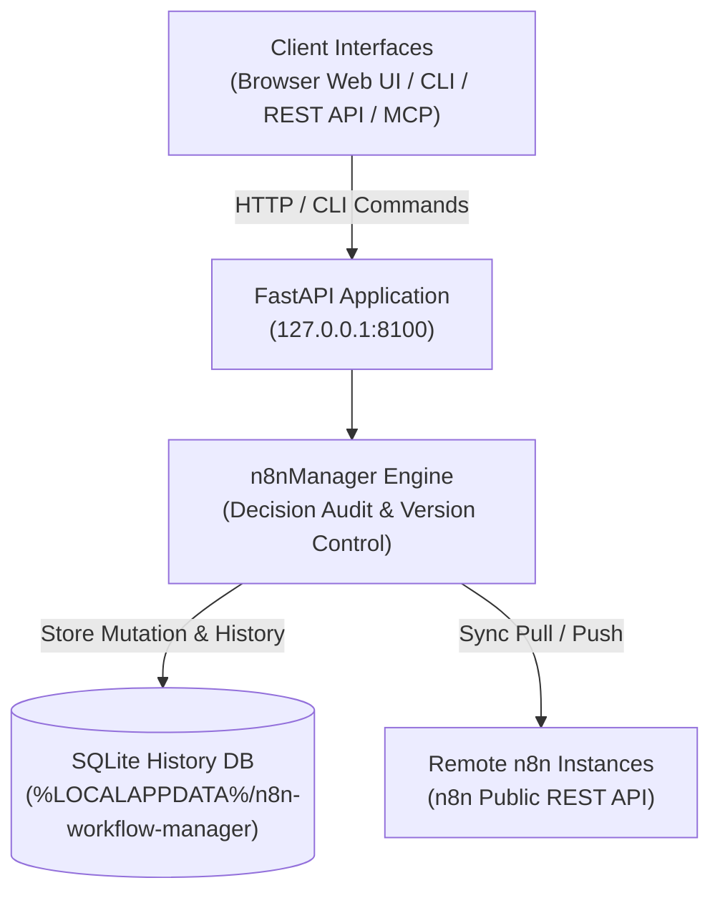

# n8n Workflow Manager

**[English](README.md) · [Deutsch](README_de.md) · [Español](README_es.md) · [日本語](README_ja.md) · [Русский](README_ru.md)**

> Local-first workflow review, visual inspection, decision-tracked editing, history, and multi-server sync for n8n.

> [!IMPORTANT]
> Independent community project. Not affiliated with, endorsed by, or sponsored
> by n8n GmbH. "n8n" is a trademark of its respective owner and is used here only
> to describe the software this tool interoperates with.

[](https://www.python.org/downloads/)
[](pyproject.toml)
[](LICENSE)
[](tests)
[](https://fastapi.tiangolo.com/)
[](https://github.com/astral-sh/ruff)
[](#what-it-does)
[](SECURITY.md)
[](SECURITY.md)
[](https://github.com/ellmos-ai)
[](https://github.com/open-bricks)
[](llms.txt)

> [!NOTE]
> **AI Agent & LLM Context**: Machine-readable specification and RAG search phrases are indexed in [`llms.txt`](llms.txt). Pairs with [`n8n-manager-mcp`](https://github.com/ellmos-ai/n8n-manager-mcp) for autonomous AI workflow operations with decision tracking. Mutations record a non-empty decision rationale, but this is not a human-approval step: some create, build, import, template, and pull paths provide defaults, while update, rollback, delete, and push require a non-empty caller value.

## Navigation

- [System Architecture](#system-architecture)
- [Workflow Lifecycle](#workflow-lifecycle)
- [Governance & Runtime Invariants](#governance-and-runtime-invariants)
- [Visual Interface & Screenshots](#visual-interface-and-screenshots)
- [Target Audience Personas & SEO](#target-personas-and-seo)
- [Architecture & Feature Comparison](#comparison-matrix)
- [What it does](#what-it-does)
- [Install and start](#install-and-start)
- [CLI examples](#cli-examples)
- [Builder API](#builder-api)
- [Configuration and data](#configuration-and-data)
- [Docker](#docker)
- [Remote n8n setup](#remote-n8n-setup)
- [Manager + MCP pairing](#manager-plus-mcp-pairing)
- [Sibling Ecosystem](#sibling-ecosystem)
- [Verification](#verification)
- [License](#license)

---

<a id="system-architecture"></a>
## System Architecture



---

<a id="workflow-lifecycle"></a>
## Workflow Lifecycle

This sequence separates local rollback from remote synchronization. A rollback restores a retained SQLite version and records the supplied decision. It changes the local database only; a separate push is required to send that state to remote n8n.

```mermaid
sequenceDiagram
    autonumber
    actor User as "Operator / AI Agent (MCP)"
    participant API as "FastAPI Application (127.0.0.1:8100)"
    participant SQLite as "Local SQLite History DB"
    participant n8n as "Configured Remote n8n API"

    Note over User,SQLite: "1. Local Rollback (No Remote Call)"
    User->>API: "POST /api/workflows/{workflow_id}/rollback/{version_number} (Decision)"
    API->>SQLite: "Read retained target version"
    SQLite-->>API: "Stored workflow JSON"
    API->>SQLite: "Update local workflow; record version and decision"
    SQLite-->>API: "Local transaction committed"
    API-->>User: "Rollback response (message, history URL)"
    Note over User,n8n: "Remote n8n remains unchanged after rollback"
    Note over User,n8n: "2. Separate Explicit Push (Optional)"
    User->>API: "POST /api/export/{workflow_id}/to-server?decision=...&server_id=..."
    API->>SQLite: "Read local workflow and remote binding"
    SQLite-->>API: "Workflow JSON and binding (if any)"
    API->>n8n: "Create or update via n8n REST API"
    n8n-->>API: "Remote result (success or error)"
    API->>SQLite: "Record sync result; update binding on success"
    API-->>User: "Push response"
```

---

<a id="governance-and-runtime-invariants"></a>
## Governance & Runtime Invariants

| # | Capability / policy | Project behavior | Boundary |
|---|---|---|---|
| 1 | **Local-first default** | The service binds to 127.0.0.1 by default. | Configured n8n connections use REST; remote setup uses SSH. This is not a zero-egress guarantee. |
| 2 | **Decision records** | Workflow mutations record a non-empty rationale. | Create, build, import, template, and pull paths can apply defaults; update, rollback, delete, and push require a non-empty caller value. A rationale records intent, not human approval. |
| 3 | **SQLite history** | Workflow versions and decision rows are stored in SQLite. | These are ordinary local database records, not immutable or tamper-proof. Deleting a workflow removes its versions. |
| 4 | **Rollback** | A retained version can be restored to the local workflow record. | Rollback leaves remote n8n unchanged. Push is separate; history is not a disaster-recovery guarantee. |
| 5 | **n8n synchronization** | Server-scoped pull and push use the n8n REST API. | A configured server and network access are required; push is explicit. |
| 6 | **Visual inspection assets** | The vis-network browser library is bundled locally. | Bundling avoids a CDN request for that library; remote sync still needs network access. |
| 7 | **API-key handling** | Registered n8n keys are kept in per-user local data and redacted in API/UI responses. | Keys are stored unencrypted; protect the user data directory as described in SECURITY.md. |
| 8 | **Interfaces** | The project provides a browser UI, REST API, and CLI; an MCP companion is maintained separately. | The companion uses this project's API; it does not change the local/remote behavior described above. |
| 9 | **Privilege model** | The application and Docker image are designed to run without elevated privileges. | This describes the documented runtime configuration. |
| 10 | **Security response policy** | SECURITY.md commits to an initial response within 48 hours and triage within five business days. | This is a policy commitment, not a runtime guarantee or a promise to ship a patch within 48 hours. |

---

<a id="visual-interface-and-screenshots"></a>
<a id="screenshots"></a>
## Visual Interface & Screenshots

The browser UI provides interactive workflow inspection, node dependency graphing, and history management without leaving your local environment:

| Dashboard & Workflow Overview | Visual Graph Viewer & Live Inspector |
|:---:|:---:|
|  |  |
| *Workflow catalog, server bindings, revision counts & quick actions* | *Interactive vis.js graph, node parameters, credentials & connections* |

---

<a id="target-personas-and-seo"></a>
## Target Audience Personas & SEO

n8n Workflow Manager is designed for technical teams, operators, and AI agents that need to inspect, document, edit, and synchronize n8n workflows with local decision and version history:

- **`[PERSONA-01]` Workflow Automation Engineers & Sysadmins**: Operators managing n8n instances across staging, testing, and production who need local workflow review, visual inspection, and server-scoped synchronization.
- **`[PERSONA-02]` AI Agent Framework Architects & MCP Integrators**: Teams integrating LLMs through n8n-manager-mcp to create or modify workflows. The manager records a decision rationale; some paths use defaults, and a rationale does not constitute human approval.
- **`[PERSONA-03]` Security & Compliance Officers**: Teams that need local SQLite workflow-version and decision history, API-key redaction in responses, bundled frontend assets, and a non-elevated runtime. SQLite history is not immutable or tamper-proof.
- **`[PERSONA-04]` DevOps & Site Reliability Engineers (SRE)**: Teams using the REST API, server-scoped sync, and local rollback from retained versions. Maintain independent backups for disaster recovery; workflow history is not a backup guarantee.

#### High-Intent Discoverability & Search Keywords
- `local n8n workflow manager`, `visual n8n graph viewer`, `n8n multi-server sync`, `decision-tracked workflow automation`, `n8n-manager-mcp companion`, `local-first workflow rollback`, `vis.js n8n editor`, `fastapi n8n controller`, `offline n8n documentation export`

---

<a id="comparison-matrix"></a>
## Architecture & Feature Comparison

Project capabilities and boundaries. This table makes no comparative claims about other products.

| # | Capability / policy | Project behavior | Boundary |
|---|---|---|---|
| 1 | **Local-first default** | The service binds to 127.0.0.1 by default. | Configured n8n connections use REST; remote setup uses SSH. This is not a zero-egress guarantee. |
| 2 | **Decision records** | Workflow mutations record a non-empty rationale. | Create, build, import, template, and pull paths can apply defaults; update, rollback, delete, and push require a non-empty caller value. A rationale records intent, not human approval. |
| 3 | **SQLite history** | Workflow versions and decision rows are stored in SQLite. | These are ordinary local database records, not immutable or tamper-proof. Deleting a workflow removes its versions. |
| 4 | **Rollback** | A retained version can be restored to the local workflow record. | Rollback leaves remote n8n unchanged. Push is separate; history is not a disaster-recovery guarantee. |
| 5 | **n8n synchronization** | Server-scoped pull and push use the n8n REST API. | A configured server and network access are required; push is explicit. |
| 6 | **Visual inspection assets** | The vis-network browser library is bundled locally. | Bundling avoids a CDN request for that library; remote sync still needs network access. |
| 7 | **API-key handling** | Registered n8n keys are kept in per-user local data and redacted in API/UI responses. | Keys are stored unencrypted; protect the user data directory as described in SECURITY.md. |
| 8 | **Interfaces** | The project provides a browser UI, REST API, and CLI; an MCP companion is maintained separately. | The companion uses this project's API; it does not change the local/remote behavior described above. |
| 9 | **Privilege model** | The application and Docker image are designed to run without elevated privileges. | This describes the documented runtime configuration. |
| 10 | **Security response policy** | SECURITY.md commits to an initial response within 48 hours and triage within five business days. | This is a policy commitment, not a runtime guarantee or a promise to ship a patch within 48 hours. |

---

<a id="what-it-does"></a>
## What it does

- Visual graph viewer and working browser editor for n8n workflow JSON.
- SQLite-backed version history and recorded decision rationales for workflow mutations; some creation and import paths use defaults.
- Local rollback through the REST API or CLI; a separate push is needed to update remote n8n.
- Per-workflow/per-server pull/push bindings using the n8n public API and cursor pagination.
- JSON and Markdown export, validated imports, and bundled generic templates.
- FastAPI REST API, Swagger UI, and a terminal CLI.

The application is local-first: it binds to `127.0.0.1` by default and stores
configuration and runtime data in per-user directories rather than inside the
installed package or source checkout.

Binding the manager to loopback does not prevent outbound connections to a configured n8n server or SSH host.

### Quick Start by Use Case

| Goal / Workflow Need | Recommended Tool / Surface | Command / Workflow |
|---|---|---|
| **Inspect & Visualize Local Workflows** | Web Dashboard & vis.js Graph Viewer | `n8n-manager serve` &rarr; open `http://127.0.0.1:8100` |
| **Document Workflows for Handoff** | Markdown / JSON Export Engine | `n8n-manager export <id> --format md` |
| **Multi-Server Sync (Staging to Prod)** | Server Registry & Pull/Push Engine | `n8n-manager push <id> --decision "Deploy reviewed changes"` |
| **Autonomous AI Workflow Authoring** | Builder REST API & MCP Server | `POST /api/workflows/build` via `n8n-manager-mcp` |
| **Restore a retained local version** | Local workflow history and rollback | `n8n-manager rollback <id> <target-version> --decision "Revert defect"` (remote n8n remains unchanged; push separately if needed) |
| **Remote n8n setup via SSH** | Automated SSH Setup Command | `n8n-manager setup --host <server> --user <deploy>` |

---

<a id="install-and-start"></a>
## Install and start

```bash
pip install git+https://github.com/ellmos-ai/n8n-workflow-manager.git
n8n-manager serve
```

Open <http://127.0.0.1:8100>. Interactive API documentation is at
<http://127.0.0.1:8100/docs>.

For development:

```bash
git clone https://github.com/ellmos-ai/n8n-workflow-manager.git
cd n8n-workflow-manager
python -m pip install -e ".[dev]"
python -m pytest -q
```

---

<a id="cli-examples"></a>
## CLI examples

> [!WARNING]
> push sends the local workflow to the configured n8n server. rollback changes
> only the local database. delete removes the local workflow, its version history,
> and local server bindings; it does not send a delete request to n8n. To send a
> locally rolled-back version to n8n, run a separate push. Check the default
> server with n8n-manager status before pushing to production. API keys registered
> with servers --add are stored unencrypted in the per-user data directory;
> protect it as you would an SSH key. See [SECURITY.md](SECURITY.md).

Some create, build, import, template, and pull paths record a default non-empty decision. Update, rollback, delete, and push require a non-empty decision from the caller. A decision records stated intent; it does not establish human approval.

```bash
n8n-manager import workflow.json --decision "Import reviewed customer workflow"
n8n-manager list
n8n-manager history 1
n8n-manager export 1 --format md

n8n-manager servers --add production https://n8n.example.com YOUR_API_KEY --default
n8n-manager push 1 --decision "Deploy reviewed version"
n8n-manager pull
n8n-manager rollback 1 2 --decision "Restore last known-good version"

n8n-manager status                       # effective paths, database and server state
n8n-manager config --show                # inspect the resolved configuration
n8n-manager config --set db_path ./my.db # change a single setting
```

TLS verification is on by default. `--no-verify-tls` exists for controlled
local environments with self-signed certificates; do not use it across
untrusted networks.

---

<a id="builder-api"></a>
## Builder API

```bash
curl -X POST http://127.0.0.1:8100/api/workflows/build \
  -H "Content-Type: application/json" \
  -d '{
    "name": "Webhook forwarder",
    "decision": "Create a reviewed draft",
    "nodes": [
      {"type": "n8n-nodes-base.webhook", "name": "Trigger", "parameters": {"path": "hook"}},
      {"type": "n8n-nodes-base.httpRequest", "name": "Forward", "parameters": {"url": "https://api.example.com"}}
    ],
    "connections": [{"from_node": "Trigger", "to_node": "Forward"}]
  }'
```

See [API_REFERENCE.md](docs/API_REFERENCE.md) for the mutation and history
contracts.

---

<a id="configuration-and-data"></a>
## Configuration and data

`n8n-manager status` prints the effective paths. Relative `db_path` values are
resolved below the user data directory.

| Platform | Configuration | Runtime data |
|---|---|---|
| Windows | `%APPDATA%\n8n-workflow-manager` | `%LOCALAPPDATA%\n8n-workflow-manager` |
| macOS | `~/Library/Application Support/n8n-workflow-manager` | same directory |
| Linux | `${XDG_CONFIG_HOME:-~/.config}/n8n-workflow-manager` | `${XDG_DATA_HOME:-~/.local/share}/n8n-workflow-manager` |

Overrides: `N8N_MANAGER_CONFIG`, `N8N_MANAGER_CONFIG_DIR`, and
`N8N_MANAGER_DATA_DIR`. Start with [config.example.json](config.example.json).
The default `trusted_hosts` accepts only loopback Host headers; explicitly list
the reviewed public hostname when using an authenticated reverse proxy.

---

<a id="docker"></a>
## Docker

```bash
docker compose up --build -d
```

The Compose port is bound to `127.0.0.1:8100`, and state is mounted below
`runtime/`. The image runs as an unprivileged user.

---

<a id="remote-n8n-setup"></a>
## Remote n8n setup

The setup command expects Docker to have been installed according to the remote
host's operating-system policy. It installs a pinned official n8n image on a
loopback-only port; it does not run a remote `curl | sh` installer.

```bash
n8n-manager setup --host your-server --user deploy --ssh-key ~/.ssh/id_ed25519
# Follow the printed ssh -L ... tunnel command, then open http://127.0.0.1:5678
```

SSH uses batch mode and `StrictHostKeyChecking=accept-new`. For public service,
provide an authenticated TLS reverse proxy. Do not expose either n8nManager or
the generated n8n listener directly to the internet.

---

<a id="manager-plus-mcp-pairing"></a>
## Manager + MCP pairing

`n8n-workflow-manager` and
[n8n-manager-mcp](https://github.com/ellmos-ai/n8n-manager-mcp) are designed as
a pair: the MCP server is the AI action layer, while this project is the human
state-and-history layer with visual review, per-workflow decisions, versions,
and rollback. A client can read `/api/workflows/{id}/history` before a mutation. Some paths provide a default rationale; update, rollback, delete, and push require a non-empty caller decision. Decision records document intent and do not certify human approval.

The authoritative decision log lives here and is client-independent, so the
same review trail can cover the MCP server, `curl`, the CLI, or the web UI.

If you are running n8n as part of a self-hosted stack rather than standalone,
[ellmos-stack](https://github.com/ellmos-ai/ellmos-stack) brings up n8n together
with Ollama and a document index via Docker Compose; this manager then connects
to that instance like to any other n8n server.
Conversational context can additionally come from a pull-based history index
such as [ctx](https://github.com/ctxrs/ctx) (Apache-2.0).

---

<a id="sibling-ecosystem"></a>
## Sibling Ecosystem

`n8n-workflow-manager` is an integral component of the [ellmos-ai](https://github.com/ellmos-ai) and [open-bricks](https://github.com/open-bricks) open-source ecosystems:

| Repository | Purpose | Integration |
|---|---|---|
| [`ellmos-ai/n8n-manager-mcp`](https://github.com/ellmos-ai/n8n-manager-mcp) | MCP Server for n8n workflow management | Autonomous AI agent action layer with decision audit |
| [`ellmos-ai/ellmos-stack`](https://github.com/ellmos-ai/ellmos-stack) | All-in-one local AI & automation stack | Runs n8n, Ollama, and KnowledgeDigest via Docker Compose |
| [`ellmos-ai/ellmos-homebase-mcp`](https://github.com/ellmos-ai/ellmos-homebase-mcp) | Central knowledge base & memory MCP | Cross-session agent memory and coordination |
| [`ellmos-ai/ellmos-controlcenter-mcp`](https://github.com/ellmos-ai/ellmos-controlcenter-mcp) | Multi-agent registry and tool orchestration | Dynamic tool bundling and routing |
| [`dev-bricks/automation-master`](https://github.com/dev-bricks/automation-master) | Central automation health & task supervisor | System-level health orchestration and watchdog |
| [`ellmos-ai/clirec`](https://github.com/ellmos-ai/clirec) | Deterministic CLI session recorder & replay engine | Interactive terminal auditing and session verification |
| [`open-bricks/open-bricks`](https://github.com/open-bricks) | Umbrella open-source organization | Shared standards, security guidelines, and governance |

---

<a id="verification"></a>
## Verification

The release contract is documented in [RELEASE_GATE.md](RELEASE_GATE.md). The
core local gates are:

```bash
python -m pytest -q
python -m ruff check n8nManager tests
python -m bandit -q -r n8nManager -lll
python -m pip_audit
python -m build
```

---

<a id="license"></a>
## License

MIT; see [LICENSE](LICENSE). Use at your own risk; no warranty or maintenance
commitment is provided.

That license covers the code written for this project. The repository and the
built distributions also ship the browser library **vis-network** (dual licensed
Apache-2.0 or MIT; used here under the MIT option), which keeps its own
copyright holders. Full notices: [THIRD_PARTY_LICENSES.md](THIRD_PARTY_LICENSES.md).
