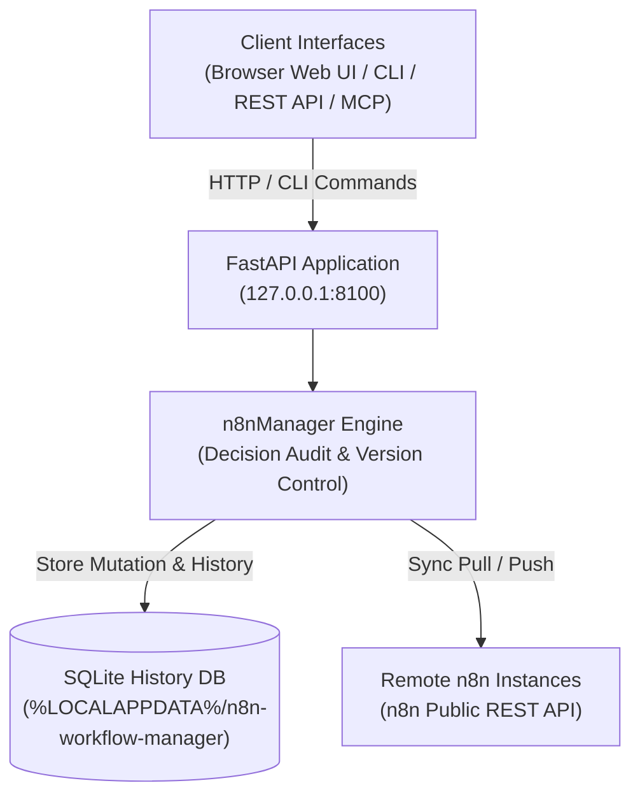

# مدير تدفقات العمل في n8n

**[English](README.md) · [Deutsch](README_de.md) · [Español](README_es.md) · [日本語](README_ja.md) · [Русский](README_ru.md) · [Français](README_fr.md) · [简体中文](README_zh.md) · [हिन्दी](README_hi.md) · [العربية](README_ar.md) · [বাংলা](README_bn.md) · [Português](README_pt.md)**

> مراجعة تدفقات العمل مع إعطاء الأولوية للعمل المحلي، وفحص بصري، وتحرير موثق بالقرارات، وسجلّ للإصدارات، ومزامنة متعددة الخوادم مع n8n.

> [!IMPORTANT]
> مشروع مجتمعي مستقل. لا يتبع شركة n8n GmbH، ولم تصادق عليه أو ترعاه.
> «n8n» علامة تجارية لمالكها، ونستخدم الاسم هنا فقط لوصف البرنامج الذي تتكامل معه هذه الأداة.

[](https://www.python.org/downloads/)
[](pyproject.toml)
[](LICENSE)
[](tests)
[](https://fastapi.tiangolo.com/)
[](https://github.com/astral-sh/ruff)
[](#what-it-does)
[](SECURITY.md)
[](SECURITY.md)
[](https://github.com/ellmos-ai)
[](https://github.com/open-bricks)
[](llms.txt)

> [!NOTE]
> **سياق وكلاء الذكاء الاصطناعي والنماذج اللغوية الكبيرة**: تُفهرس المواصفة القابلة للقراءة آلياً وعبارات البحث لاستخدام RAG في [`llms.txt`](llms.txt). ويتكامل هذا المشروع مع [`n8n-manager-mcp`](https://github.com/ellmos-ai/n8n-manager-mcp) لتنفيذ عمليات مستقلة على تدفقات عمل الذكاء الاصطناعي مع تتبع القرارات. تسجل التعديلات مبرراً غير فارغ للقرار، لكن هذا لا يشكل خطوة موافقة بشرية: بعض مسارات create وbuild وimport وtemplate وpull توفر قيماً افتراضية، بينما تتطلب مسارات update وrollback وdelete وpush قيمة غير فارغة من المستدعي.

## التنقل

- [بنية النظام](#system-architecture)
- [دورة حياة تدفق العمل](#workflow-lifecycle)
- [الحوكمة وثوابت وقت التشغيل](#governance-and-runtime-invariants)
- [الواجهة المرئية ولقطات الشاشة](#visual-interface-and-screenshots)
- [الفئات المستهدفة وتحسين الظهور في محركات البحث](#target-personas-and-seo)
- [مقارنة البنية والميزات](#comparison-matrix)
- [ما الذي يقدمه](#what-it-does)
- [التثبيت والتشغيل](#install-and-start)
- [أمثلة CLI](#cli-examples)
- [واجهة Builder API](#builder-api)
- [الإعدادات والبيانات](#configuration-and-data)
- [Docker](#docker)
- [إعداد n8n البعيد](#remote-n8n-setup)
- [اقتران المدير بخادم MCP](#manager-plus-mcp-pairing)
- [المنظومة الشقيقة](#sibling-ecosystem)
- [التحقق](#verification)
- [الترخيص](#license)

---

<a id="system-architecture"></a>
## بنية النظام



---

<a id="workflow-lifecycle"></a>
## دورة حياة تدفق العمل

يفصل هذا التسلسل بين التراجع المحلي والمزامنة مع الخادم البعيد. يعيد rollback نسخة محفوظة في SQLite ويسجل القرار المقدّم. وهو يغيّر قاعدة البيانات المحلية فقط؛ ويلزم تنفيذ push منفصل لإرسال هذه الحالة إلى n8n البعيد.

```mermaid
sequenceDiagram
    autonumber
    actor User as "Operator / AI Agent (MCP)"
    participant API as "FastAPI Application (127.0.0.1:8100)"
    participant SQLite as "Local SQLite History DB"
    participant n8n as "Configured Remote n8n API"

    Note over User,SQLite: "1. Local Rollback (No Remote Call)"
    User->>API: "POST /api/workflows/{workflow_id}/rollback/{version_number} (Decision)"
    API->>SQLite: "Read retained target version"
    SQLite-->>API: "Stored workflow JSON"
    API->>SQLite: "Update local workflow; record version and decision"
    SQLite-->>API: "Local transaction committed"
    API-->>User: "Rollback response (message, history URL)"
    Note over User,n8n: "Remote n8n remains unchanged after rollback"
    Note over User,n8n: "2. Separate Explicit Push (Optional)"
    User->>API: "POST /api/export/{workflow_id}/to-server?decision=...&server_id=..."
    API->>SQLite: "Read local workflow and remote binding"
    SQLite-->>API: "Workflow JSON and binding (if any)"
    API->>n8n: "Create or update via n8n REST API"
    n8n-->>API: "Remote result (success or error)"
    API->>SQLite: "Record sync result; update binding on success"
    API-->>User: "Push response"
```

---

<a id="governance-and-runtime-invariants"></a>
## الحوكمة وثوابت وقت التشغيل

| # | الإمكانية / السياسة | سلوك المشروع | الحدود |
|---|---|---|---|
| 1 | **محلي أولاً افتراضياً** | ترتبط الخدمة بالعنوان 127.0.0.1 افتراضياً. | تستخدم الاتصالات المضبوطة بخادم n8n واجهة REST عبر الشبكة؛ ويستخدم الإعداد البعيد SSH عبر الشبكة. لا يضمن ذلك انعدام الاتصالات الصادرة. |
| 2 | **سجلات القرارات** | تسجل تعديلات تدفقات العمل مبرراً غير فارغ. | يمكن لمسارات create وbuild وimport وtemplate وpull تطبيق قيم افتراضية؛ وتتطلب مسارات update وrollback وdelete وpush قيمة غير فارغة من المستدعي. يسجل المبرر القصد، ولا يعني موافقة بشرية. |
| 3 | **سجل SQLite** | تُخزَّن إصدارات تدفقات العمل وصفوف القرارات في SQLite. | هذه سجلات محلية عادية في قاعدة البيانات؛ ولا تتمتع بخصائص عدم القابلية للتغيير أو مقاومة العبث. يؤدي حذف تدفق عمل إلى حذف إصداراته. |
| 4 | **التراجع** | يمكن استعادة إصدار محفوظ إلى سجل تدفق العمل المحلي. | لا يغيّر rollback حالة n8n البعيد. عملية push منفصلة؛ وسجل الإصدارات ليس ضماناً للتعافي من الكوارث. |
| 5 | **مزامنة n8n** | تستخدم عمليتا pull وpush المحددتان بالخادم واجهة n8n REST API. | يلزم إعداد خادم وإتاحة الشبكة؛ وتتم عملية push صراحةً. |
| 6 | **أصول الفحص المرئي** | تُضمّن مكتبة المتصفح vis-network محلياً. | يمنع التضمين طلب CDN لهذه المكتبة؛ لكن المزامنة البعيدة تظل بحاجة إلى الشبكة. |
| 7 | **التعامل مع مفاتيح API** | تُحفظ مفاتيح n8n المسجلة ضمن بيانات محلية خاصة بكل مستخدم، وتُحجب في ردود API وواجهة المستخدم. | تُخزَّن المفاتيح دون تشفير؛ لذا احمِ مجلد بيانات المستخدم كما هو موضح في SECURITY.md. |
| 8 | **الواجهات** | يوفر المشروع واجهة متصفح وREST API وCLI؛ ويُصان مكوّن MCP المصاحب في مشروع منفصل. | يستخدم المكوّن المصاحب API هذا المشروع؛ ولا يغيّر السلوك المحلي أو البعيد الموضح أعلاه. |
| 9 | **نموذج الصلاحيات** | صُمم التطبيق وصورة Docker للعمل دون صلاحيات مرتفعة. | يصف ذلك إعداد وقت التشغيل الموثق. |
| 10 | **سياسة الاستجابة الأمنية** | تتعهد SECURITY.md باستجابة أولية خلال 48 ساعة وبالفرز خلال خمسة أيام عمل. | هذا التزام في السياسة، وليس ضماناً تشغيلياً أو وعداً بإصدار تصحيح خلال 48 ساعة. |

---

<a id="visual-interface-and-screenshots"></a>
<a id="screenshots"></a>
## الواجهة المرئية ولقطات الشاشة

توفر واجهة المتصفح فحصاً تفاعلياً لتدفقات العمل، ورسم علاقات الاعتماد بين العقد، وإدارة السجل، من دون مغادرة بيئتك المحلية:

| لوحة المعلومات ونظرة عامة على تدفق العمل | عارض الرسم المرئي وأداة الفحص المباشر |
|:---:|:---:|
|  |  |
| *فهرس تدفقات العمل، وروابط الخوادم، وعدد المراجعات، وإجراءات سريعة* | *رسم تفاعلي باستخدام vis.js، ومعاملات العقد، وبيانات الاعتماد، والاتصالات* |

---

<a id="target-personas-and-seo"></a>
## الفئات المستهدفة وتحسين الظهور في محركات البحث

صُمم مدير تدفقات العمل في n8n للفرق التقنية والمشغلين ووكلاء الذكاء الاصطناعي الذين يحتاجون إلى فحص تدفقات العمل في n8n وتوثيقها وتحريرها ومزامنتها مع سجل محلي للقرارات والإصدارات:

- **`[PERSONA-01]` مهندسو أتمتة تدفقات العمل ومسؤولو الأنظمة**: مشغلون يديرون مثيلات n8n عبر بيئات التجهيز والاختبار والإنتاج، ويحتاجون إلى مراجعة محلية لتدفقات العمل، وفحص بصري، ومزامنة محددة بالخادم.
- **`[PERSONA-02]` مهندسو أطر وكلاء الذكاء الاصطناعي ومتكاملو MCP**: فرق تدمج النماذج اللغوية الكبيرة عبر n8n-manager-mcp لإنشاء تدفقات العمل أو تعديلها. يسجل المدير مبرراً للقرار؛ وتستخدم بعض المسارات قيماً افتراضية، ولا يشكل المبرر موافقة بشرية.
- **`[PERSONA-03]` مسؤولو الأمن والامتثال**: فرق تحتاج إلى سجل محلي لإصدارات تدفقات العمل والقرارات في SQLite، وحجب مفاتيح API في الردود، وأصول واجهة أمامية مضمنة، وبيئة تشغيل بلا صلاحيات مرتفعة. بيانات سجل SQLite محلية عادية قابلة للتعديل، ولا توفر حماية من العبث.
- **`[PERSONA-04]` مهندسو DevOps وموثوقية المواقع (SRE)**: فرق تستخدم REST API والمزامنة المحددة بالخادم والتراجع المحلي إلى إصدارات محفوظة. احتفظ بنسخ احتياطية مستقلة للتعافي من الكوارث؛ فسجل تدفقات العمل ليس ضماناً للنسخ الاحتياطي.

#### كلمات البحث والاكتشاف ذات النية المرتفعة
- `local n8n workflow manager`، `visual n8n graph viewer`، `n8n multi-server sync`، `decision-tracked workflow automation`، `n8n-manager-mcp companion`، `local-first workflow rollback`، `vis.js n8n editor`، `fastapi n8n controller`، `offline n8n documentation export`

---

<a id="comparison-matrix"></a>
## مقارنة البنية والميزات

إمكانات المشروع وحدوده. لا تتضمن هذه القائمة أي ادعاءات مقارنة بشأن منتجات أخرى.

| # | الإمكانية / السياسة | سلوك المشروع | الحدود |
|---|---|---|---|
| 1 | **محلي أولاً افتراضياً** | ترتبط الخدمة بالعنوان 127.0.0.1 افتراضياً. | تستخدم الاتصالات المضبوطة بخادم n8n واجهة REST عبر الشبكة؛ ويستخدم الإعداد البعيد SSH عبر الشبكة. لا يضمن ذلك انعدام الاتصالات الصادرة. |
| 2 | **سجلات القرارات** | تسجل تعديلات تدفقات العمل مبرراً غير فارغ. | يمكن لمسارات create وbuild وimport وtemplate وpull تطبيق قيم افتراضية؛ وتتطلب مسارات update وrollback وdelete وpush قيمة غير فارغة من المستدعي. يسجل المبرر القصد، ولا يعني موافقة بشرية. |
| 3 | **سجل SQLite** | تُخزَّن إصدارات تدفقات العمل وصفوف القرارات في SQLite. | هذه سجلات محلية عادية في قاعدة البيانات؛ ولا تتمتع بخصائص عدم القابلية للتغيير أو مقاومة العبث. يؤدي حذف تدفق عمل إلى حذف إصداراته. |
| 4 | **التراجع** | يمكن استعادة إصدار محفوظ إلى سجل تدفق العمل المحلي. | لا يغيّر rollback حالة n8n البعيد. عملية push منفصلة؛ وسجل الإصدارات ليس ضماناً للتعافي من الكوارث. |
| 5 | **مزامنة n8n** | تستخدم عمليتا pull وpush المحددتان بالخادم واجهة n8n REST API. | يلزم إعداد خادم وإتاحة الشبكة؛ وتتم عملية push صراحةً. |
| 6 | **أصول الفحص المرئي** | تُضمّن مكتبة المتصفح vis-network محلياً. | يمنع التضمين طلب CDN لهذه المكتبة؛ لكن المزامنة البعيدة تظل بحاجة إلى الشبكة. |
| 7 | **التعامل مع مفاتيح API** | تُحفظ مفاتيح n8n المسجلة ضمن بيانات محلية خاصة بكل مستخدم، وتُحجب في ردود API وواجهة المستخدم. | تُخزَّن المفاتيح دون تشفير؛ لذا احمِ مجلد بيانات المستخدم كما هو موضح في SECURITY.md. |
| 8 | **الواجهات** | يوفر المشروع واجهة متصفح وREST API وCLI؛ ويُصان مكوّن MCP المصاحب في مشروع منفصل. | يستخدم المكوّن المصاحب API هذا المشروع؛ ولا يغيّر السلوك المحلي أو البعيد الموضح أعلاه. |
| 9 | **نموذج الصلاحيات** | صُمم التطبيق وصورة Docker للعمل دون صلاحيات مرتفعة. | يصف ذلك إعداد وقت التشغيل الموثق. |
| 10 | **سياسة الاستجابة الأمنية** | تتعهد SECURITY.md باستجابة أولية خلال 48 ساعة وبالفرز خلال خمسة أيام عمل. | هذا التزام في السياسة، وليس ضماناً تشغيلياً أو وعداً بإصدار تصحيح خلال 48 ساعة. |

---

<a id="what-it-does"></a>
## ما الذي يقدمه

- عارض رسومي ومحرر متصفح عملي لملفات JSON الخاصة بتدفقات عمل n8n.
- سجل إصدارات مستند إلى SQLite ومبررات قرارات مسجلة لتعديلات تدفقات العمل؛ وتستخدم بعض مسارات الإنشاء والاستيراد قيماً افتراضية.
- التراجع المحلي عبر REST API أو CLI؛ ويلزم push منفصل لتحديث n8n البعيد.
- ارتباطات pull وpush لكل تدفق عمل ولكل خادم، باستخدام API العام لـ n8n وترقيم الصفحات بالمؤشر.
- تصدير بصيغتي JSON وMarkdown، واستيراد مع التحقق من الصحة، وقوالب عامة مضمنة.
- REST API مبنية على FastAPI، وواجهة Swagger UI، وCLI طرفية.

يعطي التطبيق الأولوية للعمل المحلي: فهو يرتبط افتراضياً بـ `127.0.0.1`، ويخزن
الإعدادات وبيانات وقت التشغيل في مجلدات خاصة بكل مستخدم بدلاً من وضعها داخل
الحزمة المثبتة أو نسخة الشيفرة المصدرية.

لا يمنع ربط المدير بعنوان loopback الاتصالات الصادرة إلى خادم n8n أو مضيف SSH مضبوط.

### بداية سريعة حسب حالة الاستخدام

| الهدف / حاجة تدفق العمل | الأداة / الواجهة المقترحة | الأمر / تدفق العمل |
|---|---|---|
| **فحص تدفقات العمل المحلية وعرضها بصرياً** | لوحة الويب وعارض الرسم باستخدام vis.js | `n8n-manager serve` &rarr; افتح `http://127.0.0.1:8100` |
| **توثيق تدفقات العمل لتسليمها** | محرك تصدير Markdown / JSON | `n8n-manager export <id> --format md` |
| **المزامنة بين خوادم متعددة (من التجهيز إلى الإنتاج)** | سجل الخوادم ومحرك pull/push | `n8n-manager push <id> --decision "Deploy reviewed changes"` |
| **إنشاء تدفقات عمل آلية لوكلاء الذكاء الاصطناعي** | Builder REST API وخادم MCP | `POST /api/workflows/build` عبر `n8n-manager-mcp` |
| **استعادة إصدار محلي محفوظ** | سجل تدفقات العمل المحلي وميزة rollback | `n8n-manager rollback <id> <target-version> --decision "Revert defect"` (يبقى n8n البعيد بلا تغيير؛ نفّذ push منفصلاً عند الحاجة) |
| **إعداد n8n بعيد عبر SSH** | أمر إعداد SSH آلي | `n8n-manager setup --host <server> --user <deploy>` |

---

<a id="install-and-start"></a>
## التثبيت والتشغيل

```bash
pip install git+https://github.com/ellmos-ai/n8n-workflow-manager.git
n8n-manager serve
```

افتح <http://127.0.0.1:8100>. تتوفر وثائق API التفاعلية على
<http://127.0.0.1:8100/docs>.

للتطوير:

```bash
git clone https://github.com/ellmos-ai/n8n-workflow-manager.git
cd n8n-workflow-manager
python -m pip install -e ".[dev]"
python -m pytest -q
```

---

<a id="cli-examples"></a>
## أمثلة CLI

> [!WARNING]
> يرسل push تدفق العمل المحلي إلى خادم n8n المضبوط. أما rollback فيغيّر
> قاعدة البيانات المحلية فقط. يحذف delete تدفق العمل المحلي وسجل إصداراته
> وارتباطاته المحلية بالخوادم؛ ولا يرسل طلب حذف إلى n8n. لإرسال إصدار
> تم التراجع إليه محلياً إلى n8n، نفّذ push منفصلاً. تحقق من الخادم
> الافتراضي باستخدام n8n-manager status قبل push إلى بيئة الإنتاج. تُخزَّن
> مفاتيح API المسجلة مع الخوادم عبر servers --add دون تشفير في مجلد البيانات
> الخاص بالمستخدم؛ لذا احمه كما تحمي مفتاح SSH. راجع [SECURITY.md](SECURITY.md).

تسجل بعض مسارات create وbuild وimport وtemplate وpull قراراً افتراضياً غير فارغ. وتتطلب مسارات update وrollback وdelete وpush قراراً غير فارغ من المستدعي. ويسجل القرار القصد المعلن؛ لكنه لا يثبت وجود موافقة بشرية.

```bash
n8n-manager import workflow.json --decision "Import reviewed customer workflow"
n8n-manager list
n8n-manager history 1
n8n-manager export 1 --format md

n8n-manager servers --add production https://n8n.example.com YOUR_API_KEY --default
n8n-manager push 1 --decision "Deploy reviewed version"
n8n-manager pull
n8n-manager rollback 1 2 --decision "Restore last known-good version"

n8n-manager status                       # effective paths, database and server state
n8n-manager config --show                # inspect the resolved configuration
n8n-manager config --set db_path ./my.db # change a single setting
```

يكون التحقق من TLS مفعلاً افتراضياً. يتوفر الخيار `--no-verify-tls` لبيئات محلية
مضبوطة تستخدم شهادات موقعة ذاتياً؛ لا تستخدمه عبر شبكات
غير موثوقة.

---

<a id="builder-api"></a>
## واجهة Builder API

```bash
curl -X POST http://127.0.0.1:8100/api/workflows/build \
  -H "Content-Type: application/json" \
  -d '{
    "name": "Webhook forwarder",
    "decision": "Create a reviewed draft",
    "nodes": [
      {"type": "n8n-nodes-base.webhook", "name": "Trigger", "parameters": {"path": "hook"}},
      {"type": "n8n-nodes-base.httpRequest", "name": "Forward", "parameters": {"url": "https://api.example.com"}}
    ],
    "connections": [{"from_node": "Trigger", "to_node": "Forward"}]
  }'
```

راجع [API_REFERENCE.md](docs/API_REFERENCE.md) للاطلاع على عقود التعديل
والسجل.

---

<a id="configuration-and-data"></a>
## الإعدادات والبيانات

يطبع الأمر `n8n-manager status` المسارات الفعلية. يجري حل قيم `db_path`
النسبية ضمن مجلد بيانات المستخدم.

| المنصة | الإعدادات | بيانات وقت التشغيل |
|---|---|---|
| Windows | `%APPDATA%\n8n-workflow-manager` | `%LOCALAPPDATA%\n8n-workflow-manager` |
| macOS | `~/Library/Application Support/n8n-workflow-manager` | المجلد نفسه |
| Linux | `${XDG_CONFIG_HOME:-~/.config}/n8n-workflow-manager` | `${XDG_DATA_HOME:-~/.local/share}/n8n-workflow-manager` |

تجاوزات الإعداد: `N8N_MANAGER_CONFIG` و`N8N_MANAGER_CONFIG_DIR` و
`N8N_MANAGER_DATA_DIR`. ابدأ من [config.example.json](config.example.json).
لا يقبل `trusted_hosts` افتراضياً سوى ترويسات Host الخاصة بعنوان loopback؛ أدرج اسم المضيف
العام الذي راجعته صراحةً عند استخدام وكيل عكسي يتطلب المصادقة.

---

<a id="docker"></a>
## Docker

```bash
docker compose up --build -d
```

يرتبط المنفذ في Compose بالعنوان `127.0.0.1:8100`، وتُركّب الحالة ضمن
`runtime/`. تعمل الصورة كمستخدم غير مميّز.

---

<a id="remote-n8n-setup"></a>
## إعداد n8n البعيد

يفترض أمر الإعداد تثبيت Docker وفق سياسة نظام تشغيل المضيف البعيد. ويثبت
صورة n8n الرسمية ذات الإصدار المثبت على منفذ محصور في loopback؛ ولا يشغّل
مثبّتاً بعيداً من نوع `curl | sh`.

```bash
n8n-manager setup --host your-server --user deploy --ssh-key ~/.ssh/id_ed25519
# Follow the printed ssh -L ... tunnel command, then open http://127.0.0.1:5678
```

يستخدم SSH وضع الدفعات و`StrictHostKeyChecking=accept-new`. للخدمة العامة،
وفّر وكيلاً عكسياً يعمل ببروتوكول TLS ويتطلب المصادقة. لا تعرض n8nManager أو مستمع n8n
المنشأ مباشرةً على الإنترنت.

---

<a id="manager-plus-mcp-pairing"></a>
## اقتران المدير بخادم MCP

صُمم `n8n-workflow-manager` و
[n8n-manager-mcp](https://github.com/ellmos-ai/n8n-manager-mcp) ليعملا
كزوج: خادم MCP هو طبقة تنفيذ إجراءات الذكاء الاصطناعي، بينما يوفر هذا
المشروع طبقة الحالة والسجل للبشر، مع المراجعة المرئية والقرارات لكل تدفق
عمل والإصدارات والتراجع. يمكن للعميل قراءة `/api/workflows/{id}/history`
قبل إجراء أي تعديل. توفر بعض المسارات مبرراً افتراضياً؛ وتتطلب مسارات update
وrollback وdelete وpush قراراً غير فارغ من المستدعي. توثّق سجلات القرارات
القصد، ولا تصادق على موافقة بشرية.

يوجد سجل القرارات المعتمد هنا، وهو مستقل عن العميل، لذا يمكن أن يشمل مسار
المراجعة نفسه خادم MCP أو `curl` أو CLI أو واجهة الويب.

إذا كنت تشغّل n8n ضمن مجموعة مستضافة ذاتياً بدلاً من تشغيله مستقلاً،
فإن [ellmos-stack](https://github.com/ellmos-ai/ellmos-stack) يشغّل n8n
مع Ollama وفهرس للمستندات عبر Docker Compose؛ ثم يتصل هذا المدير بذلك
المثيل كما يتصل بأي خادم n8n آخر.
ويمكن أيضاً جلب السياق الحواري من فهرس تاريخ يعتمد على السحب، مثل
[ctx](https://github.com/ctxrs/ctx) (Apache-2.0).

---

<a id="sibling-ecosystem"></a>
## المنظومة الشقيقة

يُعدّ `n8n-workflow-manager` مكوّناً أساسياً في منظومتي البرمجيات مفتوحة
المصدر [ellmos-ai](https://github.com/ellmos-ai) و[open-bricks](https://github.com/open-bricks):

| المستودع | الغرض | التكامل |
|---|---|---|
| [`ellmos-ai/n8n-manager-mcp`](https://github.com/ellmos-ai/n8n-manager-mcp) | خادم MCP لإدارة تدفقات عمل n8n | طبقة تنفيذ إجراءات مستقلة لوكلاء الذكاء الاصطناعي مع تدقيق القرارات |
| [`ellmos-ai/ellmos-stack`](https://github.com/ellmos-ai/ellmos-stack) | مجموعة محلية متكاملة للذكاء الاصطناعي والأتمتة | تشغيل n8n وOllama وKnowledgeDigest عبر Docker Compose |
| [`ellmos-ai/ellmos-homebase-mcp`](https://github.com/ellmos-ai/ellmos-homebase-mcp) | قاعدة معرفة مركزية وذاكرة عبر MCP | ذاكرة الوكلاء وتنسيق العمل بين الجلسات |
| [`ellmos-ai/ellmos-controlcenter-mcp`](https://github.com/ellmos-ai/ellmos-controlcenter-mcp) | سجل متعدد الوكلاء وتنسيق الأدوات | تجميع الأدوات وتوجيهها ديناميكياً |
| [`dev-bricks/automation-master`](https://github.com/dev-bricks/automation-master) | مشرف مركزي لصحة الأتمتة والمهام | تنسيق صحة النظام ومراقبته |
| [`ellmos-ai/clirec`](https://github.com/ellmos-ai/clirec) | مسجل حتمي لجلسات CLI ومحرك لإعادة تشغيلها | تدقيق الطرفية التفاعلية والتحقق من الجلسات |
| [`open-bricks/open-bricks`](https://github.com/open-bricks) | منظمة جامعة للمشاريع مفتوحة المصدر | معايير مشتركة وإرشادات أمنية وحوكمة |

---

<a id="verification"></a>
## التحقق

موثق عقد الإصدار في [RELEASE_GATE.md](RELEASE_GATE.md). وتشمل
بوابات التحقق المحلية الأساسية ما يلي:

```bash
python -m pytest -q
python -m ruff check n8nManager tests
python -m bandit -q -r n8nManager -lll
python -m pip_audit
python -m build
```

---

<a id="license"></a>
## الترخيص

MIT؛ راجع [LICENSE](LICENSE). استخدم البرنامج على مسؤوليتك الخاصة؛ ولا
يُقدَّم أي ضمان أو التزام بالصيانة.

يشمل هذا الترخيص الشيفرة المكتوبة لهذا المشروع. كما يوزع المستودع وحزم
التوزيع المبنية مكتبة المتصفح **vis-network** (مرخصة ترخيصاً مزدوجاً بموجب
Apache-2.0 أو MIT؛ وتُستخدم هنا بموجب خيار MIT)، مع احتفاظ أصحاب حقوق
النشر بحقوقهم. راجع الإشعارات كاملة في [THIRD_PARTY_LICENSES.md](THIRD_PARTY_LICENSES.md).
