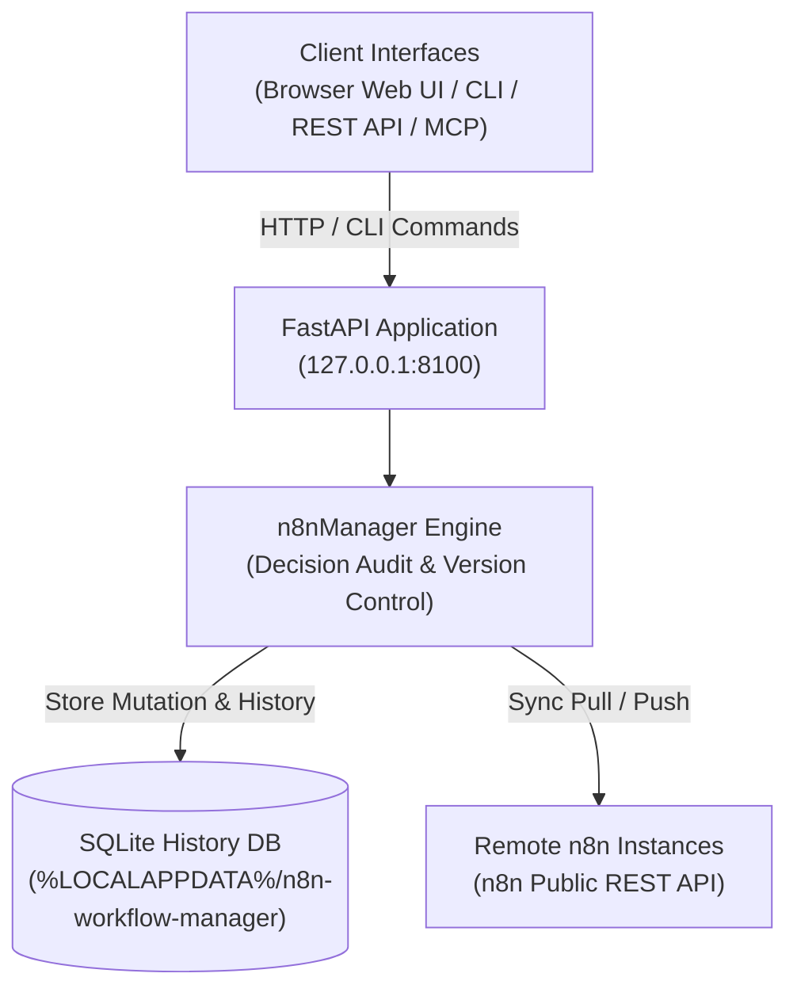

# n8n ওয়ার্কফ্লো ম্যানেজার

**[English](README.md) · [Deutsch](README_de.md) · [Español](README_es.md) · [日本語](README_ja.md) · [Русский](README_ru.md) · [Français](README_fr.md) · [简体中文](README_zh.md) · [हिन्दी](README_hi.md) · [العربية](README_ar.md) · [বাংলা](README_bn.md) · [Português](README_pt.md)**

> n8n-এর জন্য স্থানীয়ভাবে কাজ করা ওয়ার্কফ্লো পর্যালোচনা, দৃশ্যমান পরিদর্শন, সিদ্ধান্ত-নথিভুক্ত সম্পাদনা, ইতিহাস এবং একাধিক সার্ভারের সঙ্গে সিঙ্ক।

> [!IMPORTANT]
> স্বতন্ত্র কমিউনিটি প্রকল্প। n8n GmbH-এর সঙ্গে এর কোনো সম্পর্ক নেই; n8n GmbH এটি অনুমোদন বা পৃষ্ঠপোষকতা করে না। "n8n" তার নিজ নিজ মালিকের ট্রেডমার্ক এবং এখানে কেবল এই টুলটি যে সফটওয়্যারের সঙ্গে আন্তঃকার্য করে সেটি বোঝাতে ব্যবহৃত হয়েছে।

[](https://www.python.org/downloads/)
[](pyproject.toml)
[](LICENSE)
[](tests)
[](https://fastapi.tiangolo.com/)
[](https://github.com/astral-sh/ruff)
[](#what-it-does)
[](SECURITY.md)
[](SECURITY.md)
[](https://github.com/ellmos-ai)
[](https://github.com/open-bricks)
[](llms.txt)

> [!NOTE]
> **AI এজেন্ট ও LLM প্রসঙ্গ**: মেশিনে-পাঠযোগ্য স্পেসিফিকেশন এবং RAG অনুসন্ধান বাক্যাংশ [`llms.txt`](llms.txt)-এ সূচিবদ্ধ আছে। সিদ্ধান্ত-নথিভুক্ত স্বয়ংক্রিয় AI ওয়ার্কফ্লো পরিচালনার জন্য এটি [`n8n-manager-mcp`](https://github.com/ellmos-ai/n8n-manager-mcp)-এর সঙ্গে কাজ করে। পরিবর্তনের ক্ষেত্রে ফাঁকা নয় এমন সিদ্ধান্তের যুক্তি নথিভুক্ত হয়, তবে এটি মানুষের অনুমোদনের ধাপ নয়: ওয়ার্কফ্লো তৈরি, নির্মাণ, আমদানি, টেমপ্লেট থেকে তৈরি এবং সার্ভার থেকে টেনে আনার কিছু পথে ডিফল্ট যুক্তি দেওয়া হয়; হালনাগাদ, স্থানীয় সংস্করণ ফেরত আনা, মুছে ফেলা এবং সার্ভারে পাঠানোর জন্য কলকারীকে ফাঁকা নয় এমন মান দিতে হয়।

## নেভিগেশন

- [সিস্টেম আর্কিটেকচার](#system-architecture)
- [ওয়ার্কফ্লোর জীবনচক্র](#workflow-lifecycle)
- [শাসন ও রানটাইমের অপরিবর্তনীয় নিয়ম](#governance-and-runtime-invariants)
- [ভিজ্যুয়াল ইন্টারফেস ও স্ক্রিনশট](#visual-interface-and-screenshots)
- [লক্ষ্য ব্যবহারকারী, ব্যক্তিত্ব ও SEO](#target-personas-and-seo)
- [আর্কিটেকচার ও বৈশিষ্ট্যের তুলনা](#comparison-matrix)
- [এটি কী করে](#what-it-does)
- [ইনস্টল ও চালু করা](#install-and-start)
- [CLI উদাহরণ](#cli-examples)
- [Builder API](#builder-api)
- [কনফিগারেশন ও ডেটা](#configuration-and-data)
- [Docker](#docker)
- [দূরবর্তী n8n সেটআপ](#remote-n8n-setup)
- [Manager ও MCP জুটি](#manager-plus-mcp-pairing)
- [সহযোগী ইকোসিস্টেম](#sibling-ecosystem)
- [যাচাইকরণ](#verification)
- [লাইসেন্স](#license)

---

<a id="system-architecture"></a>
## সিস্টেম আর্কিটেকচার



---

<a id="workflow-lifecycle"></a>
## ওয়ার্কফ্লোর জীবনচক্র

এই ক্রমচিত্রে স্থানীয় রোলব্যাককে দূরবর্তী সিঙ্ক থেকে আলাদা দেখানো হয়েছে। রোলব্যাক SQLite-এ সংরক্ষিত একটি সংস্করণ ফিরিয়ে আনে এবং দেওয়া সিদ্ধান্তটি নথিভুক্ত করে। এতে শুধু স্থানীয় ডেটাবেস বদলায়; সেই অবস্থা দূরবর্তী n8n-এ পাঠাতে আলাদা push করতে হয়।

```mermaid
sequenceDiagram
    autonumber
    actor User as "Operator / AI Agent (MCP)"
    participant API as "FastAPI Application (127.0.0.1:8100)"
    participant SQLite as "Local SQLite History DB"
    participant n8n as "Configured Remote n8n API"

    Note over User,SQLite: "1. Local Rollback (No Remote Call)"
    User->>API: "POST /api/workflows/{workflow_id}/rollback/{version_number} (Decision)"
    API->>SQLite: "Read retained target version"
    SQLite-->>API: "Stored workflow JSON"
    API->>SQLite: "Update local workflow; record version and decision"
    SQLite-->>API: "Local transaction committed"
    API-->>User: "Rollback response (message, history URL)"
    Note over User,n8n: "Remote n8n remains unchanged after rollback"
    Note over User,n8n: "2. Separate Explicit Push (Optional)"
    User->>API: "POST /api/export/{workflow_id}/to-server?decision=...&server_id=..."
    API->>SQLite: "Read local workflow and remote binding"
    SQLite-->>API: "Workflow JSON and binding (if any)"
    API->>n8n: "Create or update via n8n REST API"
    n8n-->>API: "Remote result (success or error)"
    API->>SQLite: "Record sync result; update binding on success"
    API-->>User: "Push response"
```

---

<a id="governance-and-runtime-invariants"></a>
## শাসন ও রানটাইমের অপরিবর্তনীয় নিয়ম

| # | সক্ষমতা / নীতি | প্রকল্পের আচরণ | সীমা |
|---|---|---|---|
| 1 | **স্থানীয়-প্রথম ডিফল্ট** | পরিষেবাটি ডিফল্টভাবে 127.0.0.1 ঠিকানায় সীমাবদ্ধ থাকে। | কনফিগার করা n8n সংযোগ REST ব্যবহার করে; দূরবর্তী সেটআপে SSH লাগে। এতে বহির্গামী নেটওয়ার্ক যোগাযোগ পুরোপুরি বন্ধ থাকে—এমন নিশ্চয়তা নেই। |
| 2 | **সিদ্ধান্তের নথি** | ওয়ার্কফ্লোর পরিবর্তনে ফাঁকা নয় এমন যুক্তি নথিভুক্ত হয়। | ওয়ার্কফ্লো তৈরি, নির্মাণ, আমদানি, টেমপ্লেট থেকে তৈরি এবং সার্ভার থেকে টেনে আনার পথে ডিফল্ট যুক্তি প্রয়োগ হতে পারে; হালনাগাদ, স্থানীয় সংস্করণ ফেরত আনা, মুছে ফেলা এবং সার্ভারে পাঠানোর ক্ষেত্রে কলকারীর দেওয়া ফাঁকা নয় এমন মান লাগে। যুক্তি উদ্দেশ্য নথিভুক্ত করে, মানুষের অনুমোদন নয়। |
| 3 | **SQLite ইতিহাস** | ওয়ার্কফ্লোর সংস্করণ ও সিদ্ধান্তের সারি SQLite-এ সংরক্ষিত হয়। | এগুলো সাধারণ স্থানীয় ডেটাবেস রেকর্ড, অপরিবর্তনীয় বা কারসাজি-প্রতিরোধী নয়। ওয়ার্কফ্লো মুছলে তার সংস্করণগুলোও মুছে যায়। |
| 4 | **রোলব্যাক** | সংরক্ষিত সংস্করণ স্থানীয় ওয়ার্কফ্লো রেকর্ডে ফিরিয়ে আনা যায়। | রোলব্যাকে দূরবর্তী n8n অপরিবর্তিত থাকে। সার্ভারে পাঠানো আলাদা ধাপ; ইতিহাস দুর্যোগ-পরবর্তী পুনরুদ্ধারের নিশ্চয়তা নয়। |
| 5 | **n8n সিঙ্ক্রোনাইজেশন** | সার্ভার-নির্দিষ্টভাবে ওয়ার্কফ্লো টেনে আনা ও পাঠানো n8n REST API ব্যবহার করে। | কনফিগার করা সার্ভার ও নেটওয়ার্ক সংযোগ দরকার; পাঠানোর কাজ স্পষ্টভাবে চালাতে হয়। |
| 6 | **ভিজ্যুয়াল পরিদর্শনের উপকরণ** | vis-network ব্রাউজার লাইব্রেরি স্থানীয়ভাবে অন্তর্ভুক্ত। | এতে ওই লাইব্রেরির জন্য CDN অনুরোধ লাগে না; দূরবর্তী সিঙ্কে তবু নেটওয়ার্ক সংযোগ দরকার। |
| 7 | **API কী ব্যবস্থাপনা** | নিবন্ধিত n8n কী প্রতি-ব্যবহারকারীর স্থানীয় ডেটায় রাখা হয় এবং API/UI উত্তরে আড়াল করা হয়। | কী-গুলো এনক্রিপ্ট করা অবস্থায় সংরক্ষিত হয় না; SECURITY.md-এ বর্ণিতভাবে ব্যবহারকারীর ডেটা ডিরেক্টরি সুরক্ষিত রাখুন। |
| 8 | **ইন্টারফেস** | প্রকল্পে ব্রাউজার UI, REST API এবং CLI আছে; MCP সহযোগী আলাদাভাবে রক্ষণাবেক্ষণ করা হয়। | সহযোগীটি এই প্রকল্পের API ব্যবহার করে; উপরে বর্ণিত স্থানীয়/দূরবর্তী আচরণ বদলায় না। |
| 9 | **বিশেষাধিকার মডেল** | অ্যাপ্লিকেশন ও Docker ইমেজ উচ্চতর বিশেষাধিকার ছাড়া চালানোর জন্য নকশা করা হয়েছে। | এটি নথিভুক্ত রানটাইম কনফিগারেশনকে বর্ণনা করে। |
| 10 | **নিরাপত্তা-প্রতিক্রিয়া নীতি** | SECURITY.md-এ 48 ঘণ্টার মধ্যে প্রাথমিক প্রতিক্রিয়া এবং পাঁচ কর্মদিবসের মধ্যে ট্রায়াজের অঙ্গীকার আছে। | এটি নীতিগত অঙ্গীকার; রানটাইম নিশ্চয়তা বা 48 ঘণ্টার মধ্যে প্যাচ প্রকাশের প্রতিশ্রুতি নয়। |

---

<a id="visual-interface-and-screenshots"></a>
<a id="screenshots"></a>
## ভিজ্যুয়াল ইন্টারফেস ও স্ক্রিনশট

ব্রাউজার UI আপনার স্থানীয় পরিবেশ ছেড়ে না গিয়েই ওয়ার্কফ্লো ইন্টারঅ্যাকটিভভাবে পরীক্ষা, নোডের নির্ভরতা-গ্রাফ দেখা এবং ইতিহাস পরিচালনা করতে দেয়:

| ড্যাশবোর্ড ও ওয়ার্কফ্লোর সারসংক্ষেপ | ভিজ্যুয়াল গ্রাফ ভিউয়ার ও লাইভ ইন্সপেক্টর |
|:---:|:---:|
|  |  |
| *ওয়ার্কফ্লো ক্যাটালগ, সার্ভার সংযোগ, সংশোধনের সংখ্যা ও দ্রুত কাজ* | *ইন্টারঅ্যাকটিভ vis.js গ্রাফ, নোড প্যারামিটার, ক্রেডেনশিয়াল ও সংযোগ* |

---

<a id="target-personas-and-seo"></a>
## লক্ষ্য ব্যবহারকারী, ব্যক্তিত্ব ও SEO

n8n ওয়ার্কফ্লো ম্যানেজার এমন কারিগরি দল, অপারেটর ও AI এজেন্টদের জন্য, যাদের স্থানীয় সিদ্ধান্ত ও সংস্করণ-ইতিহাসসহ n8n ওয়ার্কফ্লো পরীক্ষা, নথিবদ্ধ, সম্পাদনা এবং সিঙ্ক করতে হয়:

- **`[PERSONA-01]` ওয়ার্কফ্লো অটোমেশন প্রকৌশলী ও সিসঅ্যাডমিন**: এমন অপারেটর, যারা স্টেজিং, পরীক্ষা ও প্রোডাকশন পরিবেশে n8n ইনস্ট্যান্স পরিচালনা করেন এবং স্থানীয় ওয়ার্কফ্লো পর্যালোচনা, ভিজ্যুয়াল পরিদর্শন ও সার্ভার-নির্দিষ্ট সিঙ্ক চান।
- **`[PERSONA-02]` AI এজেন্ট ফ্রেমওয়ার্ক আর্কিটেক্ট ও MCP ইন্টিগ্রেটর**: n8n-manager-mcp দিয়ে LLM যুক্ত করে ওয়ার্কফ্লো তৈরি বা পরিবর্তন করা দল। ম্যানেজার সিদ্ধান্তের যুক্তি নথিভুক্ত করে; কিছু ধরনের ক্রিয়ায় ডিফল্ট যুক্তি ব্যবহৃত হয়, আর যুক্তি মানুষের অনুমোদনের সমতুল্য নয়।
- **`[PERSONA-03]` নিরাপত্তা ও কমপ্লায়েন্স কর্মকর্তা**: এমন দল, যাদের স্থানীয় SQLite-এ ওয়ার্কফ্লোর সংস্করণ ও সিদ্ধান্তের ইতিহাস, উত্তরে API কী আড়াল, অন্তর্ভুক্ত ফ্রন্টএন্ড উপকরণ এবং উচ্চতর বিশেষাধিকারহীন রানটাইম দরকার। SQLite ইতিহাস অপরিবর্তনীয় বা কারসাজি-প্রতিরোধী নয়।
- **`[PERSONA-04]` DevOps ও সাইট রিলায়েবিলিটি ইঞ্জিনিয়ার (SRE)**: REST API, সার্ভার-নির্দিষ্ট সিঙ্ক এবং সংরক্ষিত সংস্করণ থেকে স্থানীয় রোলব্যাক ব্যবহার করা দল। দুর্যোগ-পরবর্তী পুনরুদ্ধারের জন্য আলাদা ব্যাকআপ রাখুন; ওয়ার্কফ্লো ইতিহাস ব্যাকআপের নিশ্চয়তা নয়।

#### উচ্চ-উদ্দেশ্যভিত্তিক খুঁজে পাওয়া ও অনুসন্ধানের কীওয়ার্ড
- `local n8n workflow manager`, `visual n8n graph viewer`, `n8n multi-server sync`, `decision-tracked workflow automation`, `n8n-manager-mcp companion`, `local-first workflow rollback`, `vis.js n8n editor`, `fastapi n8n controller`, `offline n8n documentation export`

---

<a id="comparison-matrix"></a>
## আর্কিটেকচার ও বৈশিষ্ট্যের তুলনা

প্রকল্পের সক্ষমতা ও সীমা। এই সারণিতে অন্য কোনো পণ্য সম্পর্কে তুলনামূলক দাবি করা হয়নি।

| # | সক্ষমতা / নীতি | প্রকল্পের আচরণ | সীমা |
|---|---|---|---|
| 1 | **স্থানীয়-প্রথম ডিফল্ট** | পরিষেবাটি ডিফল্টভাবে 127.0.0.1 ঠিকানায় সীমাবদ্ধ থাকে। | কনফিগার করা n8n সংযোগ REST ব্যবহার করে; দূরবর্তী সেটআপে SSH লাগে। এতে বহির্গামী নেটওয়ার্ক যোগাযোগ পুরোপুরি বন্ধ থাকে—এমন নিশ্চয়তা নেই। |
| 2 | **সিদ্ধান্তের নথি** | ওয়ার্কফ্লোর পরিবর্তনে ফাঁকা নয় এমন যুক্তি নথিভুক্ত হয়। | ওয়ার্কফ্লো তৈরি, নির্মাণ, আমদানি, টেমপ্লেট থেকে তৈরি এবং সার্ভার থেকে টেনে আনার পথে ডিফল্ট যুক্তি প্রয়োগ হতে পারে; হালনাগাদ, স্থানীয় সংস্করণ ফেরত আনা, মুছে ফেলা এবং সার্ভারে পাঠানোর ক্ষেত্রে কলকারীর দেওয়া ফাঁকা নয় এমন মান লাগে। যুক্তি উদ্দেশ্য নথিভুক্ত করে, মানুষের অনুমোদন নয়। |
| 3 | **SQLite ইতিহাস** | ওয়ার্কফ্লোর সংস্করণ ও সিদ্ধান্তের সারি SQLite-এ সংরক্ষিত হয়। | এগুলো সাধারণ স্থানীয় ডেটাবেস রেকর্ড, অপরিবর্তনীয় বা কারসাজি-প্রতিরোধী নয়। ওয়ার্কফ্লো মুছলে তার সংস্করণগুলোও মুছে যায়। |
| 4 | **রোলব্যাক** | সংরক্ষিত সংস্করণ স্থানীয় ওয়ার্কফ্লো রেকর্ডে ফিরিয়ে আনা যায়। | রোলব্যাকে দূরবর্তী n8n অপরিবর্তিত থাকে। সার্ভারে পাঠানো আলাদা ধাপ; ইতিহাস দুর্যোগ-পরবর্তী পুনরুদ্ধারের নিশ্চয়তা নয়। |
| 5 | **n8n সিঙ্ক্রোনাইজেশন** | সার্ভার-নির্দিষ্টভাবে ওয়ার্কফ্লো টেনে আনা ও পাঠানো n8n REST API ব্যবহার করে। | কনফিগার করা সার্ভার ও নেটওয়ার্ক সংযোগ দরকার; পাঠানোর কাজ স্পষ্টভাবে চালাতে হয়। |
| 6 | **ভিজ্যুয়াল পরিদর্শনের উপকরণ** | vis-network ব্রাউজার লাইব্রেরি স্থানীয়ভাবে অন্তর্ভুক্ত। | এতে ওই লাইব্রেরির জন্য CDN অনুরোধ লাগে না; দূরবর্তী সিঙ্কে তবু নেটওয়ার্ক সংযোগ দরকার। |
| 7 | **API কী ব্যবস্থাপনা** | নিবন্ধিত n8n কী প্রতি-ব্যবহারকারীর স্থানীয় ডেটায় রাখা হয় এবং API/UI উত্তরে আড়াল করা হয়। | কী-গুলো এনক্রিপ্ট করা অবস্থায় সংরক্ষিত হয় না; SECURITY.md-এ বর্ণিতভাবে ব্যবহারকারীর ডেটা ডিরেক্টরি সুরক্ষিত রাখুন। |
| 8 | **ইন্টারফেস** | প্রকল্পে ব্রাউজার UI, REST API এবং CLI আছে; MCP সহযোগী আলাদাভাবে রক্ষণাবেক্ষণ করা হয়। | সহযোগীটি এই প্রকল্পের API ব্যবহার করে; উপরে বর্ণিত স্থানীয়/দূরবর্তী আচরণ বদলায় না। |
| 9 | **বিশেষাধিকার মডেল** | অ্যাপ্লিকেশন ও Docker ইমেজ উচ্চতর বিশেষাধিকার ছাড়া চালানোর জন্য নকশা করা হয়েছে। | এটি নথিভুক্ত রানটাইম কনফিগারেশনকে বর্ণনা করে। |
| 10 | **নিরাপত্তা-প্রতিক্রিয়া নীতি** | SECURITY.md-এ 48 ঘণ্টার মধ্যে প্রাথমিক প্রতিক্রিয়া এবং পাঁচ কর্মদিবসের মধ্যে ট্রায়াজের অঙ্গীকার আছে। | এটি নীতিগত অঙ্গীকার; রানটাইম নিশ্চয়তা বা 48 ঘণ্টার মধ্যে প্যাচ প্রকাশের প্রতিশ্রুতি নয়। |

---

<a id="what-it-does"></a>
## এটি কী করে

- n8n ওয়ার্কফ্লো JSON-এর জন্য ভিজ্যুয়াল গ্রাফ ভিউয়ার ও কাজের উপযোগী ব্রাউজার এডিটর।
- SQLite-ভিত্তিক সংস্করণ-ইতিহাস এবং ওয়ার্কফ্লোর পরিবর্তনের সিদ্ধান্তের যুক্তি; তৈরির ও ইমপোর্টের কিছু পথে ডিফল্ট যুক্তি ব্যবহৃত হয়।
- REST API বা CLI দিয়ে স্থানীয় রোলব্যাক; দূরবর্তী n8n আপডেট করতে আলাদা push দরকার।
- n8n-এর উন্মুক্ত API ও কার্সর-ভিত্তিক পৃষ্ঠা-ক্রম ব্যবহার করে প্রতি-ওয়ার্কফ্লো ও প্রতি-সার্ভারের জন্য টেনে আনা/পাঠানোর সংযোগ।
- JSON ও Markdown এক্সপোর্ট, যাচাইকৃত ইমপোর্ট এবং অন্তর্ভুক্ত সাধারণ টেমপ্লেট।
- FastAPI REST API, Swagger UI এবং টার্মিনাল CLI।

অ্যাপ্লিকেশনটি স্থানীয়-প্রথম: ডিফল্টভাবে `127.0.0.1`-এ bind করে এবং
ইনস্টল করা প্যাকেজ বা সোর্স checkout-এর ভেতরে নয়, প্রতি-ব্যবহারকারীর
ডিরেক্টরিতে কনফিগারেশন ও রানটাইম ডেটা রাখে।

ম্যানেজারকে loopback ইন্টারফেসে সীমাবদ্ধ রাখলেও কনফিগার করা n8n সার্ভার বা SSH হোস্টে বহির্গামী সংযোগ বন্ধ হয় না।

### ব্যবহার অনুযায়ী দ্রুত শুরু

| লক্ষ্য / ওয়ার্কফ্লোর প্রয়োজন | প্রস্তাবিত টুল / ইন্টারফেস | কমান্ড / ওয়ার্কফ্লো |
|---|---|---|
| **স্থানীয় ওয়ার্কফ্লো পরীক্ষা ও দৃশ্যায়ন** | ওয়েব ড্যাশবোর্ড ও vis.js গ্রাফ ভিউয়ার | `n8n-manager serve` &rarr; `http://127.0.0.1:8100` খুলুন |
| **হস্তান্তরের জন্য ওয়ার্কফ্লো নথিবদ্ধ করা** | Markdown / JSON এক্সপোর্ট ইঞ্জিন | `n8n-manager export <id> --format md` |
| **একাধিক সার্ভারে সিঙ্ক (স্টেজিং থেকে প্রোডাকশন)** | সার্ভার রেজিস্ট্রি ও Pull/Push ইঞ্জিন | `n8n-manager push <id> --decision "Deploy reviewed changes"` |
| **স্বয়ংক্রিয় AI ওয়ার্কফ্লো তৈরি** | Builder REST API ও MCP Server | `POST /api/workflows/build` চালান `n8n-manager-mcp` দিয়ে |
| **সংরক্ষিত স্থানীয় সংস্করণ ফিরিয়ে আনা** | স্থানীয় ওয়ার্কফ্লো ইতিহাস ও রোলব্যাক | `n8n-manager rollback <id> <target-version> --decision "Revert defect"` (দূরবর্তী n8n অপরিবর্তিত থাকবে; দরকার হলে আলাদা push করুন) |
| **SSH দিয়ে দূরবর্তী n8n সেটআপ** | স্বয়ংক্রিয় SSH সেটআপ কমান্ড | `n8n-manager setup --host <server> --user <deploy>` |

---

<a id="install-and-start"></a>
## ইনস্টল ও চালু করা

```bash
pip install git+https://github.com/ellmos-ai/n8n-workflow-manager.git
n8n-manager serve
```

<http://127.0.0.1:8100> খুলুন। ইন্টারঅ্যাকটিভ API নথিপত্র পাবেন
<http://127.0.0.1:8100/docs>-এ।

ডেভেলপমেন্টের জন্য:

```bash
git clone https://github.com/ellmos-ai/n8n-workflow-manager.git
cd n8n-workflow-manager
python -m pip install -e ".[dev]"
python -m pytest -q
```

---

<a id="cli-examples"></a>
## CLI উদাহরণ

> [!WARNING]
> push স্থানীয় ওয়ার্কফ্লোটি কনফিগার করা n8n সার্ভারে পাঠায়। rollback
> শুধু স্থানীয় ডেটাবেসে পরিবর্তন আনে। delete স্থানীয় ওয়ার্কফ্লো, তার সংস্করণ-ইতিহাস
> এবং স্থানীয় সার্ভার সংযোগ মুছে দেয়; n8n-এ delete অনুরোধ পাঠায় না। স্থানীয়ভাবে
> রোলব্যাক করা সংস্করণ n8n-এ পাঠাতে আলাদা push চালান। production-এ push করার আগে
> n8n-manager status দিয়ে ডিফল্ট সার্ভার যাচাই করুন। servers --add দিয়ে নিবন্ধিত
> সার্ভারের API কী প্রতি-ব্যবহারকারীর ডেটা ডিরেক্টরিতে এনক্রিপশন ছাড়া রাখা হয়;
> SSH কী-এর মতোই সেটি সুরক্ষিত রাখুন। [SECURITY.md](SECURITY.md) দেখুন।

ওয়ার্কফ্লো তৈরি, নির্মাণ, আমদানি, টেমপ্লেট থেকে তৈরি এবং সার্ভার থেকে টেনে আনার কিছু পথে ফাঁকা নয় এমন ডিফল্ট সিদ্ধান্ত নথিভুক্ত হয়। হালনাগাদ, স্থানীয় সংস্করণ ফেরত আনা, মুছে ফেলা এবং সার্ভারে পাঠানোর ক্ষেত্রে কলকারীর কাছ থেকে ফাঁকা নয় এমন সিদ্ধান্ত লাগে। সিদ্ধান্তে ঘোষিত উদ্দেশ্য নথিভুক্ত হয়; এতে মানুষের অনুমোদন প্রতিষ্ঠিত হয় না।

```bash
n8n-manager import workflow.json --decision "Import reviewed customer workflow"
n8n-manager list
n8n-manager history 1
n8n-manager export 1 --format md

n8n-manager servers --add production https://n8n.example.com YOUR_API_KEY --default
n8n-manager push 1 --decision "Deploy reviewed version"
n8n-manager pull
n8n-manager rollback 1 2 --decision "Restore last known-good version"

n8n-manager status                       # effective paths, database and server state
n8n-manager config --show                # inspect the resolved configuration
n8n-manager config --set db_path ./my.db # change a single setting
```

TLS যাচাইকরণ ডিফল্টভাবে চালু থাকে। স্ব-স্বাক্ষরিত সার্টিফিকেটসহ নিয়ন্ত্রিত
স্থানীয় পরিবেশের জন্য `--no-verify-tls` আছে; অবিশ্বস্ত নেটওয়ার্কে এটি
ব্যবহার করবেন না।

---

<a id="builder-api"></a>
## Builder API

```bash
curl -X POST http://127.0.0.1:8100/api/workflows/build \
  -H "Content-Type: application/json" \
  -d '{
    "name": "Webhook forwarder",
    "decision": "Create a reviewed draft",
    "nodes": [
      {"type": "n8n-nodes-base.webhook", "name": "Trigger", "parameters": {"path": "hook"}},
      {"type": "n8n-nodes-base.httpRequest", "name": "Forward", "parameters": {"url": "https://api.example.com"}}
    ],
    "connections": [{"from_node": "Trigger", "to_node": "Forward"}]
  }'
```

পরিবর্তন ও ইতিহাসের চুক্তির জন্য [API_REFERENCE.md](docs/API_REFERENCE.md) দেখুন।

---

<a id="configuration-and-data"></a>
## কনফিগারেশন ও ডেটা

`n8n-manager status` কার্যকর পাথগুলো দেখায়। আপেক্ষিক `db_path` মান
ব্যবহারকারীর ডেটা ডিরেক্টরির অধীনে সমাধান করা হয়।

| প্ল্যাটফর্ম | কনফিগারেশন | রানটাইম ডেটা |
|---|---|---|
| Windows | `%APPDATA%\n8n-workflow-manager` | `%LOCALAPPDATA%\n8n-workflow-manager` |
| macOS | `~/Library/Application Support/n8n-workflow-manager` | একই ডিরেক্টরি |
| Linux | `${XDG_CONFIG_HOME:-~/.config}/n8n-workflow-manager` | `${XDG_DATA_HOME:-~/.local/share}/n8n-workflow-manager` |

পরিবর্তনযোগ্য মান: `N8N_MANAGER_CONFIG`, `N8N_MANAGER_CONFIG_DIR` এবং
`N8N_MANAGER_DATA_DIR`। শুরু করতে [config.example.json](config.example.json) দেখুন।
ডিফল্ট `trusted_hosts` শুধু loopback Host header গ্রহণ করে; প্রমাণীকরণ-সুরক্ষিত reverse proxy
ব্যবহার করলে পর্যালোচিত সর্বজনীন hostname স্পষ্টভাবে তালিকায় যোগ করুন।

---

<a id="docker"></a>
## Docker

```bash
docker compose up --build -d
```

Compose পোর্টটি `127.0.0.1:8100`-এ bind করে এবং অবস্থা `runtime/`-এর অধীনে
মাউন্ট হয়। ইমেজটি কম বিশেষাধিকারপ্রাপ্ত ব্যবহারকারী হিসেবে চলে।

---

<a id="remote-n8n-setup"></a>
## দূরবর্তী n8n সেটআপ

সেটআপ কমান্ড ধরে নেয়, দূরবর্তী হোস্টের অপারেটিং-সিস্টেম নীতি অনুযায়ী Docker আগে থেকেই ইনস্টল করা আছে। এটি loopback-এ সীমাবদ্ধ পোর্টে একটি নির্দিষ্ট সংস্করণে স্থির করা অফিসিয়াল n8n ইমেজ ইনস্টল করে; দূরবর্তী `curl | sh` ইনস্টলার চালায় না।

```bash
n8n-manager setup --host your-server --user deploy --ssh-key ~/.ssh/id_ed25519
# Follow the printed ssh -L ... tunnel command, then open http://127.0.0.1:5678
```

SSH ব্যাচ মোড এবং `StrictHostKeyChecking=accept-new` ব্যবহার করে। সর্বজনীন পরিষেবা চালু করলে প্রমাণীকরণ-যুক্ত TLS reverse proxy দিন। n8nManager বা
তৈরি হওয়া n8n listener—কোনোটিই সরাসরি ইন্টারনেটে উন্মুক্ত করবেন না।

---

<a id="manager-plus-mcp-pairing"></a>
## Manager ও MCP জুটি

`n8n-workflow-manager` এবং
[n8n-manager-mcp](https://github.com/ellmos-ai/n8n-manager-mcp) জুটি হিসেবে
তৈরি করা হয়েছে: MCP সার্ভারটি AI-এর কাজের স্তর, আর এই প্রকল্পটি মানুষের
অবস্থা ও ইতিহাসের স্তর—এতে ভিজ্যুয়াল পর্যালোচনা, প্রতি-ওয়ার্কফ্লোর সিদ্ধান্ত,
সংস্করণ এবং রোলব্যাক আছে। কোনো পরিবর্তনের আগে ক্লায়েন্ট
`/api/workflows/{id}/history` পড়তে পারে। কিছু পথে ডিফল্ট যুক্তি দেওয়া হয়;
update, rollback, delete এবং push-এর জন্য কলকারীর দেওয়া ফাঁকা নয় এমন সিদ্ধান্ত
লাগে। সিদ্ধান্তের নথি উদ্দেশ্য জানায়, মানুষের অনুমোদন প্রত্যয়ন করে না।

কর্তৃত্বপূর্ণ সিদ্ধান্ত-লগটি এখানেই থাকে এবং ক্লায়েন্ট-নিরপেক্ষ; তাই একই
পর্যালোচনা-ইতিহাস MCP সার্ভার, `curl`, CLI অথবা ওয়েব UI—সব ক্ষেত্রেই কাজে লাগে।

আপনি যদি স্বতন্ত্রভাবে নয়, নিজে পরিচালিত স্ট্যাকের অংশ হিসেবে n8n চালান,
[ellmos-stack](https://github.com/ellmos-ai/ellmos-stack) Docker Compose দিয়ে
n8n-এর সঙ্গে Ollama ও নথির সূচি চালু করে; এরপর এই ম্যানেজার অন্য যেকোনো n8n
সার্ভারের মতো সেই ইনস্ট্যান্সে সংযোগ করে।
কথোপকথনের প্রসঙ্গ অতিরিক্তভাবে [ctx](https://github.com/ctxrs/ctx) (Apache-2.0)-এর
মতো তথ্য-টেনে-আনা পদ্ধতির ইতিহাস সূচি থেকেও আসতে পারে।

---

<a id="sibling-ecosystem"></a>
## সহযোগী ইকোসিস্টেম

`n8n-workflow-manager` [ellmos-ai](https://github.com/ellmos-ai) এবং [open-bricks](https://github.com/open-bricks) মুক্ত-উৎস ইকোসিস্টেমের অবিচ্ছেদ্য অংশ:

| রিপোজিটরি | উদ্দেশ্য | ইন্টিগ্রেশন |
|---|---|---|
| [`ellmos-ai/n8n-manager-mcp`](https://github.com/ellmos-ai/n8n-manager-mcp) | n8n ওয়ার্কফ্লো ব্যবস্থাপনার MCP সার্ভার | সিদ্ধান্ত নিরীক্ষাসহ স্বয়ংক্রিয় AI এজেন্টের কাজের স্তর |
| [`ellmos-ai/ellmos-stack`](https://github.com/ellmos-ai/ellmos-stack) | একত্রিত স্থানীয় AI ও অটোমেশন স্ট্যাক | Docker Compose দিয়ে n8n, Ollama ও KnowledgeDigest চালায় |
| [`ellmos-ai/ellmos-homebase-mcp`](https://github.com/ellmos-ai/ellmos-homebase-mcp) | কেন্দ্রীয় জ্ঞানভান্ডার ও স্মৃতি MCP | সেশন-জুড়ে এজেন্টের স্মৃতি ও সমন্বয় |
| [`ellmos-ai/ellmos-controlcenter-mcp`](https://github.com/ellmos-ai/ellmos-controlcenter-mcp) | বহু-এজেন্ট রেজিস্ট্রি ও টুল অর্কেস্ট্রেশন | গতিশীল টুল-বান্ডলিং ও রাউটিং |
| [`dev-bricks/automation-master`](https://github.com/dev-bricks/automation-master) | কেন্দ্রীয় অটোমেশন স্বাস্থ্য ও কাজের তদারক | সিস্টেম-স্তরের স্বাস্থ্য-সমন্বয় ও স্বয়ংক্রিয় নজরদারি |
| [`ellmos-ai/clirec`](https://github.com/ellmos-ai/clirec) | নির্ধারিত CLI সেশন রেকর্ডার ও পুনরায় চালানোর ইঞ্জিন | ইন্টারঅ্যাকটিভ টার্মিনাল নিরীক্ষা ও সেশন যাচাইকরণ |
| [`open-bricks/open-bricks`](https://github.com/open-bricks) | ছাতার মতো ওপেন-সোর্স সংস্থা | ভাগ করা মানদণ্ড, নিরাপত্তা নির্দেশিকা ও শাসনব্যবস্থা |

---

<a id="verification"></a>
## যাচাইকরণ

রিলিজের চুক্তি [RELEASE_GATE.md](RELEASE_GATE.md)-এ নথিভুক্ত। মূল স্থানীয়
গেটগুলো হলো:

```bash
python -m pytest -q
python -m ruff check n8nManager tests
python -m bandit -q -r n8nManager -lll
python -m pip_audit
python -m build
```

---

<a id="license"></a>
## লাইসেন্স

MIT; [LICENSE](LICENSE) দেখুন। নিজ দায়িত্বে ব্যবহার করুন; কোনো ওয়ারেন্টি বা
রক্ষণাবেক্ষণের অঙ্গীকার দেওয়া হয় না।

এই লাইসেন্সে প্রকল্পের জন্য লেখা কোড অন্তর্ভুক্ত। রিপোজিটরি ও বিল্ড করা
ডিস্ট্রিবিউশনেও ব্রাউজার লাইব্রেরি **vis-network** রয়েছে (Apache-2.0 অথবা MIT
দ্বৈত লাইসেন্সে; এখানে MIT শর্তে ব্যবহৃত), যার কপিরাইট নিজ নিজ অধিকারীদের।
সম্পূর্ণ নোটিশ: [THIRD_PARTY_LICENSES.md](THIRD_PARTY_LICENSES.md)।
