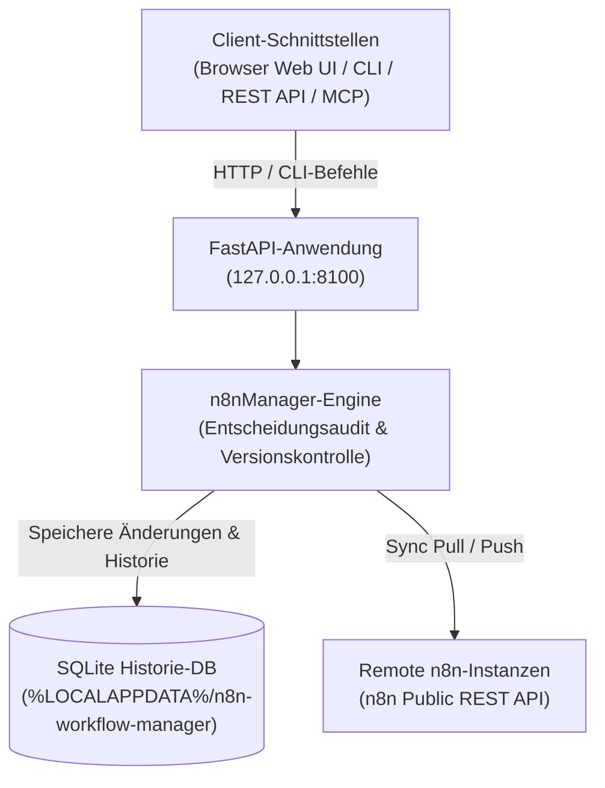

# n8n Workflow Manager

**[English](README.md) · [Deutsch](README_de.md) · [Español](README_es.md) · [日本語](README_ja.md) · [Русский](README_ru.md)**

> Lokale Workflow-Durchsicht, visuelle Prüfung, entscheidungsbegründete Bearbeitung, Historie und Multi-Server-Sync für n8n.

> [!IMPORTANT]
> Unabhängiges Community-Projekt. Weder mit der n8n GmbH verbunden noch von ihr
> unterstützt oder gesponsert. „n8n" ist eine Marke des jeweiligen Inhabers und
> wird hier nur verwendet, um die Software zu bezeichnen, mit der dieses Werkzeug
> zusammenarbeitet.

[](https://www.python.org/downloads/)
[](pyproject.toml)
[](LICENSE)
[](tests)
[](https://fastapi.tiangolo.com/)
[](https://github.com/astral-sh/ruff)
[](#funktionen)
[](SECURITY.md)
[](SECURITY.md)
[](https://github.com/ellmos-ai)
[](https://github.com/open-bricks)
[](llms.txt)

> [!NOTE]
> **KI-Agenten & LLM-Kontext**: Maschinenlesbare Spezifikationen und RAG-Suchphrasen sind in [`llms.txt`](llms.txt) indiziert. Ergänzt sich ideal mit [`n8n-manager-mcp`](https://github.com/ellmos-ai/n8n-manager-mcp) für autonome KI-Workflow-Steuerung mit Entscheidungsverfolgung. Änderungen protokollieren eine nicht leere Entscheidungsbegründung, sind aber keine menschliche Freigabe: Für Erstellen, Build, Import, Vorlagen und Pull gibt es Standardwerte; Update, Rollback, Delete und Push verlangen einen nicht leeren Eingabewert.

## Navigation

- [Systemarchitektur](#systemarchitektur)
- [Workflow-Lebenszyklus](#workflow-lebenszyklus)
- [Governance- & Laufzeit-Invarianten](#governance-und-laufzeit-invarianten)
- [Benutzeroberfläche & Screenshots](#benutzeroberflaeche-und-screenshots)
- [Zielgruppen-Personas & SEO](#zielgruppen-personas-und-seo)
- [Architektur- & Funktionsvergleich](#vergleichsmatrix)
- [Funktionen](#funktionen)
- [Installation und Start](#installation-und-start)
- [CLI-Beispiele](#cli-beispiele)
- [Builder API](#builder-api)
- [Konfiguration und Daten](#konfiguration-und-daten)
- [Docker](#docker)
- [Entfernte n8n-Installation](#entfernte-n8n-installation)
- [Manager + MCP als Paar](#manager-und-mcp-als-paar)
- [Geschwister-Ökosystem](#geschwister-oekosystem)
- [Prüfung](#pruefung)
- [Lizenz](#lizenz)

---

<a id="systemarchitektur"></a>
## Systemarchitektur



---

<a id="workflow-lebenszyklus"></a>
## Workflow-Lebenszyklus

Die Abfolge trennt lokales Rollback und entfernte Synchronisierung. Ein Rollback spielt eine gespeicherte SQLite-Version zurück und protokolliert die angegebene Begründung. Es ändert nur die lokale Datenbank; um den Stand an n8n zu senden, ist ein separater Push nötig.

```mermaid
sequenceDiagram
    autonumber
    actor User as "Operator / AI Agent (MCP)"
    participant API as "FastAPI Application (127.0.0.1:8100)"
    participant SQLite as "Local SQLite History DB"
    participant n8n as "Configured Remote n8n API"

    Note over User,SQLite: "1. Local Rollback (No Remote Call)"
    User->>API: "POST /api/workflows/{workflow_id}/rollback/{version_number} (Decision)"
    API->>SQLite: "Read retained target version"
    SQLite-->>API: "Stored workflow JSON"
    API->>SQLite: "Update local workflow; record version and decision"
    SQLite-->>API: "Local transaction committed"
    API-->>User: "Rollback response (message, history URL)"
    Note over User,n8n: "Remote n8n remains unchanged after rollback"
    Note over User,n8n: "2. Separate Explicit Push (Optional)"
    User->>API: "POST /api/export/{workflow_id}/to-server?decision=...&server_id=..."
    API->>SQLite: "Read local workflow and remote binding"
    SQLite-->>API: "Workflow JSON and binding (if any)"
    API->>n8n: "Create or update via n8n REST API"
    n8n-->>API: "Remote result (success or error)"
    API->>SQLite: "Record sync result; update binding on success"
    API-->>User: "Push response"
```

---

<a id="governance-und-laufzeit-invarianten"></a>
## Governance- & Laufzeit-Invarianten

| Nr. | Funktion / Richtlinie | Verhalten des Projekts | Grenze |
|---|---|---|---|
| 1 | **Local-First-Standard** | Der Dienst bindet standardmäßig an 127.0.0.1. | Konfigurierte n8n-Verbindungen nutzen REST; die entfernte Einrichtung nutzt SSH. Das garantiert nicht, dass keinerlei Daten nach außen gehen. |
| 2 | **Entscheidungsprotokolle** | Workflow-Änderungen speichern eine nicht leere Begründung. | Für Erstellen, Build, Import, Vorlage und Pull gibt es Standardwerte; Update, Rollback, Delete und Push verlangen einen nicht leeren Eingabewert. Eine Begründung protokolliert Absicht, ist aber keine menschliche Freigabe. |
| 3 | **SQLite-Historie** | Workflow-Versionen und Entscheidungszeilen werden in SQLite gespeichert. | Es sind normale lokale Datenbankeinträge, nicht unveränderlich oder manipulationssicher. Beim Löschen eines Workflows werden seine Versionen entfernt. |
| 4 | **Rollback** | Eine gespeicherte Version kann in den lokalen Workflow-Datensatz zurückgespielt werden. | Das Rollback ändert den entfernten n8n-Workflow nicht. Push ist separat; die Historie garantiert keine Wiederherstellung nach Datenverlust. |
| 5 | **n8n-Synchronisierung** | Workflow-bezogener Pull und Push nutzen die n8n-REST-API. | Ein konfigurierter Server und Netzwerkzugriff sind erforderlich; Push erfolgt ausdrücklich. |
| 6 | **Ressourcen zur visuellen Prüfung** | Die vis-network-Browserbibliothek ist lokal eingebunden. | Dadurch entfällt ein CDN-Abruf dieser Bibliothek; Remote-Sync benötigt weiterhin Netzwerkzugriff. |
| 7 | **Umgang mit API-Schlüsseln** | Registrierte n8n-Schlüssel liegen in lokalen Benutzerdaten und werden in API/UI-Antworten maskiert. | Schlüssel werden unverschlüsselt gespeichert; das Benutzerdatenverzeichnis ist wie in SECURITY.md beschrieben zu schützen. |
| 8 | **Schnittstellen** | Das Projekt bietet Browser-UI, REST-API und CLI; ein MCP-Begleiter wird separat gepflegt. | Der Begleiter nutzt die API dieses Projekts und ändert das beschriebene Verhalten lokal/remote nicht. |
| 9 | **Rechte** | Anwendung und Docker-Image sind für den Betrieb ohne erhöhte Rechte ausgelegt. | Dies beschreibt die dokumentierte Laufzeitkonfiguration. |
| 10 | **Richtlinie zur Sicherheitsreaktion** | SECURITY.md sagt eine Erstreaktion innerhalb von 48 Stunden und eine Triage innerhalb von fünf Werktagen zu. | Richtlinienzusage, keine Laufzeitgarantie und keine Zusage für einen Patch innerhalb von 48 Stunden. |

---

<a id="benutzeroberflaeche-und-screenshots"></a>
<a id="screenshots"></a>
## Benutzeroberfläche & Screenshots

Die browserbasierte Benutzeroberfläche ermöglicht interaktive Workflow-Inspektion, Visualisierung von Node-Abhängigkeiten und Historienverwaltung direkt im lokalen Netzwerk:

| Dashboard & Workflow-Übersicht | Visueller Graph-Viewer & Live-Inspektor |
|:---:|:---:|
|  |  |
| *Workflow-Katalog, Server-Anbindungen, Revisionszähler & Schnellaktionen* | *Interaktiver vis.js-Graph, Node-Parameter, Credentials & Verbindungen* |

---

<a id="zielgruppen-personas-und-seo"></a>
## Zielgruppen-Personas & SEO

n8n Workflow Manager richtet sich an technische Teams, Betreiber und KI-Agenten, die n8n-Workflows mit lokaler Entscheidungs- und Versionshistorie prüfen, dokumentieren, bearbeiten und synchronisieren müssen:

- **`[PERSONA-01]` Workflow-Automatisierungs-Ingenieure & Sysadmins**: Betreiber von n8n-Instanzen in Staging, Test und Produktion, die lokale Workflow-Prüfung, visuelle Inspektion und serverbezogene Synchronisierung benötigen.
- **`[PERSONA-02]` KI-Agenten-Architekten & MCP-Integratoren**: Teams, die LLMs über n8n-manager-mcp zum Erstellen oder Ändern von Workflows einsetzen. Der Manager protokolliert eine Begründung; einige Wege nutzen Standardwerte, und eine Begründung ist keine menschliche Freigabe.
- **`[PERSONA-03]` Sicherheits- & Compliance-Beauftragte**: Teams, die eine lokale SQLite-Versions- und Entscheidungshistorie, maskierte API-Schlüssel in Antworten, lokal gebündelte Frontend-Assets und einen Betrieb ohne erhöhte Rechte benötigen. Die SQLite-Historie ist weder unveränderlich noch manipulationssicher.
- **`[PERSONA-04]` DevOps & Site Reliability Engineers (SRE)**: Teams, die REST-API, serverbezogenen Sync und lokales Rollback aus gespeicherten Versionen nutzen. Für Notfallwiederherstellung sind unabhängige Backups nötig; die Workflow-Historie ist keine Backup-Garantie.

#### High-Intent SEO-Suchphrasen & Auffindbarkeit
- `lokaler n8n workflow manager`, `visueller n8n graph viewer`, `n8n multi-server synchronisation`, `entscheidungsbegründete workflow automation`, `n8n mcp server integration`, `local-first n8n rollback`, `vis.js n8n editor`, `fastapi n8n steuerung`, `offline n8n dokumentation export`

---

<a id="vergleichsmatrix"></a>
## Architektur- & Funktionsvergleich

Projektfähigkeiten und Grenzen. Diese Tabelle enthält keine unbelegten Vergleiche mit anderen Produkten.

| Nr. | Funktion / Richtlinie | Verhalten des Projekts | Grenze |
|---|---|---|---|
| 1 | **Local-First-Standard** | Der Dienst bindet standardmäßig an 127.0.0.1. | Konfigurierte n8n-Verbindungen nutzen REST; die entfernte Einrichtung nutzt SSH. Das garantiert nicht, dass keinerlei Daten nach außen gehen. |
| 2 | **Entscheidungsprotokolle** | Workflow-Änderungen speichern eine nicht leere Begründung. | Für Erstellen, Build, Import, Vorlage und Pull gibt es Standardwerte; Update, Rollback, Delete und Push verlangen einen nicht leeren Eingabewert. Eine Begründung protokolliert Absicht, ist aber keine menschliche Freigabe. |
| 3 | **SQLite-Historie** | Workflow-Versionen und Entscheidungszeilen werden in SQLite gespeichert. | Es sind normale lokale Datenbankeinträge, nicht unveränderlich oder manipulationssicher. Beim Löschen eines Workflows werden seine Versionen entfernt. |
| 4 | **Rollback** | Eine gespeicherte Version kann in den lokalen Workflow-Datensatz zurückgespielt werden. | Das Rollback ändert den entfernten n8n-Workflow nicht. Push ist separat; die Historie garantiert keine Wiederherstellung nach Datenverlust. |
| 5 | **n8n-Synchronisierung** | Workflow-bezogener Pull und Push nutzen die n8n-REST-API. | Ein konfigurierter Server und Netzwerkzugriff sind erforderlich; Push erfolgt ausdrücklich. |
| 6 | **Ressourcen zur visuellen Prüfung** | Die vis-network-Browserbibliothek ist lokal eingebunden. | Dadurch entfällt ein CDN-Abruf dieser Bibliothek; Remote-Sync benötigt weiterhin Netzwerkzugriff. |
| 7 | **Umgang mit API-Schlüsseln** | Registrierte n8n-Schlüssel liegen in lokalen Benutzerdaten und werden in API/UI-Antworten maskiert. | Schlüssel werden unverschlüsselt gespeichert; das Benutzerdatenverzeichnis ist wie in SECURITY.md beschrieben zu schützen. |
| 8 | **Schnittstellen** | Das Projekt bietet Browser-UI, REST-API und CLI; ein MCP-Begleiter wird separat gepflegt. | Der Begleiter nutzt die API dieses Projekts und ändert das beschriebene Verhalten lokal/remote nicht. |
| 9 | **Rechte** | Anwendung und Docker-Image sind für den Betrieb ohne erhöhte Rechte ausgelegt. | Dies beschreibt die dokumentierte Laufzeitkonfiguration. |
| 10 | **Richtlinie zur Sicherheitsreaktion** | SECURITY.md sagt eine Erstreaktion innerhalb von 48 Stunden und eine Triage innerhalb von fünf Werktagen zu. | Richtlinienzusage, keine Laufzeitgarantie und keine Zusage für einen Patch innerhalb von 48 Stunden. |

---

<a id="funktionen"></a>
## Funktionen

- Visueller Graph-Viewer und funktionsfähiger Browser-Editor für n8n-Workflow-JSON.
- SQLite-Versionshistorie und protokollierte Entscheidungsbegründungen für Workflow-Änderungen; einige Erstellungs- und Importwege verwenden Standardwerte.
- Lokales Rollback über REST-API oder CLI; um n8n remote zu aktualisieren, ist ein separater Push nötig.
- Eigene Pull/Push-Bindungen je Workflow und Server über die öffentliche n8n API mit Cursor-Paginierung.
- Validierter Import, JSON-/Markdown-Export und generische mitgelieferte Vorlagen.
- FastAPI REST API, Swagger UI und Kommandozeile.

Die Anwendung ist lokal ausgerichtet: Sie bindet standardmäßig an `127.0.0.1`
und speichert Konfiguration sowie Laufzeitdaten in Benutzerverzeichnissen statt
im installierten Paket oder Quellordner.

Die Loopback-Bindung des Managers verhindert keine ausgehenden Verbindungen zu einem konfigurierten n8n-Server oder SSH-Host.

### Schnellstart nach Anwendungsfall

| Ziel / Workflow-Anforderung | Empfohlenes Werkzeug / Oberfläche | Befehl / Ablauf |
|---|---|---|
| **Lokale Workflows inspizieren & visualisieren** | Web-Dashboard & vis.js Graph-Viewer | `n8n-manager serve` &rarr; öffne `http://127.0.0.1:8100` |
| **Workflows für Übergaben dokumentieren** | Markdown- / JSON-Export-Engine | `n8n-manager export <id> --format md` |
| **Multi-Server-Sync (Staging nach Produktion)** | Server-Register & Pull/Push-Engine | `n8n-manager push <id> --decision "Freigegebenen Stand deployen"` |
| **Autonome KI-Workflow-Generierung** | Builder REST-API & MCP-Server | `POST /api/workflows/build` via `n8n-manager-mcp` |
| **Gespeicherte lokale Version wiederherstellen** | Lokale Workflow-Historie und Rollback | `n8n-manager rollback <id> <ziel-version> --decision "Defekt rückgängig machen"` (n8n remote bleibt unverändert; Push bei Bedarf separat ausführen) |
| **Remote-n8n-Einrichtung über SSH** | Automatisierter SSH-Setup-Befehl | `n8n-manager setup --host <server> --user <deploy>` |

---

<a id="installation-und-start"></a>
## Installation und Start

```bash
pip install git+https://github.com/ellmos-ai/n8n-workflow-manager.git
n8n-manager serve
```

Öffne <http://127.0.0.1:8100>. Die interaktive API-Dokumentation liegt unter
<http://127.0.0.1:8100/docs>.

Für die Entwicklung:

```bash
git clone https://github.com/ellmos-ai/n8n-workflow-manager.git
cd n8n-workflow-manager
python -m pip install -e ".[dev]"
python -m pytest -q
```

---

<a id="cli-beispiele"></a>
## CLI-Beispiele

> [!WARNING]
> push sendet den lokalen Workflow an den konfigurierten n8n-Server. rollback
> ändert nur die lokale Datenbank. delete entfernt den lokalen Workflow, seine
> Versionshistorie und lokalen Serverbindungen; es sendet keine Löschanfrage an
> n8n. Um einen lokal zurückgespielten Stand an n8n zu senden, ist ein separater
> push nötig. Prüfe vor einem Push in Produktion den Standardserver mit
> n8n-manager status. Mit servers --add registrierte API-Schlüssel werden
> unverschlüsselt im Benutzerdatenverzeichnis gespeichert; schütze es wie einen
> SSH-Schlüssel. Siehe [SECURITY.md](SECURITY.md).

Für Erstellen, Build, Import, Vorlagen und Pull können nicht leere Standardbegründungen gespeichert werden. Update, Rollback, Delete und Push verlangen eine nicht leere Begründung vom Aufrufer. Eine Entscheidung protokolliert die angegebene Absicht, sie ist keine menschliche Freigabe.

```bash
n8n-manager import workflow.json --decision "Geprüften Kundenworkflow importieren"
n8n-manager list
n8n-manager history 1
n8n-manager export 1 --format md

n8n-manager servers --add production https://n8n.example.com YOUR_API_KEY --default
n8n-manager push 1 --decision "Geprüfte Version ausrollen"
n8n-manager pull
n8n-manager rollback 1 2 --decision "Letzte stabile Version wiederherstellen"

n8n-manager status                       # effektive Pfade, Datenbank- und Serverstand
n8n-manager config --show                # aufgelöste Konfiguration ansehen
n8n-manager config --set db_path ./my.db # einzelne Einstellung ändern
```

Die TLS-Prüfung ist standardmäßig aktiv. `--no-verify-tls` ist nur für
kontrollierte lokale Umgebungen mit selbstsignierten Zertifikaten gedacht.

---

<a id="builder-api"></a>
## Builder API

```bash
curl -X POST http://127.0.0.1:8100/api/workflows/build \
  -H "Content-Type: application/json" \
  -d '{
    "name": "Webhook-Weiterleitung",
    "decision": "Geprüften Entwurf anlegen",
    "nodes": [
      {"type": "n8n-nodes-base.webhook", "name": "Trigger", "parameters": {"path": "hook"}},
      {"type": "n8n-nodes-base.httpRequest", "name": "Forward", "parameters": {"url": "https://api.example.com"}}
    ],
    "connections": [{"from_node": "Trigger", "to_node": "Forward"}]
  }'
```

Die vollständigen Verträge stehen in der [API-Referenz](docs/API_REFERENCE.md).

---

<a id="konfiguration-und-daten"></a>
## Konfiguration und Daten

`n8n-manager status` zeigt die tatsächlich verwendeten Pfade. Relative
`db_path`-Werte werden im Benutzerdatenverzeichnis aufgelöst.

| Plattform | Konfiguration | Laufzeitdaten |
|---|---|---|
| Windows | `%APPDATA%\n8n-workflow-manager` | `%LOCALAPPDATA%\n8n-workflow-manager` |
| macOS | `~/Library/Application Support/n8n-workflow-manager` | gleiches Verzeichnis |
| Linux | `${XDG_CONFIG_HOME:-~/.config}/n8n-workflow-manager` | `${XDG_DATA_HOME:-~/.local/share}/n8n-workflow-manager` |

Überschreibungen: `N8N_MANAGER_CONFIG`, `N8N_MANAGER_CONFIG_DIR` und
`N8N_MANAGER_DATA_DIR`. Ausgangspunkt ist
[config.example.json](config.example.json).
`trusted_hosts` akzeptiert standardmäßig nur Loopback-Host-Header. Bei einem
authentifizierenden Reverse-Proxy muss dessen geprüfter öffentlicher Hostname
explizit eingetragen werden.

---

<a id="docker"></a>
## Docker

```bash
docker compose up --build -d
```

Compose bindet an `127.0.0.1:8100`; Daten liegen unter `runtime/`. Das Image
läuft als unprivilegierter Benutzer.

---

<a id="entfernte-n8n-installation"></a>
## Entfernte n8n-Installation

Docker muss auf dem Zielsystem bereits entsprechend dessen Betriebssystemregeln
installiert sein. Der Setup-Befehl startet ein fest versioniertes offizielles
n8n-Image nur auf Loopback und führt keinen entfernten `curl | sh`-Installer aus.

```bash
n8n-manager setup --host dein-server --user deploy --ssh-key ~/.ssh/id_ed25519
# Danach den ausgegebenen ssh -L ... Tunnel öffnen und http://127.0.0.1:5678 aufrufen.
```

SSH nutzt Batch-Modus und `StrictHostKeyChecking=accept-new`. Für einen
öffentlichen Dienst ist ein authentifizierender TLS-Reverse-Proxy erforderlich.

---

<a id="manager-und-mcp-als-paar"></a>
## Manager + MCP als Paar

`n8n-workflow-manager` und
[n8n-manager-mcp](https://github.com/ellmos-ai/n8n-manager-mcp) sind als Paar
gedacht: Der MCP-Server bildet die KI-Aktionsschicht; dieses Projekt ist die
Zustands- und Verlaufsschicht für Menschen mit visueller Prüfung,
Entscheidungsprotokoll, Versionen und Rollback. Ein Client kann vor einer Änderung die Historie unter `/api/workflows/{id}/history` lesen. Einige Wege setzen eine Standardbegründung; Update, Rollback, Delete und Push verlangen eine nicht leere Begründung des Aufrufers. Entscheidungszeilen protokollieren Absicht und bestätigen keine menschliche Freigabe.

Das maßgebliche Entscheidungsprotokoll liegt hier und ist client-unabhängig. Es
kann daher MCP, `curl`, CLI und Web-UI gleichermaßen abdecken. Zusätzlicher
Konversationskontext kann aus einem pull-basierten Verlaufsindex wie
[ctx](https://github.com/ctxrs/ctx) (Apache-2.0) stammen.

Wer n8n nicht einzeln, sondern als Teil eines selbst gehosteten Stacks betreibt:
[ellmos-stack](https://github.com/ellmos-ai/ellmos-stack) startet n8n zusammen mit
Ollama und einer Dokumentensuche über Docker Compose; dieser Manager verbindet
sich anschließend wie mit jedem anderen n8n-Server.

---

<a id="geschwister-oekosystem"></a>
## Geschwister-Ökosystem

`n8n-workflow-manager` ist ein zentraler Baustein der Open-Source-Ökosysteme von [ellmos-ai](https://github.com/ellmos-ai) und [open-bricks](https://github.com/open-bricks):

| Repository | Zweck | Integration |
|---|---|---|
| [`ellmos-ai/n8n-manager-mcp`](https://github.com/ellmos-ai/n8n-manager-mcp) | MCP-Server für n8n-Workflow-Steuerung | Autonome KI-Aktionsschicht mit Entscheidungsprotokoll |
| [`ellmos-ai/ellmos-stack`](https://github.com/ellmos-ai/ellmos-stack) | Lokaler KI- & Automations-Stack | Betreibt n8n, Ollama und KnowledgeDigest per Docker Compose |
| [`ellmos-ai/ellmos-homebase-mcp`](https://github.com/ellmos-ai/ellmos-homebase-mcp) | Zentrales Wissens- & Gedächtnis-MCP | Sitzungsübergreifendes Gedächtnis und Agentenkoordination |
| [`ellmos-ai/ellmos-controlcenter-mcp`](https://github.com/ellmos-ai/ellmos-controlcenter-mcp) | Multi-Agenten-Registry & Tool-Orchestrierung | Dynamische Werkzeugbündelung und Routing |
| [`dev-bricks/automation-master`](https://github.com/dev-bricks/automation-master) | Zentrale Automations- & Task-Überwachung | Systemweite Health-Orchestrierung und Watchdog |
| [`ellmos-ai/clirec`](https://github.com/ellmos-ai/clirec) | Deterministischer CLI-Session-Recorder & Replay-Engine | Interaktives Terminal-Audit und Sitzungsverifikation |
| [`open-bricks/open-bricks`](https://github.com/open-bricks) | Dachorganisation für Open-Source-Software | Gemeinsame Standards, Sicherheitsrichtlinien und Governance |

---

<a id="pruefung"></a>
## Prüfung

Der Releasevertrag steht in [RELEASE_GATE.md](RELEASE_GATE.md). Die zentralen
lokalen Gates sind:

```bash
python -m pytest -q
python -m ruff check n8nManager tests
python -m bandit -q -r n8nManager -lll
python -m pip_audit
python -m build
```

---

<a id="lizenz"></a>
## Lizenz

MIT, siehe [LICENSE](LICENSE). Nutzung auf eigenes Risiko; keine Gewähr und
keine Wartungszusage.

Diese Lizenz deckt den für dieses Projekt geschriebenen Code. Repository und
Distributionen enthalten zusätzlich die Browser-Bibliothek **vis-network** (dual
lizenziert Apache-2.0 oder MIT; hier unter der MIT-Option genutzt) mit eigenen
Rechteinhabern. Vollständige Hinweise:
[THIRD_PARTY_LICENSES.md](THIRD_PARTY_LICENSES.md).

### Gesetzlicher Hinweis (§ 521 BGB Gefälligkeitsrecht)

Die Bereitstellung dieser Open-Source-Software erfolgt unentgeltlich im Sinne einer Gefälligkeit gemäß § 521 BGB. Die Haftung des Autors ist auf Vorsatz und grobe Fahrlässigkeit beschränkt. Die Nutzung erfolgt auf eigenes Risiko und ohne Mängelhaftung oder Pflegeverpflichtung.
