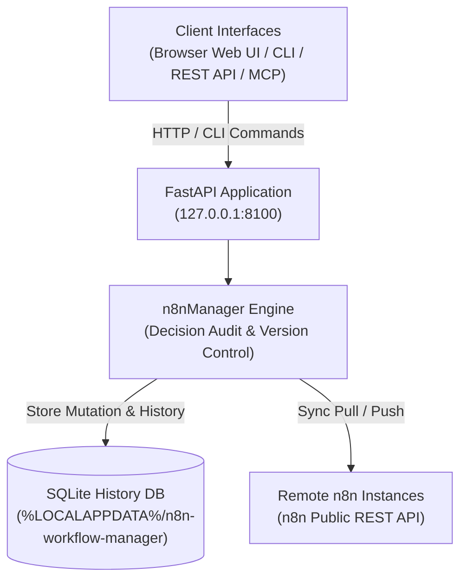
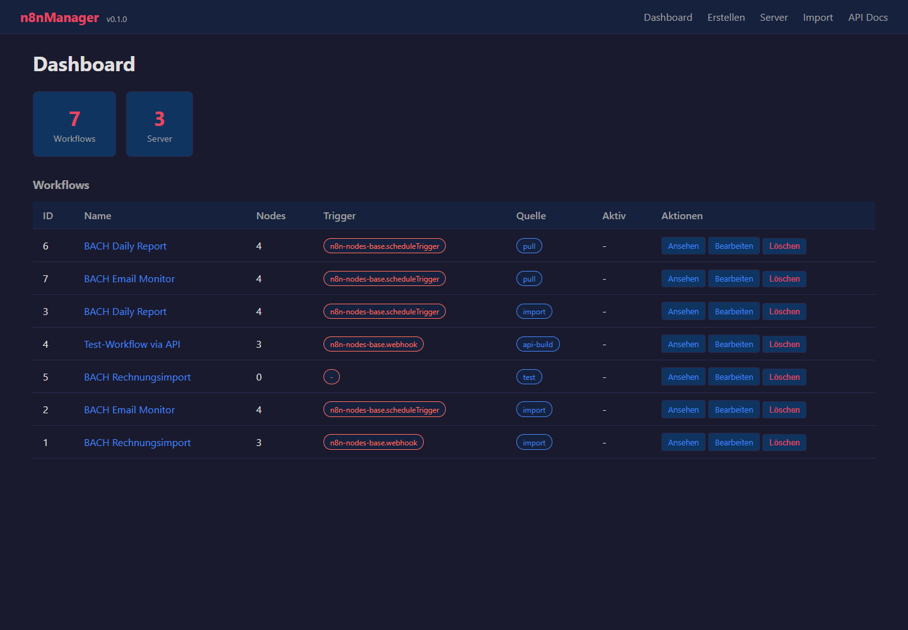
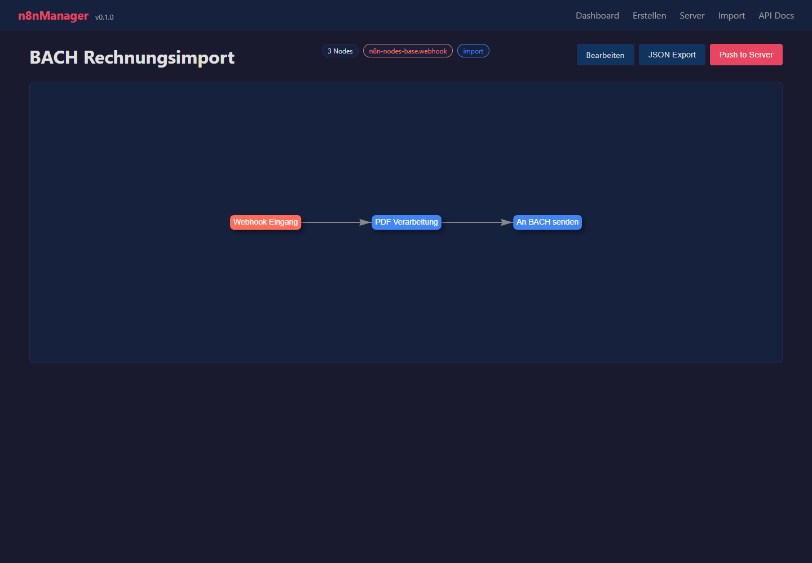

# n8n Workflow Manager

**[English](README.md)** · **[Versión en alemán](README_de.md)** · **Español**

> Revisión local de flujos de trabajo, inspección visual, edición con decisiones registradas, historial y sincronización entre varios servidores de n8n.

> [!IMPORTANT]
> Proyecto comunitario independiente. No está afiliado a n8n GmbH ni cuenta con su respaldo o patrocinio. «n8n» es una marca de su respectivo titular y aquí se utiliza únicamente para describir el software con el que esta herramienta interactúa.

[](https://www.python.org/downloads/)
[](pyproject.toml)
[](LICENSE)
[](tests)
[](https://fastapi.tiangolo.com/)
[](https://github.com/astral-sh/ruff)
[](#what-it-does)
[](SECURITY.md)
[](SECURITY.md)
[](https://github.com/ellmos-ai)
[](https://github.com/open-bricks)
[](llms.txt)

> [!NOTE]
> **Contexto para agentes de IA y LLM**: La especificación legible por máquinas y las frases de búsqueda para RAG están indexadas en [`llms.txt`](llms.txt). Se integra con [`n8n-manager-mcp`](https://github.com/ellmos-ai/n8n-manager-mcp) para que los agentes de IA operen flujos de trabajo con seguimiento de decisiones. Las modificaciones registran una justificación no vacía, pero esto no constituye una aprobación humana: algunas rutas de creación, build, importación, plantilla y pull aplican valores predeterminados; update, rollback, delete y push exigen un valor no vacío del cliente.

## Navegación

- [Arquitectura del sistema](#system-architecture)
- [Ciclo de vida del flujo de trabajo](#workflow-lifecycle)
- [Gobernanza e invariantes de ejecución](#governance-and-runtime-invariants)
- [Interfaz visual y capturas de pantalla](#visual-interface-and-screenshots)
- [Perfiles del público objetivo y SEO](#target-personas-and-seo)
- [Comparación de arquitectura y funciones](#comparison-matrix)
- [Funciones](#what-it-does)
- [Instalación y puesta en marcha](#install-and-start)
- [Ejemplos de CLI](#cli-examples)
- [API de creación](#builder-api)
- [Configuración y datos](#configuration-and-data)
- [Docker](#docker)
- [Configuración de n8n remoto](#remote-n8n-setup)
- [Integración de Manager y MCP](#manager-plus-mcp-pairing)
- [Ecosistema relacionado](#sibling-ecosystem)
- [Verificación](#verification)
- [Licencia](#license)

---

<a id="system-architecture"></a>
## Arquitectura del sistema




---

<a id="workflow-lifecycle"></a>
## Ciclo de vida del flujo de trabajo

La secuencia separa la reversión local de la sincronización remota. Una reversión restaura una versión de SQLite conservada y registra la decisión indicada. Solo modifica la base de datos local; para enviar ese estado a n8n hace falta un push independiente.

```mermaid
sequenceDiagram
    autonumber
    actor User as "Operator / AI Agent (MCP)"
    participant API as "FastAPI Application (127.0.0.1:8100)"
    participant SQLite as "Local SQLite History DB"
    participant n8n as "Configured Remote n8n API"

    Note over User,SQLite: "1. Local Rollback (No Remote Call)"
    User->>API: "POST /api/workflows/{workflow_id}/rollback/{version_number} (Decision)"
    API->>SQLite: "Read retained target version"
    SQLite-->>API: "Stored workflow JSON"
    API->>SQLite: "Update local workflow; record version and decision"
    SQLite-->>API: "Local transaction committed"
    API-->>User: "Rollback response (message, history URL)"
    Note over User,n8n: "Remote n8n remains unchanged after rollback"
    Note over User,n8n: "2. Separate Explicit Push (Optional)"
    User->>API: "POST /api/export/{workflow_id}/to-server?decision=...&server_id=..."
    API->>SQLite: "Read local workflow and remote binding"
    SQLite-->>API: "Workflow JSON and binding (if any)"
    API->>n8n: "Create or update via n8n REST API"
    n8n-->>API: "Remote result (success or error)"
    API->>SQLite: "Record sync result; update binding on success"
    API-->>User: "Push response"
```

---

<a id="governance-and-runtime-invariants"></a>
## Gobernanza e invariantes de ejecución

| N.º | Función / política | Comportamiento del proyecto | Límite |
|---|---|---|---|
| 1 | **Predeterminado local-first** | El servicio se vincula a 127.0.0.1 de forma predeterminada. | Las conexiones configuradas con n8n usan REST; la configuración remota usa SSH. Esto no garantiza ausencia de tráfico saliente. |
| 2 | **Registro de decisiones** | Las modificaciones de flujos registran una justificación no vacía. | Creación, build, importación, plantilla y pull pueden aplicar valores predeterminados; update, rollback, delete y push exigen un valor del cliente. La justificación registra intención, no aprobación humana. |
| 3 | **Historial SQLite** | Las versiones de flujos y las filas de decisiones se guardan en SQLite. | Son registros locales normales, no inmutables ni a prueba de manipulaciones. Al borrar un flujo también se eliminan sus versiones. |
| 4 | **Reversión** | Una versión conservada puede restaurarse en el registro local del flujo. | La reversión no cambia el flujo remoto de n8n. Push es aparte; el historial no garantiza recuperación ante desastres. |
| 5 | **Sincronización con n8n** | Pull y push por servidor usan la API REST de n8n. | Se necesita un servidor configurado y acceso de red; el push es explícito. |
| 6 | **Recursos de inspección visual** | La biblioteca de navegador vis-network está incluida localmente. | Así se evita una petición a CDN para esa biblioteca; la sincronización remota sigue necesitando red. |
| 7 | **Gestión de claves API** | Las claves n8n registradas se guardan en datos locales del usuario y se ocultan en respuestas de API/UI. | Las claves se guardan sin cifrar; protege el directorio de datos del usuario como indica SECURITY.md. |
| 8 | **Interfaces** | El proyecto ofrece interfaz web, API REST y CLI; el complemento MCP se mantiene por separado. | El complemento usa la API de este proyecto y no cambia el comportamiento local/remoto descrito. |
| 9 | **Privilegios** | La aplicación y la imagen Docker están diseñadas para ejecutarse sin privilegios elevados. | Esto describe la configuración de ejecución documentada. |
| 10 | **Política de respuesta de seguridad** | SECURITY.md se compromete a responder inicialmente en 48 horas y a hacer la clasificación en cinco días laborables. | Compromiso de política, no garantía de ejecución ni promesa de publicar un parche en 48 horas. |

---

<a id="visual-interface-and-screenshots"></a>
<a id="screenshots"></a>
## Interfaz visual y capturas de pantalla

La interfaz web permite inspeccionar flujos de trabajo, visualizar las dependencias entre nodos y consultar el historial sin salir del entorno local:

| Panel y resumen de flujos | Visor de grafos e inspector en directo |
|:---:|:---:|
|  |  |
| *Catálogo de flujos, enlaces de servidores, número de revisiones y acciones rápidas* | *Grafo interactivo de vis.js, parámetros de nodos, credenciales y conexiones* |

---

<a id="target-personas-and-seo"></a>
## Perfiles del público objetivo y SEO

n8n Workflow Manager está dirigido a equipos técnicos, operadores y agentes de IA que necesitan revisar, documentar, editar y sincronizar flujos de n8n con un historial local de versiones y decisiones:

- **`[PERSONA-01]` Ingenieros de automatización de flujos y administradores de sistemas**: Operadores de instancias n8n en preproducción, pruebas y producción que necesitan revisar flujos locales, inspeccionarlos visualmente y sincronizarlos por servidor.
- **`[PERSONA-02]` Arquitectos de frameworks de agentes de IA e integradores de MCP**: Equipos que integran LLM mediante n8n-manager-mcp para crear o modificar flujos. El administrador registra una justificación; algunas rutas usan valores predeterminados, y una justificación no equivale a una aprobación humana.
- **`[PERSONA-03]` Responsables de seguridad y cumplimiento**: Equipos que necesitan historial local de versiones y decisiones en SQLite, claves API ocultas en las respuestas, recursos del frontend incluidos localmente y ejecución sin privilegios elevados. El historial SQLite no es inmutable ni a prueba de manipulaciones.
- **`[PERSONA-04]` Ingenieros de DevOps y fiabilidad del sitio (SRE)**: Equipos que utilizan la API REST, la sincronización por servidor y la reversión local desde versiones conservadas. Mantén copias de seguridad independientes para la recuperación ante desastres; el historial de flujos no garantiza copias de seguridad.

#### Visibilidad en búsquedas y palabras clave de alta intención
- `gestor local de flujos de n8n`, `visor de grafos de n8n`, `sincronización de n8n entre varios servidores`, `automatización de flujos con decisiones registradas`, `complemento n8n-manager-mcp`, `reversión local de flujos de n8n`, `editor de n8n con vis.js`, `controlador de n8n con FastAPI`, `exportación sin conexión de documentación de n8n`

---

<a id="comparison-matrix"></a>
## Comparación de arquitectura y funciones

Capacidades y límites del proyecto. Esta tabla no hace afirmaciones comparativas no verificadas sobre otros productos.

| N.º | Función / política | Comportamiento del proyecto | Límite |
|---|---|---|---|
| 1 | **Predeterminado local-first** | El servicio se vincula a 127.0.0.1 de forma predeterminada. | Las conexiones configuradas con n8n usan REST; la configuración remota usa SSH. Esto no garantiza ausencia de tráfico saliente. |
| 2 | **Registro de decisiones** | Las modificaciones de flujos registran una justificación no vacía. | Creación, build, importación, plantilla y pull pueden aplicar valores predeterminados; update, rollback, delete y push exigen un valor del cliente. La justificación registra intención, no aprobación humana. |
| 3 | **Historial SQLite** | Las versiones de flujos y las filas de decisiones se guardan en SQLite. | Son registros locales normales, no inmutables ni a prueba de manipulaciones. Al borrar un flujo también se eliminan sus versiones. |
| 4 | **Reversión** | Una versión conservada puede restaurarse en el registro local del flujo. | La reversión no cambia el flujo remoto de n8n. Push es aparte; el historial no garantiza recuperación ante desastres. |
| 5 | **Sincronización con n8n** | Pull y push por servidor usan la API REST de n8n. | Se necesita un servidor configurado y acceso de red; el push es explícito. |
| 6 | **Recursos de inspección visual** | La biblioteca de navegador vis-network está incluida localmente. | Así se evita una petición a CDN para esa biblioteca; la sincronización remota sigue necesitando red. |
| 7 | **Gestión de claves API** | Las claves n8n registradas se guardan en datos locales del usuario y se ocultan en respuestas de API/UI. | Las claves se guardan sin cifrar; protege el directorio de datos del usuario como indica SECURITY.md. |
| 8 | **Interfaces** | El proyecto ofrece interfaz web, API REST y CLI; el complemento MCP se mantiene por separado. | El complemento usa la API de este proyecto y no cambia el comportamiento local/remoto descrito. |
| 9 | **Privilegios** | La aplicación y la imagen Docker están diseñadas para ejecutarse sin privilegios elevados. | Esto describe la configuración de ejecución documentada. |
| 10 | **Política de respuesta de seguridad** | SECURITY.md se compromete a responder inicialmente en 48 horas y a hacer la clasificación en cinco días laborables. | Compromiso de política, no garantía de ejecución ni promesa de publicar un parche en 48 horas. |

---

<a id="what-it-does"></a>
## Funciones

- Visor de grafos y editor web de trabajo para los JSON de flujos de n8n.
- Historial de versiones SQLite y justificaciones registradas para las modificaciones; algunas rutas de creación e importación usan valores predeterminados.
- Reversión local mediante la API REST o la CLI; hace falta un push independiente para actualizar n8n remoto.
- Enlaces de sincronización por flujo y servidor mediante la API pública de n8n y paginación por cursor.
- Exportación a JSON y Markdown, importaciones validadas y plantillas genéricas incluidas.
- API REST con FastAPI, interfaz Swagger y CLI de terminal.

La aplicación funciona en local: de forma predeterminada se vincula a `127.0.0.1` y guarda la configuración y los datos de ejecución en directorios del usuario, no en el paquete instalado ni en el árbol de código fuente.

La vinculación del administrador a loopback no impide conexiones salientes al servidor n8n o al host SSH configurados.

### Inicio rápido por caso de uso

| Objetivo / necesidad | Herramienta o interfaz recomendada | Comando / flujo |
|---|---|---|
| **Inspeccionar y visualizar flujos locales** | Panel web y visor de grafos de vis.js | `n8n-manager serve` y después abre `http://127.0.0.1:8100` |
| **Documentar flujos para entregarlos a otra persona** | Motor de exportación Markdown / JSON | `n8n-manager export <id> --format md` |
| **Sincronizar varios servidores (preproducción a producción)** | Registro de servidores y motor Pull/Push | `n8n-manager push <id> --decision "Deploy reviewed changes"` |
| **Crear flujos de trabajo con un agente de IA** | API REST del creador y servidor MCP | `POST /api/workflows/build` mediante `n8n-manager-mcp` |
| **Restaurar una versión local conservada** | Historial local del flujo y reversión | `n8n-manager rollback <id> <target-version> --decision "Revert defect"` (n8n remoto no cambia; ejecuta push por separado si hace falta) |
| **Desplegar n8n remoto sin configuración manual** | Comando de configuración automática por SSH | `n8n-manager setup --host <server> --user <deploy>` |

---

<a id="install-and-start"></a>
## Instalar e iniciar

```bash
pip install git+https://github.com/ellmos-ai/n8n-workflow-manager.git
n8n-manager serve
```


Abre <http://127.0.0.1:8100>. La documentación interactiva de la API está en
<http://127.0.0.1:8100/docs>.

Para desarrollo:

```bash
git clone https://github.com/ellmos-ai/n8n-workflow-manager.git
cd n8n-workflow-manager
python -m pip install -e ".[dev]"
python -m pytest -q
```


---

<a id="cli-examples"></a>
## Ejemplos de CLI

> [!WARNING]
> push envía el flujo local al servidor n8n configurado. rollback solo cambia
> la base de datos local. delete elimina el flujo local, su historial de versiones
> y los enlaces locales con servidores; no envía una solicitud de borrado a n8n.
> Para enviar a n8n un estado restaurado localmente, ejecuta un push por separado.
> Antes de enviar a producción, comprueba el servidor predeterminado con
> n8n-manager status. Las claves API registradas con servers --add se guardan
> sin cifrar en el directorio de datos del usuario; protégelo como una clave SSH.
> Consulta [SECURITY.md](SECURITY.md).

Las rutas de creación, build, importación, plantilla y pull pueden guardar una decisión no vacía predeterminada. Update, rollback, delete y push exigen una decisión no vacía del cliente. La decisión registra la intención declarada; no acredita aprobación humana.

```bash
n8n-manager import workflow.json --decision "Import reviewed customer workflow"
n8n-manager list
n8n-manager history 1
n8n-manager export 1 --format md

n8n-manager servers --add production https://n8n.example.com YOUR_API_KEY --default
n8n-manager push 1 --decision "Deploy reviewed version"
n8n-manager pull
n8n-manager rollback 1 2 --decision "Restore last known-good version"

n8n-manager status                       # effective paths, database and server state
n8n-manager config --show                # inspect the resolved configuration
n8n-manager config --set db_path ./my.db # change a single setting
```


La verificación TLS está activada de forma predeterminada. `--no-verify-tls` está disponible para entornos locales controlados con certificados autofirmados; no lo uses en redes no confiables.

---

<a id="builder-api"></a>
## API de creación

```bash
curl -X POST http://127.0.0.1:8100/api/workflows/build \
  -H "Content-Type: application/json" \
  -d '{
    "name": "Webhook forwarder",
    "decision": "Create a reviewed draft",
    "nodes": [
      {"type": "n8n-nodes-base.webhook", "name": "Trigger", "parameters": {"path": "hook"}},
      {"type": "n8n-nodes-base.httpRequest", "name": "Forward", "parameters": {"url": "https://api.example.com"}}
    ],
    "connections": [{"from_node": "Trigger", "to_node": "Forward"}]
  }'
```


Consulta [API_REFERENCE.md](docs/API_REFERENCE.md) para conocer los contratos de modificación e historial.

---

<a id="configuration-and-data"></a>
## Configuración y datos

`n8n-manager status` muestra las rutas efectivas. Los valores relativos de `db_path` se resuelven dentro del directorio de datos del usuario.

| Plataforma | Configuración | Datos de ejecución |
|---|---|---|
| Windows | `%APPDATA%\n8n-workflow-manager` | `%LOCALAPPDATA%\n8n-workflow-manager` |
| macOS | `~/Library/Application Support/n8n-workflow-manager` | El mismo directorio |
| Linux | `${XDG_CONFIG_HOME:-~/.config}/n8n-workflow-manager` | `${XDG_DATA_HOME:-~/.local/share}/n8n-workflow-manager` |

Sobrescrituras: `N8N_MANAGER_CONFIG`, `N8N_MANAGER_CONFIG_DIR` y
`N8N_MANAGER_DATA_DIR`. Empieza con [config.example.json](config.example.json).
El valor predeterminado de `trusted_hosts` solo acepta encabezados Host de loopback; si utilizas un proxy inverso autenticado, añade explícitamente el nombre de host público que hayas revisado.

---

<a id="docker"></a>
## Docker

```bash
docker compose up --build -d
```


El puerto de Compose está vinculado a `127.0.0.1:8100`, y el estado se monta bajo
`runtime/`. La imagen se ejecuta con un usuario sin privilegios.

---

<a id="remote-n8n-setup"></a>
## Configuración de n8n remoto

El comando de configuración presupone que Docker ya está instalado de acuerdo con la política del sistema operativo del host remoto. Instala una imagen oficial de n8n fijada en un puerto limitado a loopback; no ejecuta un instalador remoto de `curl | sh`.

```bash
n8n-manager setup --host your-server --user deploy --ssh-key ~/.ssh/id_ed25519
# Follow the printed ssh -L ... tunnel command, then open http://127.0.0.1:5678
```


SSH usa el modo por lotes y `StrictHostKeyChecking=accept-new`. Para ofrecer un servicio público, utiliza un proxy inverso TLS autenticado. No expongas directamente a Internet ni n8nManager ni la instancia de n8n generada.

---

<a id="manager-plus-mcp-pairing"></a>
## Integración de Manager y MCP

`n8n-workflow-manager` y
[n8n-manager-mcp](https://github.com/ellmos-ai/n8n-manager-mcp) están diseñados para funcionar juntos: el servidor MCP es la capa de acciones de IA, mientras que este proyecto proporciona a las personas una capa de estado e historial con revisión visual, decisiones por flujo, versiones y reversión. Antes de una modificación, el cliente puede leer el historial en `/api/workflows/{id}/history`. Algunas rutas proporcionan una justificación predeterminada; update, rollback, delete y push exigen una decisión no vacía. El registro expresa la intención y no acredita aprobación humana.

El registro de decisiones autoritativo reside aquí y no depende del cliente, por lo que la misma pista de revisión puede cubrir el servidor MCP, `curl`, la CLI o la interfaz web.

Si ejecutas n8n como parte de un stack autohospedado y no de forma independiente,
[ellmos-stack](https://github.com/ellmos-ai/ellmos-stack) inicia n8n junto con Ollama y un índice de documentos mediante Docker Compose; este administrador se conecta a esa instancia como a cualquier otro servidor de n8n.
El contexto conversacional también puede proceder de un índice de historial consultado bajo demanda, como [ctx](https://github.com/ctxrs/ctx) (Apache-2.0).

---

<a id="sibling-ecosystem"></a>
## Ecosistema relacionado

`n8n-workflow-manager` es un componente integral de los ecosistemas de código abierto [ellmos-ai](https://github.com/ellmos-ai) y [open-bricks](https://github.com/open-bricks):

| Repositorio | Propósito | Integración |
|---|---|---|
| [`ellmos-ai/n8n-manager-mcp`](https://github.com/ellmos-ai/n8n-manager-mcp) | Servidor MCP para administrar flujos de n8n | Capa de acciones para agentes de IA autónomos con auditoría de decisiones |
| [`ellmos-ai/ellmos-stack`](https://github.com/ellmos-ai/ellmos-stack) | Stack local de IA y automatización, todo en uno | Ejecuta n8n, Ollama y KnowledgeDigest con Docker Compose |
| [`ellmos-ai/ellmos-homebase-mcp`](https://github.com/ellmos-ai/ellmos-homebase-mcp) | Base de conocimiento central y MCP de memoria | Memoria de agentes entre sesiones y coordinación |
| [`ellmos-ai/ellmos-controlcenter-mcp`](https://github.com/ellmos-ai/ellmos-controlcenter-mcp) | Registro multiagente y orquestación de herramientas | Agrupación dinámica y enrutamiento de herramientas |
| [`dev-bricks/automation-master`](https://github.com/dev-bricks/automation-master) | Supervisión central del estado de automatización y tareas | Orquestación del estado del sistema y watchdog |
| [`ellmos-ai/clirec`](https://github.com/ellmos-ai/clirec) | Grabador determinista de sesiones CLI y motor de reproducción | Auditoría de terminales interactivos y verificación de sesiones |
| [`open-bricks/open-bricks`](https://github.com/open-bricks) | Organización paraguas de código abierto | Estándares compartidos, directrices de seguridad y gobernanza |

---

<a id="verification"></a>
## Verificación

El contrato de publicación está documentado en [RELEASE_GATE.md](RELEASE_GATE.md). Las comprobaciones locales principales son:

```bash
python -m pytest -q
python -m ruff check n8nManager tests
python -m bandit -q -r n8nManager -lll
python -m pip_audit
python -m build
```


---

<a id="license"></a>
## Licencia

MIT; consulta [LICENSE](LICENSE). El uso es bajo tu responsabilidad; no se ofrece garantía ni compromiso de mantenimiento.

Esta licencia cubre el código escrito para este proyecto. El repositorio y las distribuciones compiladas también incluyen la biblioteca de navegador **vis-network** (con doble licencia Apache-2.0 o MIT; aquí se utiliza bajo la opción MIT), que conserva sus propios titulares de derechos de autor. Avisos completos: [THIRD_PARTY_LICENSES.md](THIRD_PARTY_LICENSES.md).
