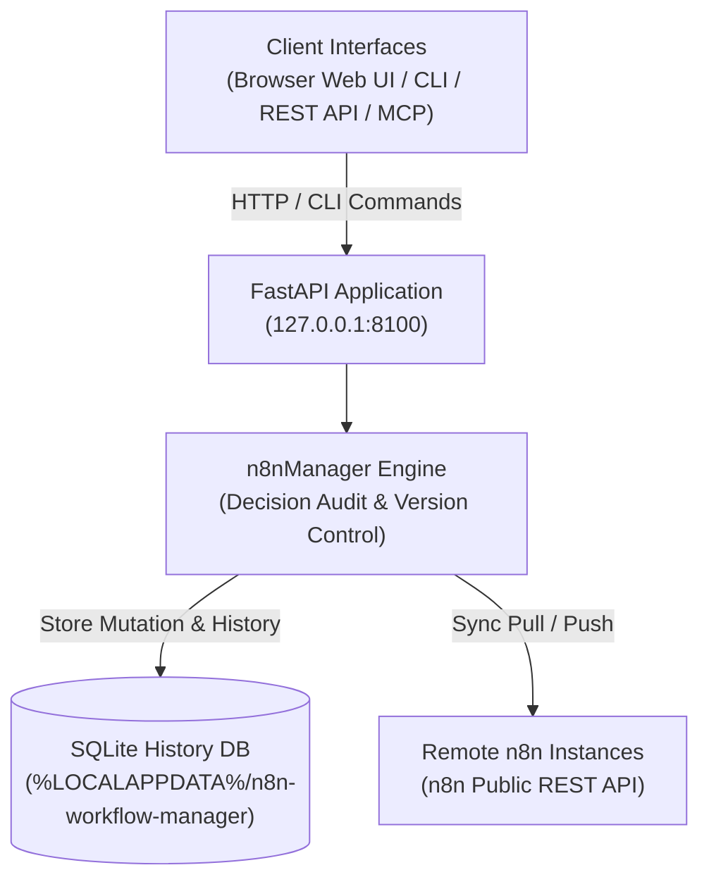
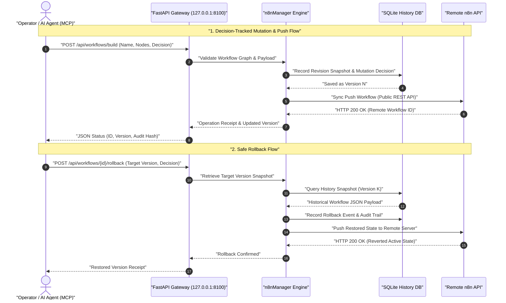

# n8n Workflow Manager

**[English](README.md)** · **[Versión en alemán](README_de.md)** · **Español**

> Revisión local de flujos de trabajo, inspección visual, edición con decisiones registradas, historial y sincronización entre varios servidores de n8n.

> [!IMPORTANT]
> Proyecto comunitario independiente. No está afiliado a n8n GmbH ni cuenta con su respaldo o patrocinio. «n8n» es una marca de su respectivo titular y aquí se utiliza únicamente para describir el software con el que esta herramienta interactúa.

[](https://www.python.org/downloads/)
[](pyproject.toml)
[](LICENSE)
[](tests)
[](https://fastapi.tiangolo.com/)
[](https://github.com/astral-sh/ruff)
[](#what-it-does)
[](SECURITY.md)
[](SECURITY.md)
[](https://github.com/ellmos-ai)
[](https://github.com/open-bricks)
[](llms.txt)

> [!NOTE]
> **Contexto para agentes de IA y LLM**: La especificación legible por máquinas y las frases de búsqueda para RAG están indexadas en [`llms.txt`](llms.txt). Se integra con [`n8n-manager-mcp`](https://github.com/ellmos-ai/n8n-manager-mcp) para que los agentes de IA operen flujos de trabajo con seguimiento de decisiones. Todas las operaciones que modifican datos requieren un parámetro explícito `--decision` o `decision` para mantener la auditabilidad.

## Navegación

- [Arquitectura del sistema](#system-architecture)
- [Ciclo de vida del flujo de trabajo](#workflow-lifecycle)
- [Gobernanza e invariantes de ejecución](#governance-and-runtime-invariants)
- [Interfaz visual y capturas de pantalla](#visual-interface-and-screenshots)
- [Perfiles del público objetivo y SEO](#target-personas-and-seo)
- [Comparación de arquitectura y funciones](#comparison-matrix)
- [Funciones](#what-it-does)
- [Instalación y puesta en marcha](#install-and-start)
- [Ejemplos de CLI](#cli-examples)
- [API de creación](#builder-api)
- [Configuración y datos](#configuration-and-data)
- [Docker](#docker)
- [Configuración de n8n remoto](#remote-n8n-setup)
- [Integración de Manager y MCP](#manager-plus-mcp-pairing)
- [Ecosistema relacionado](#sibling-ecosystem)
- [Verificación](#verification)
- [Licencia](#license)

---

<a id="system-architecture"></a>
## Arquitectura del sistema




---

<a id="workflow-lifecycle"></a>
## Ciclo de vida del flujo de trabajo

La siguiente secuencia muestra cómo las operaciones (por ejemplo, crear o modificar un flujo de trabajo) requieren una decisión de auditoría explícita, guardan instantáneas inmutables en SQLite, se sincronizan con servidores n8n remotos y permiten una reversión determinista.




---

<a id="governance-and-runtime-invariants"></a>
## Gobernanza e invariantes de ejecución

| N.º | Invariante | Descripción | Mecanismo de aplicación |
|---|---|---|---|
| 1 | **100 % local y sin salida de datos** | Funciona íntegramente en loopback `127.0.0.1`, sin analítica externa ni envío de datos a terceros. | Vinculación del host FastAPI y conjunto de pruebas |
| 2 | **Auditoría obligatoria de decisiones** | Toda modificación (`import`, `build`, `push`, `rollback`, `delete`) requiere una justificación explícita. | Comprobación CLI `--decision` y validación REST |
| 3 | **Registro de eventos e instantáneas en SQLite** | Las instantáneas JSON completas de los flujos se versionan de forma inmutable en SQLite. | Esquema `n8nManager.core.database` |
| 4 | **Seguridad de reversión determinista** | Cualquier versión anterior de un flujo puede inspeccionarse y restaurarse sin perder datos. | `/api/workflows/{id}/rollback` y CLI `rollback` |
| 5 | **Sin elevación (RunAsInvoker)** | Nunca requiere privilegios de administrador o de root. | Ejecución en espacio de usuario y usuario de Docker sin privilegios |
| 6 | **Compatibilidad de rutas multiplataforma** | Respeta los directorios nativos de configuración y datos en Windows, macOS y Linux. | Resolución de rutas mediante Platformdirs |
| 7 | **Redacción y protección de claves API** | Los tokens sensibles de la API de n8n se ocultan en las respuestas de la interfaz y la REST, y solo se guardan en los datos locales del usuario. | Enmascaramiento durante la serialización |
| 8 | **Recursos integrados para uso sin conexión** | Las dependencias del frontend (vis-network 10.1.0) están fijadas e incluidas para permitir un funcionamiento completamente sin conexión. | Recursos estáticos integrados con hashes SRI |
| 9 | **Interoperabilidad con agentes y MCP** | Integración fluida con `n8n-manager-mcp` para modificar flujos de n8n mediante agentes de IA con auditoría humana. | Contratos REST JSON estándar y `llms.txt` |
| 10 | **SLA de seguridad de 48 horas** | Compromiso de divulgación coordinada de vulnerabilidades y aplicación rápida de parches entre ellmos-ai y open-bricks. | Compromiso de política en [SECURITY.md](SECURITY.md) |

---

<a id="visual-interface-and-screenshots"></a>
<a id="screenshots"></a>
## Interfaz visual y capturas de pantalla

La interfaz web permite inspeccionar flujos de trabajo, visualizar las dependencias entre nodos y consultar el historial sin salir del entorno local:

| Panel y resumen de flujos | Visor de grafos e inspector en directo |
|:---:|:---:|
|  |  |
| *Catálogo de flujos, enlaces de servidores, número de revisiones y acciones rápidas* | *Grafo interactivo de vis.js, parámetros de nodos, credenciales y conexiones* |

---

<a id="target-personas-and-seo"></a>
## Perfiles del público objetivo y SEO

n8n Workflow Manager está diseñado para equipos técnicos, operadores y agentes de IA que necesitan una gobernanza estricta de sus flujos de automatización:

- **`[PERSONA-01]` Ingenieros de automatización de flujos de trabajo y administradores de sistemas**: Operadores que gestionan instancias n8n complejas y de varias etapas en entornos de preproducción, pruebas y producción, y necesitan sincronización entre servidores, comparación visual de grafos y ausencia de salida de datos.
- **`[PERSONA-02]` Arquitectos de frameworks de agentes de IA e integradores de MCP**: Equipos que integran LLM (mediante `n8n-manager-mcp`) para crear o modificar flujos de forma autónoma, con justificaciones de decisión obligatorias y supervisión humana (`--decision`).
- **`[PERSONA-03]` Responsables de seguridad y cumplimiento**: Equipos de seguridad que necesitan registros de auditoría inmutables en SQLite, redacción de credenciales sensibles, recursos de frontend integrados para uso sin conexión y cumplimiento estricto de la no elevación (`RunAsInvoker`).
- **`[PERSONA-04]` Ingenieros de DevOps y fiabilidad del sitio (SRE)**: Equipos de infraestructura que despliegan imágenes de contenedor fijadas (`docker-compose.yml`), copias de seguridad automatizadas, API REST con paginación por cursor y reversión determinista inmediata.

#### Visibilidad en búsquedas y palabras clave de alta intención
- `gestor local de flujos de n8n`, `visor de grafos de n8n`, `sincronización de n8n entre varios servidores`, `automatización de flujos con decisiones registradas`, `complemento n8n-manager-mcp`, `reversión local de flujos de n8n`, `editor de n8n con vis.js`, `controlador de n8n con FastAPI`, `exportación sin conexión de documentación de n8n`.

---

<a id="comparison-matrix"></a>
## Comparación de arquitectura y funciones

Comparación de `n8n-workflow-manager` con las alternativas habituales de despliegue y administración en varias dimensiones operativas:

| Dimensión / capacidad | Interfaz web nativa de n8n | Commits JSON sin procesar en Git | Herramientas REST genéricas (Postman) | n8n Workflow Manager |
|:---|:---:|:---:|:---:|:---:|
| **1. Ejecución local (`127.0.0.1`)** | Depende del servidor | No aplica | Local | **Sí (loopback predeterminado)** |
| **2. Justificación obligatoria de decisiones** | No | Mensaje de commit opcional | No | **Obligatoria (`--decision`)** |
| **3. Registro inmutable de revisiones SQLite** | Solo base de datos interna | Solo historial de Git | No | **Instantáneas JSON dedicadas** |
| **4. Visor visual de grafos (vis.js sin conexión)** | Navegador en línea | No | No | **Sí (integrado para uso sin conexión)** |
| **5. Reversión determinista con un solo clic** | Importación manual de JSON | `git checkout` | Carga manual | **Sí (CLI / API REST)** |
| **6. Sincronización multiservidor y paginación por cursor** | Solo Enterprise Cloud | Manual | Script manual | **Integrada (Pull/Push)** |
| **7. Integración nativa con agentes de IA (protocolo MCP)** | No | No | No | **Sí (`n8n-manager-mcp`)** |
| **8. Seguridad sin elevación (`RunAsInvoker`)** | Contexto del servidor | No aplica | Espacio de usuario | **Aplicada (`RunAsInvoker`)** |
| **9. Compatibilidad multiplataforma (Windows/macOS/Linux)** | Solo web | CLI | Escritorio | **Resolución nativa completa de rutas** |
| **10. SLA coordinado de seguridad de 48 horas** | SLA del proveedor | Comunidad | No aplica | **Compromiso formal** |

---

<a id="what-it-does"></a>
## Funciones

- Visor de grafos y editor web de trabajo para los JSON de flujos de n8n.
- Historial de versiones con SQLite y auditoría de decisiones para cada modificación.
- Reversión mediante la API REST o la CLI.
- Enlaces de sincronización por flujo y servidor mediante la API pública de n8n y paginación por cursor.
- Exportación a JSON y Markdown, importaciones validadas y plantillas genéricas incluidas.
- API REST con FastAPI, interfaz Swagger y CLI de terminal.

La aplicación funciona en local: de forma predeterminada se vincula a `127.0.0.1` y guarda la configuración y los datos de ejecución en directorios del usuario, no en el paquete instalado ni en el árbol de código fuente.

### Inicio rápido por caso de uso

| Objetivo / necesidad | Herramienta o interfaz recomendada | Comando / flujo |
|---|---|---|
| **Inspeccionar y visualizar flujos locales** | Panel web y visor de grafos de vis.js | `n8n-manager serve` y después abre `http://127.0.0.1:8100` |
| **Documentar flujos para entregarlos a otra persona** | Motor de exportación Markdown / JSON | `n8n-manager export <id> --format md` |
| **Sincronizar varios servidores (preproducción a producción)** | Registro de servidores y motor Pull/Push | `n8n-manager push <id> --decision "Deploy reviewed changes"` |
| **Crear flujos de trabajo con un agente de IA** | API REST del creador y servidor MCP | `POST /api/workflows/build` mediante `n8n-manager-mcp` |
| **Recuperación inmediata ante desastres / reversión** | Instantáneas SQLite y reversión REST | `n8n-manager rollback <id> <target-version> --decision "Revert defect"` |
| **Desplegar n8n remoto sin configuración manual** | Comando de configuración automática por SSH | `n8n-manager setup --host <server> --user <deploy>` |

---

<a id="install-and-start"></a>
## Instalar e iniciar

```bash
pip install git+https://github.com/ellmos-ai/n8n-workflow-manager.git
n8n-manager serve
```


Abre <http://127.0.0.1:8100>. La documentación interactiva de la API está en
<http://127.0.0.1:8100/docs>.

Para desarrollo:

```bash
git clone https://github.com/ellmos-ai/n8n-workflow-manager.git
cd n8n-workflow-manager
python -m pip install -e ".[dev]"
python -m pytest -q
```


---

<a id="cli-examples"></a>
## Ejemplos de CLI

> [!WARNING]
> `push`, `rollback` y `delete` cambian o eliminan flujos de trabajo **en el servidor n8n conectado**, no solo en la base de datos local. Antes de apuntarlos a una instancia de producción, comprueba qué servidor es el predeterminado (`n8n-manager status`). Las claves API que registres con `servers --add` se guardan **sin cifrar** en el directorio de datos del usuario; protege ese directorio igual que protegerías una clave SSH. Consulta [SECURITY.md](SECURITY.md).

Las modificaciones que pueden sustituir o eliminar el estado requieren una decisión breve. Esta se guarda junto con el historial del flujo.

```bash
n8n-manager import workflow.json --decision "Import reviewed customer workflow"
n8n-manager list
n8n-manager history 1
n8n-manager export 1 --format md

n8n-manager servers --add production https://n8n.example.com YOUR_API_KEY --default
n8n-manager push 1 --decision "Deploy reviewed version"
n8n-manager pull
n8n-manager rollback 1 2 --decision "Restore last known-good version"

n8n-manager status                       # effective paths, database and server state
n8n-manager config --show                # inspect the resolved configuration
n8n-manager config --set db_path ./my.db # change a single setting
```


La verificación TLS está activada de forma predeterminada. `--no-verify-tls` está disponible para entornos locales controlados con certificados autofirmados; no lo uses en redes no confiables.

---

<a id="builder-api"></a>
## API de creación

```bash
curl -X POST http://127.0.0.1:8100/api/workflows/build \
  -H "Content-Type: application/json" \
  -d '{
    "name": "Webhook forwarder",
    "decision": "Create a reviewed draft",
    "nodes": [
      {"type": "n8n-nodes-base.webhook", "name": "Trigger", "parameters": {"path": "hook"}},
      {"type": "n8n-nodes-base.httpRequest", "name": "Forward", "parameters": {"url": "https://api.example.com"}}
    ],
    "connections": [{"from_node": "Trigger", "to_node": "Forward"}]
  }'
```


Consulta [API_REFERENCE.md](docs/API_REFERENCE.md) para conocer los contratos de modificación e historial.

---

<a id="configuration-and-data"></a>
## Configuración y datos

`n8n-manager status` muestra las rutas efectivas. Los valores relativos de `db_path` se resuelven dentro del directorio de datos del usuario.

| Plataforma | Configuración | Datos de ejecución |
|---|---|---|
| Windows | `%APPDATA%\n8n-workflow-manager` | `%LOCALAPPDATA%\n8n-workflow-manager` |
| macOS | `~/Library/Application Support/n8n-workflow-manager` | El mismo directorio |
| Linux | `${XDG_CONFIG_HOME:-~/.config}/n8n-workflow-manager` | `${XDG_DATA_HOME:-~/.local/share}/n8n-workflow-manager` |

Sobrescrituras: `N8N_MANAGER_CONFIG`, `N8N_MANAGER_CONFIG_DIR` y
`N8N_MANAGER_DATA_DIR`. Empieza con [config.example.json](config.example.json).
El valor predeterminado de `trusted_hosts` solo acepta encabezados Host de loopback; si utilizas un proxy inverso autenticado, añade explícitamente el nombre de host público que hayas revisado.

---

<a id="docker"></a>
## Docker

```bash
docker compose up --build -d
```


El puerto de Compose está vinculado a `127.0.0.1:8100`, y el estado se monta bajo
`runtime/`. La imagen se ejecuta con un usuario sin privilegios.

---

<a id="remote-n8n-setup"></a>
## Configuración de n8n remoto

El comando de configuración presupone que Docker ya está instalado de acuerdo con la política del sistema operativo del host remoto. Instala una imagen oficial de n8n fijada en un puerto limitado a loopback; no ejecuta un instalador remoto de `curl | sh`.

```bash
n8n-manager setup --host your-server --user deploy --ssh-key ~/.ssh/id_ed25519
# Follow the printed ssh -L ... tunnel command, then open http://127.0.0.1:5678
```


SSH usa el modo por lotes y `StrictHostKeyChecking=accept-new`. Para ofrecer un servicio público, utiliza un proxy inverso TLS autenticado. No expongas directamente a Internet ni n8nManager ni la instancia de n8n generada.

---

<a id="manager-plus-mcp-pairing"></a>
## Integración de Manager y MCP

`n8n-workflow-manager` y
[n8n-manager-mcp](https://github.com/ellmos-ai/n8n-manager-mcp) están diseñados para funcionar juntos: el servidor MCP es la capa de acciones de IA, mientras que este proyecto proporciona a las personas una capa de estado e historial con revisión visual, decisiones por flujo, versiones y reversión. Antes de enviar la decisión obligatoria para una modificación, un cliente puede leer `/api/workflows/{id}/history`.

El registro de decisiones autoritativo reside aquí y no depende del cliente, por lo que la misma pista de revisión puede cubrir el servidor MCP, `curl`, la CLI o la interfaz web.

Si ejecutas n8n como parte de un stack autohospedado y no de forma independiente,
[ellmos-stack](https://github.com/ellmos-ai/ellmos-stack) inicia n8n junto con Ollama y un índice de documentos mediante Docker Compose; este administrador se conecta a esa instancia como a cualquier otro servidor de n8n.
El contexto conversacional también puede proceder de un índice de historial consultado bajo demanda, como [ctx](https://github.com/ctxrs/ctx) (Apache-2.0).

---

<a id="sibling-ecosystem"></a>
## Ecosistema relacionado

`n8n-workflow-manager` es un componente integral de los ecosistemas de código abierto [ellmos-ai](https://github.com/ellmos-ai) y [open-bricks](https://github.com/open-bricks):

| Repositorio | Propósito | Integración |
|---|---|---|
| [`ellmos-ai/n8n-manager-mcp`](https://github.com/ellmos-ai/n8n-manager-mcp) | Servidor MCP para administrar flujos de n8n | Capa de acciones para agentes de IA autónomos con auditoría de decisiones |
| [`ellmos-ai/ellmos-stack`](https://github.com/ellmos-ai/ellmos-stack) | Stack local de IA y automatización, todo en uno | Ejecuta n8n, Ollama y Chroma con Docker Compose |
| [`ellmos-ai/ellmos-homebase-mcp`](https://github.com/ellmos-ai/ellmos-homebase-mcp) | Base de conocimiento central y MCP de memoria | Memoria de agentes entre sesiones y coordinación |
| [`ellmos-ai/ellmos-controlcenter-mcp`](https://github.com/ellmos-ai/ellmos-controlcenter-mcp) | Registro multiagente y orquestación de herramientas | Agrupación dinámica y enrutamiento de herramientas |
| [`dev-bricks/automation-master`](https://github.com/dev-bricks/automation-master) | Supervisión central del estado de automatización y tareas | Orquestación del estado del sistema y watchdog |
| [`ellmos-ai/clirec`](https://github.com/ellmos-ai/clirec) | Grabador determinista de sesiones CLI y motor de reproducción | Auditoría de terminales interactivos y verificación de sesiones |
| [`open-bricks/open-bricks`](https://github.com/open-bricks) | Organización paraguas de código abierto | Estándares compartidos, directrices de seguridad y gobernanza |

---

<a id="verification"></a>
## Verificación

El contrato de publicación está documentado en [RELEASE_GATE.md](RELEASE_GATE.md). Las comprobaciones locales principales son:

```bash
python -m pytest -q
python -m ruff check n8nManager tests
python -m bandit -q -r n8nManager -lll
python -m pip_audit
python -m build
```


---

<a id="license"></a>
## Licencia

MIT; consulta [LICENSE](LICENSE). El uso es bajo tu responsabilidad; no se ofrece garantía ni compromiso de mantenimiento.

Esta licencia cubre el código escrito para este proyecto. El repositorio y las distribuciones compiladas también incluyen la biblioteca de navegador **vis-network** (con doble licencia Apache-2.0 o MIT; aquí se utiliza bajo la opción MIT), que conserva sus propios titulares de derechos de autor. Avisos completos: [THIRD_PARTY_LICENSES.md](THIRD_PARTY_LICENSES.md).
