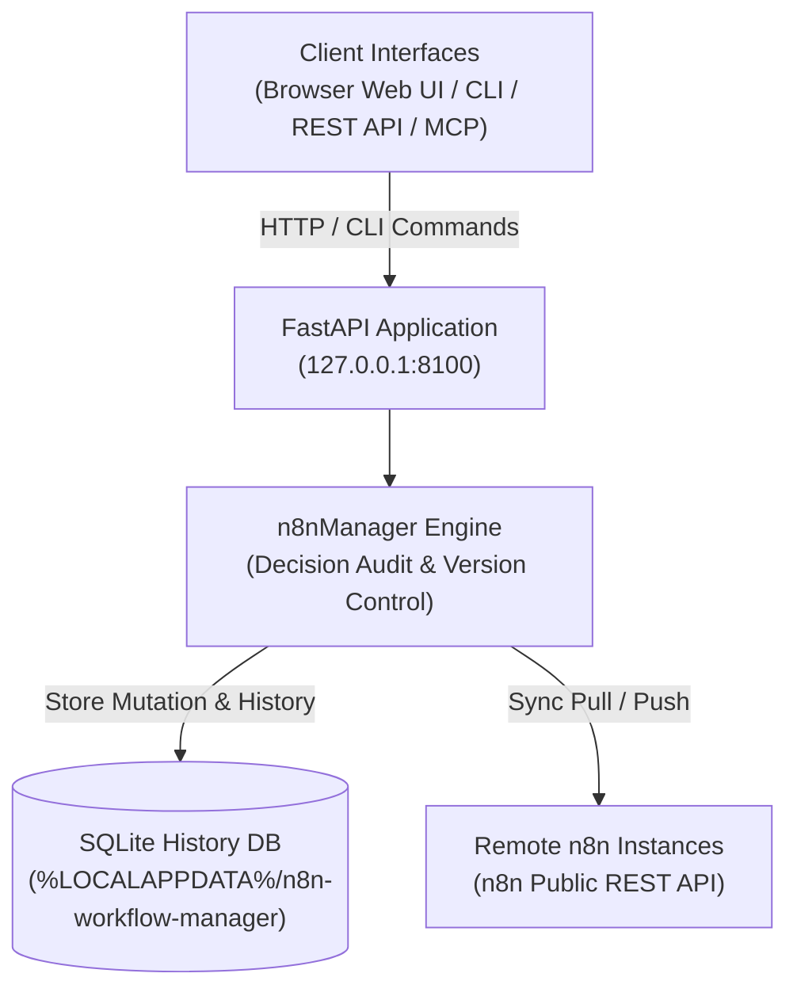

# Gestionnaire de workflows n8n

**[English](README.md) · [Deutsch](README_de.md) · [Español](README_es.md) · [日本語](README_ja.md) · [Русский](README_ru.md) · [Français](README_fr.md) · [简体中文](README_zh.md) · [हिन्दी](README_hi.md)**

> Gestion des workflows n8n en privilégiant le local : revue, inspection visuelle, modifications avec suivi des décisions, historique et synchronisation multi-serveurs.

> [!IMPORTANT]
> Projet communautaire indépendant. Sans affiliation avec n8n GmbH, ni approbation ou parrainage de sa part,
> « n8n » est une marque de son propriétaire respectif, utilisée ici uniquement
> pour désigner le logiciel avec lequel cet outil interagit.

[](https://www.python.org/downloads/)
[](pyproject.toml)
[](LICENSE)
[](tests)
[](https://fastapi.tiangolo.com/)
[](https://github.com/astral-sh/ruff)
[](#what-it-does)
[](SECURITY.md)
[](SECURITY.md)
[](https://github.com/ellmos-ai)
[](https://github.com/open-bricks)
[](llms.txt)

> [!NOTE]
> **Contexte pour les agents IA et les LLM** : la spécification lisible par machine et les expressions de recherche pour le RAG sont indexées dans [`llms.txt`](llms.txt). Ce projet s’associe à [`n8n-manager-mcp`](https://github.com/ellmos-ai/n8n-manager-mcp) pour permettre aux agents IA d’effectuer des opérations autonomes sur les workflows avec suivi des décisions. Les mutations enregistrent un motif de décision non vide, mais cela ne vaut pas approbation humaine : certaines opérations de création, de construction, d’importation, d’utilisation de modèles et de récupération (pull) appliquent une valeur par défaut, tandis que les opérations de mise à jour, de retour arrière (rollback), de suppression et d’envoi (push) exigent une valeur non vide fournie par l’appelant.

## Navigation

- [Architecture du système](#system-architecture)
- [Cycle de vie des workflows](#workflow-lifecycle)
- [Gouvernance et invariants à l’exécution](#governance-and-runtime-invariants)
- [Interface visuelle et captures d’écran](#visual-interface-and-screenshots)
- [Profils du public cible et SEO](#target-personas-and-seo)
- [Comparatif de l’architecture et des fonctionnalités](#comparison-matrix)
- [Fonctionnalités](#what-it-does)
- [Installation et démarrage](#install-and-start)
- [Exemples CLI](#cli-examples)
- [API de création](#builder-api)
- [Configuration et données](#configuration-and-data)
- [Docker](#docker)
- [Configuration d’un serveur n8n distant](#remote-n8n-setup)
- [Association du gestionnaire et du serveur MCP](#manager-plus-mcp-pairing)
- [Écosystème associé](#sibling-ecosystem)
- [Vérification](#verification)
- [Licence](#license)

---

<a id="system-architecture"></a>
## Architecture du système



---

<a id="workflow-lifecycle"></a>
## Cycle de vie des workflows

Cette séquence distingue le retour arrière local de la synchronisation distante. Un retour arrière restaure une version SQLite conservée et enregistre la décision fournie. Il ne modifie que la base de données locale ; une action push distincte est nécessaire pour envoyer cet état au serveur n8n distant.

```mermaid
sequenceDiagram
    autonumber
    actor User as "Operator / AI Agent (MCP)"
    participant API as "FastAPI Application (127.0.0.1:8100)"
    participant SQLite as "Local SQLite History DB"
    participant n8n as "Configured Remote n8n API"

    Note over User,SQLite: "1. Local Rollback (No Remote Call)"
    User->>API: "POST /api/workflows/{workflow_id}/rollback/{version_number} (Decision)"
    API->>SQLite: "Read retained target version"
    SQLite-->>API: "Stored workflow JSON"
    API->>SQLite: "Update local workflow; record version and decision"
    SQLite-->>API: "Local transaction committed"
    API-->>User: "Rollback response (message, history URL)"
    Note over User,n8n: "Remote n8n remains unchanged after rollback"
    Note over User,n8n: "2. Separate Explicit Push (Optional)"
    User->>API: "POST /api/export/{workflow_id}/to-server?decision=...&server_id=..."
    API->>SQLite: "Read local workflow and remote binding"
    SQLite-->>API: "Workflow JSON and binding (if any)"
    API->>n8n: "Create or update via n8n REST API"
    n8n-->>API: "Remote result (success or error)"
    API->>SQLite: "Record sync result; update binding on success"
    API-->>User: "Push response"
```

---

<a id="governance-and-runtime-invariants"></a>
## Gouvernance et invariants à l’exécution

| # | Capacité / règle | Comportement du projet | Limite |
|---|---|---|---|
| 1 | **Priorité au local par défaut** | Le service est lié à 127.0.0.1 par défaut. | Les connexions n8n configurées utilisent REST ; la configuration distante utilise SSH. Cela ne garantit pas l’absence de trafic sortant. |
| 2 | **Enregistrement des décisions** | Les mutations de workflows consignent un motif non vide. | Les opérations de création, de construction, d’importation, d’utilisation de modèles et de récupération (pull) peuvent appliquer une valeur par défaut ; les opérations de mise à jour, de retour arrière (rollback), de suppression et d’envoi (push) exigent une valeur non vide fournie par l’appelant. Un motif consigne une intention, pas une approbation humaine. |
| 3 | **Historique SQLite** | Les versions des workflows et les lignes de décision sont stockées dans SQLite. | Ce sont des enregistrements ordinaires dans une base de données locale, ni immuables ni protégés contre la falsification. La suppression d’un workflow supprime ses versions. |
| 4 | **Retour arrière** | Une version conservée peut être restaurée dans l’enregistrement local du workflow. | Le retour arrière ne modifie pas le serveur n8n distant. Le push est une action distincte ; l’historique ne constitue pas une garantie de reprise après sinistre. |
| 5 | **Synchronisation n8n** | Les opérations pull et push propres à chaque serveur utilisent l’API REST n8n. | Un serveur configuré et un accès réseau sont nécessaires ; le push est une action explicite. |
| 6 | **Ressources d’inspection visuelle** | La bibliothèque vis-network destinée au navigateur est incluse localement. | Son inclusion évite une requête à un CDN pour cette bibliothèque ; la synchronisation distante nécessite toujours un accès réseau. |
| 7 | **Gestion des clés API** | Les clés n8n enregistrées sont conservées dans les données locales de chaque utilisateur et masquées dans les réponses de l’API et de l’interface. | Les clés sont stockées sans chiffrement ; protégez le répertoire de données utilisateur comme indiqué dans SECURITY.md. |
| 8 | **Interfaces** | Le projet fournit une interface Web, une API REST et une CLI ; un compagnon MCP est maintenu séparément. | Le compagnon utilise l’API de ce projet ; il ne modifie pas le comportement local ou distant décrit ci-dessus. |
| 9 | **Modèle de privilèges** | L’application et l’image Docker sont conçues pour fonctionner sans privilèges élevés. | Cela décrit la configuration d’exécution documentée. |
| 10 | **Politique de réponse aux incidents de sécurité** | SECURITY.md s’engage à fournir une première réponse sous 48 heures et à effectuer le triage sous cinq jours ouvrés. | Il s’agit d’un engagement prévu par la politique, pas d’une garantie à l’exécution ni d’une promesse de livrer un correctif sous 48 heures. |

---

<a id="visual-interface-and-screenshots"></a>
<a id="screenshots"></a>
## Interface visuelle et captures d’écran

L’interface Web permet d’inspecter les workflows, de visualiser les dépendances entre les nœuds et de gérer l’historique, sans quitter votre environnement local :

| Tableau de bord et aperçu des workflows | Visualisation du graphe et inspection en direct |
|:---:|:---:|
|  |  |
| *Catalogue des workflows, associations aux serveurs, nombre de révisions et actions rapides* | *Graphe vis.js interactif, paramètres des nœuds, identifiants et connexions* |

---

<a id="target-personas-and-seo"></a>
## Profils du public cible et SEO

n8n Workflow Manager s’adresse aux équipes techniques, aux opérateurs et aux agents IA qui doivent inspecter, documenter, modifier et synchroniser des workflows n8n en conservant localement l’historique des décisions et des versions :

- **`[PERSONA-01]`** Ingénieurs en automatisation des workflows et administrateurs système : opérateurs qui gèrent des instances n8n en préproduction, en test et en production et qui ont besoin d’examiner les workflows localement, de les inspecter visuellement et de les synchroniser par serveur.
- **`[PERSONA-02]`** Architectes de frameworks d’agents IA et intégrateurs MCP : équipes qui intègrent des LLM via n8n-manager-mcp pour créer ou modifier des workflows. Le gestionnaire consigne un motif de décision ; certaines opérations utilisent une valeur par défaut, et ce motif ne vaut pas approbation humaine.
- **`[PERSONA-03]`** Responsables de la sécurité et de la conformité : équipes qui ont besoin d’un historique local des versions de workflows et des décisions dans SQLite, du masquage des clés API dans les réponses, de ressources front-end incluses localement et d’une exécution sans privilèges élevés. L’historique SQLite n’est ni immuable ni protégé contre la falsification.
- **`[PERSONA-04]`** Ingénieurs DevOps et fiabilité des sites (SRE) : équipes qui utilisent l’API REST, la synchronisation par serveur et le retour arrière local vers des versions conservées. Gardez des sauvegardes indépendantes pour la reprise après sinistre ; l’historique des workflows ne garantit pas la sauvegarde.

#### Mots-clés de recherche à forte intention
- `local n8n workflow manager`, `visual n8n graph viewer`, `n8n multi-server sync`, `decision-tracked workflow automation`, `n8n-manager-mcp companion`, `local-first workflow rollback`, `vis.js n8n editor`, `fastapi n8n controller`, `offline n8n documentation export`

---

<a id="comparison-matrix"></a>
## Comparatif de l’architecture et des fonctionnalités

Capacités et limites du projet. Ce tableau ne formule aucune affirmation comparative sur d’autres produits.

| # | Capacité / règle | Comportement du projet | Limite |
|---|---|---|---|
| 1 | **Priorité au local par défaut** | Le service est lié à 127.0.0.1 par défaut. | Les connexions n8n configurées utilisent REST ; la configuration distante utilise SSH. Cela ne garantit pas l’absence de trafic sortant. |
| 2 | **Enregistrement des décisions** | Les mutations de workflows consignent un motif non vide. | Les opérations de création, de construction, d’importation, d’utilisation de modèles et de récupération (pull) peuvent appliquer une valeur par défaut ; les opérations de mise à jour, de retour arrière (rollback), de suppression et d’envoi (push) exigent une valeur non vide fournie par l’appelant. Un motif consigne une intention, pas une approbation humaine. |
| 3 | **Historique SQLite** | Les versions des workflows et les lignes de décision sont stockées dans SQLite. | Ce sont des enregistrements ordinaires dans une base de données locale, ni immuables ni protégés contre la falsification. La suppression d’un workflow supprime ses versions. |
| 4 | **Retour arrière** | Une version conservée peut être restaurée dans l’enregistrement local du workflow. | Le retour arrière ne modifie pas le serveur n8n distant. Le push est une action distincte ; l’historique ne constitue pas une garantie de reprise après sinistre. |
| 5 | **Synchronisation n8n** | Les opérations pull et push propres à chaque serveur utilisent l’API REST n8n. | Un serveur configuré et un accès réseau sont nécessaires ; le push est une action explicite. |
| 6 | **Ressources d’inspection visuelle** | La bibliothèque vis-network destinée au navigateur est incluse localement. | Son inclusion évite une requête à un CDN pour cette bibliothèque ; la synchronisation distante nécessite toujours un accès réseau. |
| 7 | **Gestion des clés API** | Les clés n8n enregistrées sont conservées dans les données locales de chaque utilisateur et masquées dans les réponses de l’API et de l’interface. | Les clés sont stockées sans chiffrement ; protégez le répertoire de données utilisateur comme indiqué dans SECURITY.md. |
| 8 | **Interfaces** | Le projet fournit une interface Web, une API REST et une CLI ; un compagnon MCP est maintenu séparément. | Le compagnon utilise l’API de ce projet ; il ne modifie pas le comportement local ou distant décrit ci-dessus. |
| 9 | **Modèle de privilèges** | L’application et l’image Docker sont conçues pour fonctionner sans privilèges élevés. | Cela décrit la configuration d’exécution documentée. |
| 10 | **Politique de réponse aux incidents de sécurité** | SECURITY.md s’engage à fournir une première réponse sous 48 heures et à effectuer le triage sous cinq jours ouvrés. | Il s’agit d’un engagement prévu par la politique, pas d’une garantie à l’exécution ni d’une promesse de livrer un correctif sous 48 heures. |

---

<a id="what-it-does"></a>
## Fonctionnalités

- Visualiseur de graphes et éditeur Web opérationnel pour les fichiers JSON de workflows n8n.
- Historique des versions dans SQLite et motifs de décision consignés pour les mutations de workflows ; certaines opérations de création et d’importation utilisent une valeur par défaut.
- Retour arrière local via l’API REST ou la CLI ; un push distinct est nécessaire pour mettre à jour le serveur n8n distant.
- Liaisons pull/push par workflow et par serveur, via l’API publique n8n et avec pagination par curseur.
- Export JSON et Markdown, imports validés et modèles génériques inclus.
- API REST FastAPI, interface Swagger UI et CLI utilisable dans le terminal.

L’application privilégie le local : par défaut, elle est liée à `127.0.0.1` et stocke
sa configuration et ses données d’exécution dans les répertoires propres à chaque utilisateur,
plutôt que dans le paquet installé ou le dossier du code source.

Lier le gestionnaire à l’interface de bouclage n’empêche pas les connexions sortantes vers un serveur n8n ou un hôte SSH configuré.

### Démarrage rapide par cas d’usage

| Objectif / besoin | Outil ou interface recommandé | Commande / procédure |
|---|---|---|
| **Inspecter et visualiser les workflows locaux** | Tableau de bord Web et visualiseur de graphes vis.js | `n8n-manager serve` &rarr; ouvrir `http://127.0.0.1:8100` |
| **Documenter les workflows pour les transmettre** | Outil d’export Markdown / JSON | `n8n-manager export <id> --format md` |
| **Synchroniser plusieurs serveurs (préproduction vers production)** | Registre des serveurs et moteur de récupération/d’envoi (pull/push) | `n8n-manager push <id> --decision "Deploy reviewed changes"` |
| **Créer des workflows de façon autonome avec l’IA** | API REST de création et serveur MCP | `POST /api/workflows/build` via `n8n-manager-mcp` |
| **Restaurer une version locale conservée** | Historique local des workflows et retour arrière | `n8n-manager rollback <id> <target-version> --decision "Revert defect"` (le serveur n8n distant reste inchangé ; effectuez un push distinct si nécessaire) |
| **Configurer un serveur n8n distant via SSH** | Commande automatisée de configuration SSH | `n8n-manager setup --host <server> --user <deploy>` |

---

<a id="install-and-start"></a>
## Installation et démarrage

```bash
pip install git+https://github.com/ellmos-ai/n8n-workflow-manager.git
n8n-manager serve
```

Ouvrez <http://127.0.0.1:8100>. La documentation interactive de l’API est disponible à l’adresse
<http://127.0.0.1:8100/docs>.

Pour le développement :

```bash
git clone https://github.com/ellmos-ai/n8n-workflow-manager.git
cd n8n-workflow-manager
python -m pip install -e ".[dev]"
python -m pytest -q
```

---

<a id="cli-examples"></a>
## Exemples CLI

> [!WARNING]
> push envoie le workflow local au serveur n8n configuré. rollback ne modifie
> que la base de données locale. delete supprime le workflow local, son historique
> des versions et ses associations locales aux serveurs ; aucune requête de suppression
> n’est envoyée à n8n. Pour envoyer à n8n une version restaurée localement,
> effectuez un push distinct. Avant un push en production, vérifiez le serveur par défaut
> avec n8n-manager status. Les clés API enregistrées via servers --add sont
> stockées sans chiffrement dans le répertoire de données utilisateur ; protégez-le comme une clé SSH. Voir [SECURITY.md](SECURITY.md).

Certaines opérations de création, de construction, d’importation, d’utilisation de modèles et de récupération (pull) enregistrent une décision par défaut non vide. Les opérations de mise à jour, de retour arrière (rollback), de suppression et d’envoi (push) exigent une décision non vide fournie par l’appelant. Une décision consigne l’intention déclarée ; elle ne vaut pas approbation humaine.

```bash
n8n-manager import workflow.json --decision "Import reviewed customer workflow"
n8n-manager list
n8n-manager history 1
n8n-manager export 1 --format md

n8n-manager servers --add production https://n8n.example.com YOUR_API_KEY --default
n8n-manager push 1 --decision "Deploy reviewed version"
n8n-manager pull
n8n-manager rollback 1 2 --decision "Restore last known-good version"

n8n-manager status                       # effective paths, database and server state
n8n-manager config --show                # inspect the resolved configuration
n8n-manager config --set db_path ./my.db # change a single setting
```

La vérification TLS est activée par défaut. L’option `--no-verify-tls` existe pour les
environnements locaux maîtrisés utilisant des certificats autosignés ; ne l’utilisez pas
sur des réseaux non fiables.

---

<a id="builder-api"></a>
## API de création

```bash
curl -X POST http://127.0.0.1:8100/api/workflows/build \
  -H "Content-Type: application/json" \
  -d '{
    "name": "Webhook forwarder",
    "decision": "Create a reviewed draft",
    "nodes": [
      {"type": "n8n-nodes-base.webhook", "name": "Trigger", "parameters": {"path": "hook"}},
      {"type": "n8n-nodes-base.httpRequest", "name": "Forward", "parameters": {"url": "https://api.example.com"}}
    ],
    "connections": [{"from_node": "Trigger", "to_node": "Forward"}]
  }'
```

Pour connaître les contrats liés aux mutations et à l’historique,
consultez [API_REFERENCE.md](docs/API_REFERENCE.md).

---

<a id="configuration-and-data"></a>
## Configuration et données

`n8n-manager status` affiche les chemins effectifs. Les valeurs relatives de `db_path` sont
résolues sous le répertoire des données utilisateur.

| Plateforme | Configuration | Données d’exécution |
|---|---|---|
| Windows | `%APPDATA%\n8n-workflow-manager` | `%LOCALAPPDATA%\n8n-workflow-manager` |
| macOS | `~/Library/Application Support/n8n-workflow-manager` | même répertoire |
| Linux | `${XDG_CONFIG_HOME:-~/.config}/n8n-workflow-manager` | `${XDG_DATA_HOME:-~/.local/share}/n8n-workflow-manager` |

Variables de remplacement : `N8N_MANAGER_CONFIG`, `N8N_MANAGER_CONFIG_DIR` et
`N8N_MANAGER_DATA_DIR`. Commencez par [config.example.json](config.example.json).
La valeur par défaut de `trusted_hosts` n’accepte que les en-têtes Host de boucle locale ; indiquez
explicitement le nom d’hôte public vérifié si vous utilisez un proxy inverse authentifié.

---

<a id="docker"></a>
## Docker

```bash
docker compose up --build -d
```

Le port Compose est lié à `127.0.0.1:8100`, et l’état est monté sous
`runtime/`. L’image s’exécute avec un utilisateur sans privilèges élevés.

---

<a id="remote-n8n-setup"></a>
## Configuration d’un serveur n8n distant

La commande de configuration suppose que Docker a été installé conformément à la politique du
système d’exploitation de l’hôte distant. Elle installe une image n8n officielle épinglée sur un
port limité à l’interface de bouclage ; elle n’exécute pas d’installateur distant de type `curl | sh`.

```bash
n8n-manager setup --host your-server --user deploy --ssh-key ~/.ssh/id_ed25519
# Follow the printed ssh -L ... tunnel command, then open http://127.0.0.1:5678
```

SSH utilise le mode batch et `StrictHostKeyChecking=accept-new`. Pour un service public,
fournissez un proxy inverse TLS authentifié. N’exposez directement à Internet ni n8nManager ni
le serveur n8n généré.

---

<a id="manager-plus-mcp-pairing"></a>
## Association du gestionnaire et du serveur MCP

`n8n-workflow-manager` et
[n8n-manager-mcp](https://github.com/ellmos-ai/n8n-manager-mcp) sont conçus pour fonctionner
ensemble : le serveur MCP est la couche d’action pour l’IA, tandis que ce projet constitue la couche
de gestion des états et de l’historique destinée aux utilisateurs, avec revue visuelle, décisions par workflow, versions
et retour arrière. Un client peut lire `/api/workflows/{id}/history` avant une mutation. Certaines opérations fournissent un motif par défaut ; les opérations de mise à jour, de retour arrière (rollback), de suppression et d’envoi (push) exigent une décision non vide fournie par l’appelant. Les enregistrements de décision décrivent l’intention et ne certifient pas une approbation humaine.

Le journal de décisions faisant autorité se trouve ici et est indépendant du client ; le
même historique de revue peut donc couvrir le serveur MCP, `curl`, la CLI ou l’interface Web.

Si vous exécutez n8n dans une pile auto-hébergée plutôt qu’en mode autonome,
[ellmos-stack](https://github.com/ellmos-ai/ellmos-stack) lance n8n avec
Ollama et un index documentaire via Docker Compose ; ce gestionnaire se connecte ensuite
à cette instance comme à tout autre serveur n8n.
Le contexte conversationnel peut aussi provenir d’un index d’historique fondé sur des récupérations à la demande,
tel que [ctx](https://github.com/ctxrs/ctx) (Apache-2.0).

---

<a id="sibling-ecosystem"></a>
## Écosystème associé

`n8n-workflow-manager` fait partie intégrante des écosystèmes open source [ellmos-ai](https://github.com/ellmos-ai) et [open-bricks](https://github.com/open-bricks) :

| Dépôt | Fonction | Intégration |
|---|---|---|
| [`ellmos-ai/n8n-manager-mcp`](https://github.com/ellmos-ai/n8n-manager-mcp) | Serveur MCP pour la gestion des workflows n8n | Couche d’action pour agents IA autonomes, avec audit des décisions |
| [`ellmos-ai/ellmos-stack`](https://github.com/ellmos-ai/ellmos-stack) | Pile locale tout-en-un pour l’IA et l’automatisation | Lance n8n, Ollama et KnowledgeDigest via Docker Compose |
| [`ellmos-ai/ellmos-homebase-mcp`](https://github.com/ellmos-ai/ellmos-homebase-mcp) | Base de connaissances centrale et mémoire MCP | Mémoire et coordination des agents entre les sessions |
| [`ellmos-ai/ellmos-controlcenter-mcp`](https://github.com/ellmos-ai/ellmos-controlcenter-mcp) | Registre multi-agents et orchestration des outils | Regroupement et routage dynamiques des outils |
| [`dev-bricks/automation-master`](https://github.com/dev-bricks/automation-master) | Superviseur central de l’état et des tâches des automatisations | Supervision et surveillance de l’état au niveau système |
| [`ellmos-ai/clirec`](https://github.com/ellmos-ai/clirec) | Outil déterministe d’enregistrement et de relecture des sessions CLI | Audit interactif du terminal et vérification des sessions |
| [`open-bricks/open-bricks`](https://github.com/open-bricks) | Organisation faîtière open source | Normes partagées, directives de sécurité et gouvernance |

---

<a id="verification"></a>
## Vérification

Le contrat de publication est décrit dans [RELEASE_GATE.md](RELEASE_GATE.md). Les
principaux contrôles locaux sont :

```bash
python -m pytest -q
python -m ruff check n8nManager tests
python -m bandit -q -r n8nManager -lll
python -m pip_audit
python -m build
```

---

<a id="license"></a>
## Licence

MIT ; voir [LICENSE](LICENSE). Utilisation à vos risques et périls ; aucune garantie n’est fournie
et aucun engagement de maintenance n’est pris.

Cette licence couvre le code écrit pour ce projet. Le dépôt et les distributions
distribuées incluent également la bibliothèque de navigateur **vis-network** (double licence
Apache-2.0 ou MIT ; elle est utilisée ici sous l’option MIT), qui conserve ses propres
titulaires de droits d’auteur. Mentions complètes : [THIRD_PARTY_LICENSES.md](THIRD_PARTY_LICENSES.md).
