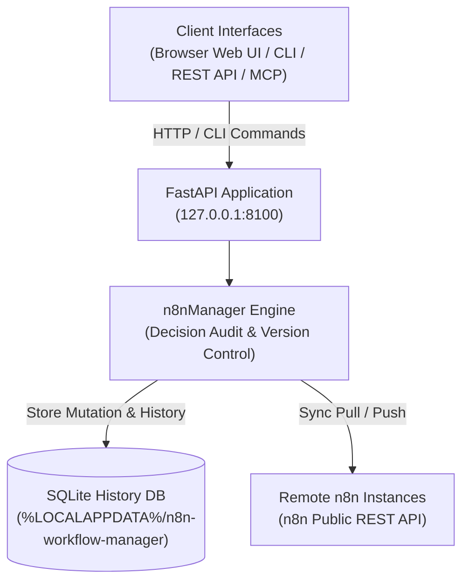

# n8n वर्कफ़्लो मैनेजर

**[English](README.md) · [Deutsch](README_de.md) · [Español](README_es.md) · [日本語](README_ja.md) · [Русский](README_ru.md) · [Français](README_fr.md) · [简体中文](README_zh.md) · [हिन्दी](README_hi.md)**

> n8n के लिए स्थानीय वर्कफ़्लो समीक्षा, दृश्य निरीक्षण, निर्णय-ट्रैकिंग के साथ संपादन, इतिहास और कई सर्वरों के बीच समन्वय।

> [!IMPORTANT]
> यह स्वतंत्र सामुदायिक परियोजना है। यह n8n GmbH से संबद्ध नहीं है और उसे n8n GmbH का अनुमोदन या प्रायोजन प्राप्त नहीं है।
> “n8n” अपने संबंधित स्वामी का ट्रेडमार्क है। यहाँ इसका उपयोग केवल उस सॉफ़्टवेयर का वर्णन करने के लिए किया गया है
> जिसके साथ यह टूल काम करता है।

[](https://www.python.org/downloads/)
[](pyproject.toml)
[](LICENSE)
[](tests)
[](https://fastapi.tiangolo.com/)
[](https://github.com/astral-sh/ruff)
[](#what-it-does)
[](SECURITY.md)
[](SECURITY.md)
[](https://github.com/ellmos-ai)
[](https://github.com/open-bricks)
[](llms.txt)

> [!NOTE]
> **AI एजेंट और LLM संदर्भ**: मशीन-पठनीय विनिर्देश और RAG खोज-वाक्यांश [`llms.txt`](llms.txt) में सूचीबद्ध हैं। निर्णय-ट्रैकिंग के साथ स्वायत्त AI वर्कफ़्लो संचालन के लिए इसे [`n8n-manager-mcp`](https://github.com/ellmos-ai/n8n-manager-mcp) के साथ उपयोग किया जा सकता है। बदलावों के साथ गैर-रिक्त निर्णय-औचित्य दर्ज होता है, लेकिन यह मानव-अनुमोदन की प्रक्रिया नहीं है: create, build, import, template और pull के कुछ मार्ग डिफ़ॉल्ट मान देते हैं, जबकि update, rollback, delete और push के लिए कॉल करने वाले से गैर-रिक्त मान आवश्यक है।

## नेविगेशन

- [सिस्टम आर्किटेक्चर](#system-architecture)
- [वर्कफ़्लो जीवनचक्र](#workflow-lifecycle)
- [शासन-व्यवस्था और रनटाइम के स्थिर नियम](#governance-and-runtime-invariants)
- [दृश्य इंटरफ़ेस और स्क्रीनशॉट](#visual-interface-and-screenshots)
- [लक्षित उपयोगकर्ता-प्रोफ़ाइल और SEO](#target-personas-and-seo)
- [आर्किटेक्चर और सुविधाओं की तुलना](#comparison-matrix)
- [यह क्या करता है](#what-it-does)
- [इंस्टॉल करना और शुरू करना](#install-and-start)
- [CLI उदाहरण](#cli-examples)
- [वर्कफ़्लो बिल्डर API](#builder-api)
- [कॉन्फ़िगरेशन और डेटा](#configuration-and-data)
- [Docker](#docker)
- [रिमोट n8n सेटअप](#remote-n8n-setup)
- [मैनेजर और MCP का संयोजन](#manager-plus-mcp-pairing)
- [संबद्ध पारिस्थितिकी तंत्र](#sibling-ecosystem)
- [सत्यापन](#verification)
- [लाइसेंस](#license)

---

<a id="system-architecture"></a>
## सिस्टम आर्किटेक्चर



---

<a id="workflow-lifecycle"></a>
## वर्कफ़्लो जीवनचक्र

यह क्रम स्थानीय rollback और रिमोट समन्वय को अलग रखता है। rollback सहेजे गए SQLite संस्करण को बहाल करता है और दिया गया निर्णय दर्ज करता है। इससे केवल स्थानीय डेटाबेस बदलता है; उस स्थिति को रिमोट n8n पर भेजने के लिए अलग से push करना आवश्यक है।

```mermaid
sequenceDiagram
    autonumber
    actor User as "Operator / AI Agent (MCP)"
    participant API as "FastAPI Application (127.0.0.1:8100)"
    participant SQLite as "Local SQLite History DB"
    participant n8n as "Configured Remote n8n API"

    Note over User,SQLite: "1. Local Rollback (No Remote Call)"
    User->>API: "POST /api/workflows/{workflow_id}/rollback/{version_number} (Decision)"
    API->>SQLite: "Read retained target version"
    SQLite-->>API: "Stored workflow JSON"
    API->>SQLite: "Update local workflow; record version and decision"
    SQLite-->>API: "Local transaction committed"
    API-->>User: "Rollback response (message, history URL)"
    Note over User,n8n: "Remote n8n remains unchanged after rollback"
    Note over User,n8n: "2. Separate Explicit Push (Optional)"
    User->>API: "POST /api/export/{workflow_id}/to-server?decision=...&server_id=..."
    API->>SQLite: "Read local workflow and remote binding"
    SQLite-->>API: "Workflow JSON and binding (if any)"
    API->>n8n: "Create or update via n8n REST API"
    n8n-->>API: "Remote result (success or error)"
    API->>SQLite: "Record sync result; update binding on success"
    API-->>User: "Push response"
```

---

<a id="governance-and-runtime-invariants"></a>
## शासन-व्यवस्था और रनटाइम के स्थिर नियम

| # | क्षमता / नीति | परियोजना का व्यवहार | सीमा |
|---|---|---|---|
| 1 | **स्थानीय उपयोग को प्राथमिकता** | सेवा डिफ़ॉल्ट रूप से 127.0.0.1 पर सुनती है। | कॉन्फ़िगर किए गए n8n कनेक्शन REST का उपयोग करते हैं; रिमोट सेटअप SSH का। नेटवर्क से कोई संपर्क न होने की यह गारंटी नहीं है। |
| 2 | **निर्णय अभिलेख** | वर्कफ़्लो में बदलावों के साथ गैर-रिक्त औचित्य दर्ज होता है। | create, build, import, template और pull के कुछ मार्ग डिफ़ॉल्ट मान दे सकते हैं; update, rollback, delete और push के लिए कॉल करने वाले का गैर-रिक्त मान आवश्यक है। औचित्य मंशा दर्ज करता है, मानव-अनुमोदन नहीं। |
| 3 | **SQLite इतिहास** | वर्कफ़्लो संस्करण और निर्णय प्रविष्टियाँ SQLite में रखी जाती हैं। | ये सामान्य स्थानीय डेटाबेस रिकॉर्ड हैं; अपरिवर्तनीय या छेड़छाड़-रोधी नहीं हैं। वर्कफ़्लो मिटाने से उसके संस्करण भी हट जाते हैं। |
| 4 | **स्थानीय rollback** | सहेजे गए संस्करण से स्थानीय वर्कफ़्लो रिकॉर्ड बहाल किया जा सकता है। | rollback से रिमोट n8n में कोई बदलाव नहीं होता। push अलग से करना पड़ता है; इतिहास आपदा-पुनर्प्राप्ति की गारंटी नहीं है। |
| 5 | **n8n समन्वयन** | सर्वर-विशिष्ट pull और push, n8n REST API का उपयोग करते हैं। | कॉन्फ़िगर किया हुआ सर्वर और नेटवर्क पहुँच आवश्यक हैं; push स्पष्ट रूप से चलाया जाता है। |
| 6 | **दृश्य निरीक्षण की सामग्री** | vis-network ब्राउज़र लाइब्रेरी स्थानीय रूप से शामिल है। | इसे साथ रखने से उस लाइब्रेरी के लिए CDN अनुरोध नहीं करना पड़ता; रिमोट समन्वय के लिए फिर भी नेटवर्क पहुँच चाहिए। |
| 7 | **API key का प्रबंधन** | पंजीकृत n8n keys प्रति-उपयोगकर्ता स्थानीय डेटा में रखी जाती हैं और API/UI प्रतिक्रियाओं में छिपाई जाती हैं। | keys बिना एन्क्रिप्शन रखी जाती हैं; उपयोगकर्ता डेटा डायरेक्टरी को SECURITY.md में बताए अनुसार सुरक्षित रखें। |
| 8 | **इंटरफ़ेस** | परियोजना browser UI, REST API और CLI देती है; MCP companion अलग से बनाए रखा जाता है। | companion इस परियोजना के API का उपयोग करता है; ऊपर बताया गया स्थानीय/रिमोट व्यवहार नहीं बदलता। |
| 9 | **विशेषाधिकार मॉडल** | एप्लिकेशन और Docker image को उन्नत विशेषाधिकारों के बिना चलाने के लिए बनाया गया है। | यह दस्तावेज़ीकृत रनटाइम कॉन्फ़िगरेशन का वर्णन है। |
| 10 | **सुरक्षा-प्रतिक्रिया नीति** | SECURITY.md में 48 घंटों के भीतर शुरुआती जवाब और पाँच कारोबारी दिनों के भीतर प्राथमिकता-जाँच का वचन दिया गया है। | यह नीति का वचन है, रनटाइम गारंटी या 48 घंटों में पैच जारी करने का आश्वासन नहीं। |

---

<a id="visual-interface-and-screenshots"></a>
<a id="screenshots"></a>
## दृश्य इंटरफ़ेस और स्क्रीनशॉट

ब्राउज़र UI में स्थानीय वातावरण छोड़े बिना वर्कफ़्लो का इंटरैक्टिव निरीक्षण, नोड निर्भरता ग्राफ़ और इतिहास प्रबंधन उपलब्ध हैं:

| डैशबोर्ड और वर्कफ़्लो का अवलोकन | दृश्य ग्राफ़ व्यूअर और लाइव निरीक्षक |
|:---:|:---:|
|  |  |
| *वर्कफ़्लो सूची, सर्वर बाइंडिंग, संशोधन संख्या और त्वरित कार्रवाइयाँ* | *इंटरैक्टिव vis.js ग्राफ़, नोड पैरामीटर, क्रेडेंशियल और कनेक्शन* |

---

<a id="target-personas-and-seo"></a>
## लक्षित उपयोगकर्ता-प्रोफ़ाइल और SEO

n8n Workflow Manager उन तकनीकी टीमों, ऑपरेटरों और AI एजेंटों के लिए बनाया गया है जिन्हें स्थानीय निर्णय और संस्करण इतिहास के साथ n8n वर्कफ़्लो का निरीक्षण, दस्तावेज़ीकरण, संपादन और समन्वय करना होता है:

- **`[PERSONA-01]` वर्कफ़्लो ऑटोमेशन इंजीनियर और सिस्टम प्रशासक**: ऐसे ऑपरेटर जो staging, testing और production में n8n इंस्टेंस सँभालते हैं और जिन्हें स्थानीय वर्कफ़्लो समीक्षा, दृश्य निरीक्षण और सर्वर-विशिष्ट समन्वय चाहिए।
- **`[PERSONA-02]` AI एजेंट फ़्रेमवर्क आर्किटेक्ट और MCP इंटीग्रेटर**: वे टीमें जो n8n-manager-mcp के माध्यम से LLM जोड़कर वर्कफ़्लो बनाती या बदलती हैं। मैनेजर निर्णय का औचित्य दर्ज करता है; कुछ मार्गों में डिफ़ॉल्ट लागू होते हैं और औचित्य मानव-अनुमोदन नहीं होता।
- **`[PERSONA-03]` सुरक्षा और अनुपालन अधिकारी**: वे टीमें जिन्हें स्थानीय SQLite वर्कफ़्लो-संस्करण और निर्णय इतिहास, प्रतिक्रियाओं में API keys को छिपाना, साथ में शामिल frontend सामग्री और बिना उन्नत विशेषाधिकार वाला रनटाइम चाहिए। SQLite इतिहास अपरिवर्तनीय या छेड़छाड़-रोधी नहीं है।
- **`[PERSONA-04]` DevOps और साइट विश्वसनीयता इंजीनियर (SRE)**: वे टीमें जो REST API, सर्वर-विशिष्ट समन्वय और सहेजे गए संस्करणों से स्थानीय rollback का उपयोग करती हैं। आपदा-पुनर्प्राप्ति के लिए अलग बैकअप रखें; वर्कफ़्लो इतिहास बैकअप की गारंटी नहीं है।

#### उच्च-इरादे वाले खोज शब्द और आसानी से खोजे जाने के संकेत
- `local n8n workflow manager`, `visual n8n graph viewer`, `n8n multi-server sync`, `decision-tracked workflow automation`, `n8n-manager-mcp companion`, `local-first workflow rollback`, `vis.js n8n editor`, `fastapi n8n controller`, `offline n8n documentation export`

---

<a id="comparison-matrix"></a>
## आर्किटेक्चर और सुविधाओं की तुलना

परियोजना की क्षमताएँ और सीमाएँ। यह तालिका अन्य उत्पादों से कोई तुलनात्मक दावा नहीं करती।

| # | क्षमता / नीति | परियोजना का व्यवहार | सीमा |
|---|---|---|---|
| 1 | **स्थानीय उपयोग को प्राथमिकता** | सेवा डिफ़ॉल्ट रूप से 127.0.0.1 पर सुनती है। | कॉन्फ़िगर किए गए n8n कनेक्शन REST का उपयोग करते हैं; रिमोट सेटअप SSH का। नेटवर्क से कोई संपर्क न होने की यह गारंटी नहीं है। |
| 2 | **निर्णय अभिलेख** | वर्कफ़्लो में बदलावों के साथ गैर-रिक्त औचित्य दर्ज होता है। | create, build, import, template और pull के कुछ मार्ग डिफ़ॉल्ट मान दे सकते हैं; update, rollback, delete और push के लिए कॉल करने वाले का गैर-रिक्त मान आवश्यक है। औचित्य मंशा दर्ज करता है, मानव-अनुमोदन नहीं। |
| 3 | **SQLite इतिहास** | वर्कफ़्लो संस्करण और निर्णय प्रविष्टियाँ SQLite में रखी जाती हैं। | ये सामान्य स्थानीय डेटाबेस रिकॉर्ड हैं; अपरिवर्तनीय या छेड़छाड़-रोधी नहीं हैं। वर्कफ़्लो मिटाने से उसके संस्करण भी हट जाते हैं। |
| 4 | **स्थानीय rollback** | सहेजे गए संस्करण से स्थानीय वर्कफ़्लो रिकॉर्ड बहाल किया जा सकता है। | rollback से रिमोट n8n में कोई बदलाव नहीं होता। push अलग से करना पड़ता है; इतिहास आपदा-पुनर्प्राप्ति की गारंटी नहीं है। |
| 5 | **n8n समन्वयन** | सर्वर-विशिष्ट pull और push, n8n REST API का उपयोग करते हैं। | कॉन्फ़िगर किया हुआ सर्वर और नेटवर्क पहुँच आवश्यक हैं; push स्पष्ट रूप से चलाया जाता है। |
| 6 | **दृश्य निरीक्षण की सामग्री** | vis-network ब्राउज़र लाइब्रेरी स्थानीय रूप से शामिल है। | इसे साथ रखने से उस लाइब्रेरी के लिए CDN अनुरोध नहीं करना पड़ता; रिमोट समन्वय के लिए फिर भी नेटवर्क पहुँच चाहिए। |
| 7 | **API key का प्रबंधन** | पंजीकृत n8n keys प्रति-उपयोगकर्ता स्थानीय डेटा में रखी जाती हैं और API/UI प्रतिक्रियाओं में छिपाई जाती हैं। | keys बिना एन्क्रिप्शन रखी जाती हैं; उपयोगकर्ता डेटा डायरेक्टरी को SECURITY.md में बताए अनुसार सुरक्षित रखें। |
| 8 | **इंटरफ़ेस** | परियोजना browser UI, REST API और CLI देती है; MCP companion अलग से बनाए रखा जाता है। | companion इस परियोजना के API का उपयोग करता है; ऊपर बताया गया स्थानीय/रिमोट व्यवहार नहीं बदलता। |
| 9 | **विशेषाधिकार मॉडल** | एप्लिकेशन और Docker image को उन्नत विशेषाधिकारों के बिना चलाने के लिए बनाया गया है। | यह दस्तावेज़ीकृत रनटाइम कॉन्फ़िगरेशन का वर्णन है। |
| 10 | **सुरक्षा-प्रतिक्रिया नीति** | SECURITY.md में 48 घंटों के भीतर शुरुआती जवाब और पाँच कारोबारी दिनों के भीतर प्राथमिकता-जाँच का वचन दिया गया है। | यह नीति का वचन है, रनटाइम गारंटी या 48 घंटों में पैच जारी करने का आश्वासन नहीं। |

---

<a id="what-it-does"></a>
## यह क्या करता है

- n8n वर्कफ़्लो JSON को देखने और संपादित करने के लिए दृश्य ग्राफ़ व्यूअर और ब्राउज़र संपादक।
- वर्कफ़्लो में बदलावों के लिए SQLite-आधारित संस्करण इतिहास और दर्ज निर्णय-औचित्य; बनाने और आयात करने के कुछ मार्गों में डिफ़ॉल्ट मान लागू होते हैं।
- REST API या CLI से स्थानीय rollback; रिमोट n8n अपडेट करने के लिए अलग से push करना आवश्यक है।
- n8n सार्वजनिक API और cursor pagination का उपयोग करके प्रति-वर्कफ़्लो और प्रति-सर्वर pull/push बाइंडिंग।
- JSON और Markdown निर्यात, सत्यापित आयात और साथ में शामिल सामान्य टेम्पलेट।
- FastAPI REST API, Swagger UI और टर्मिनल CLI।

एप्लिकेशन स्थानीय उपयोग को प्राथमिकता देता है: यह डिफ़ॉल्ट रूप से `127.0.0.1` पर सुनता है और
कॉन्फ़िगरेशन और रनटाइम डेटा प्रति-उपयोगकर्ता डायरेक्टरी में रखता है, न कि
इंस्टॉल किए गए पैकेज या सोर्स चेकआउट के भीतर।

मैनेजर को loopback पर बाँधने से कॉन्फ़िगर किए गए n8n सर्वर या SSH होस्ट से बाहर जाने वाले कनेक्शन नहीं रुकते।

### उपयोग के अनुसार त्वरित शुरुआत

| लक्ष्य / वर्कफ़्लो की ज़रूरत | सुझाया गया टूल / इंटरफ़ेस | कमांड / वर्कफ़्लो |
|---|---|---|
| **स्थानीय वर्कफ़्लो का निरीक्षण और दृश्य रूप में देखना** | वेब डैशबोर्ड और vis.js ग्राफ़ व्यूअर | `n8n-manager serve` &rarr; खोलें `http://127.0.0.1:8100` |
| **हस्तांतरण के लिए वर्कफ़्लो का दस्तावेज़ीकरण** | Markdown / JSON निर्यात इंजन | `n8n-manager export <id> --format md` |
| **कई सर्वरों में समन्वय (staging से production तक)** | सर्वर रजिस्ट्री और Pull/Push इंजन | `n8n-manager push <id> --decision "Deploy reviewed changes"` |
| **स्वायत्त AI वर्कफ़्लो लेखन** | Builder REST API और MCP Server | `POST /api/workflows/build` via `n8n-manager-mcp` |
| **सहेजे गए स्थानीय संस्करण को बहाल करना** | स्थानीय वर्कफ़्लो इतिहास और rollback | `n8n-manager rollback <id> <target-version> --decision "Revert defect"` (रिमोट n8n अपरिवर्तित रहता है; ज़रूरत हो तो अलग से push करें) |
| **SSH से रिमोट n8n सेटअप** | स्वचालित SSH सेटअप कमांड | `n8n-manager setup --host <server> --user <deploy>` |

---

<a id="install-and-start"></a>
## इंस्टॉल करना और शुरू करना

```bash
pip install git+https://github.com/ellmos-ai/n8n-workflow-manager.git
n8n-manager serve
```

<http://127.0.0.1:8100> खोलें। इंटरैक्टिव API दस्तावेज़ यहाँ उपलब्ध हैं:
<http://127.0.0.1:8100/docs>.

विकास के लिए:

```bash
git clone https://github.com/ellmos-ai/n8n-workflow-manager.git
cd n8n-workflow-manager
python -m pip install -e ".[dev]"
python -m pytest -q
```

---

<a id="cli-examples"></a>
## CLI उदाहरण

> [!WARNING]
> push स्थानीय वर्कफ़्लो को कॉन्फ़िगर किए गए n8n सर्वर पर भेजता है। rollback
> केवल स्थानीय डेटाबेस बदलता है। delete स्थानीय वर्कफ़्लो और उसका संस्करण इतिहास
> तथा स्थानीय सर्वर बाइंडिंग हटाता है; यह n8n को delete अनुरोध नहीं भेजता।
> स्थानीय rollback संस्करण n8n पर भेजने के लिए अलग से push चलाएँ। डिफ़ॉल्ट
> सर्वर पर production push करने से पहले n8n-manager status में जाँचें। API keys
> servers --add से दर्ज keys प्रति-उपयोगकर्ता डेटा डायरेक्टरी में बिना एन्क्रिप्शन रखी जाती हैं;
> इसे SSH key की तरह सुरक्षित रखें। [SECURITY.md](SECURITY.md) देखें।

create, build, import, template और pull के कुछ मार्ग डिफ़ॉल्ट रूप से गैर-रिक्त निर्णय दर्ज करते हैं। update, rollback, delete और push के लिए कॉल करने वाले से गैर-रिक्त निर्णय आवश्यक है। निर्णय घोषित मंशा दर्ज करता है; इससे मानव-अनुमोदन सिद्ध नहीं होता।

```bash
n8n-manager import workflow.json --decision "Import reviewed customer workflow"
n8n-manager list
n8n-manager history 1
n8n-manager export 1 --format md

n8n-manager servers --add production https://n8n.example.com YOUR_API_KEY --default
n8n-manager push 1 --decision "Deploy reviewed version"
n8n-manager pull
n8n-manager rollback 1 2 --decision "Restore last known-good version"

n8n-manager status                       # effective paths, database and server state
n8n-manager config --show                # inspect the resolved configuration
n8n-manager config --set db_path ./my.db # change a single setting
```

TLS सत्यापन डिफ़ॉल्ट रूप से चालू रहता है। नियंत्रित वातावरण के लिए `--no-verify-tls` उपलब्ध है
जहाँ self-signed प्रमाणपत्र हों; इसे
अविश्वसनीय नेटवर्क पर उपयोग न करें।

---

<a id="builder-api"></a>
## वर्कफ़्लो बिल्डर API

```bash
curl -X POST http://127.0.0.1:8100/api/workflows/build \
  -H "Content-Type: application/json" \
  -d '{
    "name": "Webhook forwarder",
    "decision": "Create a reviewed draft",
    "nodes": [
      {"type": "n8n-nodes-base.webhook", "name": "Trigger", "parameters": {"path": "hook"}},
      {"type": "n8n-nodes-base.httpRequest", "name": "Forward", "parameters": {"url": "https://api.example.com"}}
    ],
    "connections": [{"from_node": "Trigger", "to_node": "Forward"}]
  }'
```

बदलावों और इतिहास संबंधी अनुबंध [API_REFERENCE.md](docs/API_REFERENCE.md) में
देखें।

---

<a id="configuration-and-data"></a>
## कॉन्फ़िगरेशन और डेटा

`n8n-manager status` प्रभावी पथ दिखाता है। सापेक्ष `db_path` मान
उपयोगकर्ता डेटा डायरेक्टरी के भीतर निर्धारित होते हैं।

| प्लेटफ़ॉर्म | कॉन्फ़िगरेशन | रनटाइम डेटा |
|---|---|---|
| Windows | `%APPDATA%\n8n-workflow-manager` | `%LOCALAPPDATA%\n8n-workflow-manager` |
| macOS | `~/Library/Application Support/n8n-workflow-manager` | वही डायरेक्टरी |
| Linux | `${XDG_CONFIG_HOME:-~/.config}/n8n-workflow-manager` | `${XDG_DATA_HOME:-~/.local/share}/n8n-workflow-manager` |

ओवरराइड: `N8N_MANAGER_CONFIG`, `N8N_MANAGER_CONFIG_DIR` और
`N8N_MANAGER_DATA_DIR`। शुरुआत के लिए [config.example.json](config.example.json) देखें।
डिफ़ॉल्ट `trusted_hosts` केवल loopback Host headers स्वीकार करता है; प्रमाणित reverse proxy के लिए
समीक्षा किया हुआ सार्वजनिक hostname स्पष्ट रूप से सूचीबद्ध करें।

---

<a id="docker"></a>
## Docker

```bash
docker compose up --build -d
```

Compose पोर्ट `127.0.0.1:8100` पर बाँधा गया है और स्थिति `runtime/` के नीचे माउंट होती है।
इमेज बिना उन्नत विशेषाधिकार वाले उपयोगकर्ता के रूप में चलती है।

---

<a id="remote-n8n-setup"></a>
## रिमोट n8n सेटअप

setup कमांड मानता है कि रिमोट होस्ट पर उसके ऑपरेटिंग-सिस्टम नियमों के अनुसार Docker पहले से इंस्टॉल है।
यह लूपबैक-सीमित पोर्ट पर n8n की पिन की गई आधिकारिक इमेज इंस्टॉल करता है;
यह रिमोट होस्ट पर `curl | sh` इंस्टॉलर नहीं चलाता। इसलिए SSH सेटअप शून्य-कॉन्फ़िगरेशन वाला नहीं है।

```bash
n8n-manager setup --host your-server --user deploy --ssh-key ~/.ssh/id_ed25519
# Follow the printed ssh -L ... tunnel command, then open http://127.0.0.1:5678
```

SSH batch mode और `StrictHostKeyChecking=accept-new` का उपयोग करता है। सार्वजनिक सेवा के लिए
प्रमाणित TLS reverse proxy दें। n8nManager या
बनाए गए n8n listener को सीधे इंटरनेट पर उपलब्ध न कराएँ।

---

<a id="manager-plus-mcp-pairing"></a>
## मैनेजर और MCP का संयोजन

`n8n-workflow-manager` तथा
[n8n-manager-mcp](https://github.com/ellmos-ai/n8n-manager-mcp) को साथ काम करने के लिए बनाया गया है:
MCP server AI कार्रवाइयों की परत है, जबकि यह परियोजना दृश्य समीक्षा, प्रति-वर्कफ़्लो
निर्णयों, संस्करणों और rollback के साथ मानव-समीक्षा हेतु स्थिति और इतिहास की परत है।
बदलाव से पहले क्लाइंट `/api/workflows/{id}/history` पढ़ सकता है। कुछ मार्ग डिफ़ॉल्ट औचित्य देते हैं; update, rollback, delete और push के लिए कॉल करने वाले का गैर-रिक्त निर्णय आवश्यक है। निर्णय अभिलेख मंशा दर्ज करते हैं, मानव-अनुमोदन प्रमाणित नहीं करते।

निर्णय का आधिकारिक लॉग यहीं रहता है और किसी एक क्लाइंट पर निर्भर नहीं है, इसलिए
एक ही समीक्षा-इतिहास MCP server, `curl`, CLI या web UI के लिए काम आता है।

अगर आप n8n को अलग से चलाने के बजाय self-hosted स्टैक के हिस्से के रूप में चला रहे हैं, तो
[ellmos-stack](https://github.com/ellmos-ai/ellmos-stack), Docker Compose के ज़रिए n8n के साथ
Ollama और दस्तावेज़ इंडेक्स शुरू करता है; इसके बाद यह मैनेजर
उस इंस्टेंस से किसी भी अन्य n8n सर्वर की तरह जुड़ता है।
बातचीत का संदर्भ pull-आधारित इतिहास इंडेक्स से भी लिया जा सकता है,
जैसे [ctx](https://github.com/ctxrs/ctx) (Apache-2.0)।

---

<a id="sibling-ecosystem"></a>
## संबद्ध पारिस्थितिकी तंत्र

`n8n-workflow-manager`, [ellmos-ai](https://github.com/ellmos-ai) और [open-bricks](https://github.com/open-bricks) ओपन-सोर्स पारिस्थितिकी तंत्रों का अभिन्न हिस्सा है:

| रिपॉज़िटरी | उद्देश्य | एकीकरण |
|---|---|---|
| [`ellmos-ai/n8n-manager-mcp`](https://github.com/ellmos-ai/n8n-manager-mcp) | n8n वर्कफ़्लो प्रबंधन के लिए MCP Server | निर्णय ऑडिट के साथ स्वायत्त AI एजेंट कार्रवाइयों की परत |
| [`ellmos-ai/ellmos-stack`](https://github.com/ellmos-ai/ellmos-stack) | स्थानीय AI और ऑटोमेशन का एकीकृत स्टैक | Docker Compose के ज़रिए n8n, Ollama और KnowledgeDigest चलाता है |
| [`ellmos-ai/ellmos-homebase-mcp`](https://github.com/ellmos-ai/ellmos-homebase-mcp) | केंद्रीय ज्ञान-आधार और मेमोरी MCP | सत्रों के बीच एजेंट मेमोरी और समन्वय |
| [`ellmos-ai/ellmos-controlcenter-mcp`](https://github.com/ellmos-ai/ellmos-controlcenter-mcp) | बहु-एजेंट रजिस्ट्री और टूल ऑर्केस्ट्रेशन | गतिशील टूल बंडलिंग और रूटिंग |
| [`dev-bricks/automation-master`](https://github.com/dev-bricks/automation-master) | केंद्रीय ऑटोमेशन स्वास्थ्य और कार्य पर्यवेक्षक | सिस्टम-स्तरीय स्वास्थ्य ऑर्केस्ट्रेशन और वॉचडॉग |
| [`ellmos-ai/clirec`](https://github.com/ellmos-ai/clirec) | नियतात्मक CLI सत्र रिकॉर्डर और रीप्ले इंजन | इंटरैक्टिव टर्मिनल ऑडिट और सत्र सत्यापन |
| [`open-bricks/open-bricks`](https://github.com/open-bricks) | छत्र ओपन-सोर्स संगठन | साझा मानक, सुरक्षा दिशानिर्देश और शासन-व्यवस्था |

---

<a id="verification"></a>
## सत्यापन

रिलीज़ अनुबंध [RELEASE_GATE.md](RELEASE_GATE.md) में दर्ज है।
मुख्य स्थानीय जाँचें:

```bash
python -m pytest -q
python -m ruff check n8nManager tests
python -m bandit -q -r n8nManager -lll
python -m pip_audit
python -m build
```

---

<a id="license"></a>
## लाइसेंस

MIT; [LICENSE](LICENSE) देखें। उपयोग अपने जोखिम पर करें; कोई वारंटी या रखरखाव
वचन नहीं दिया जाता।

यह लाइसेंस इस परियोजना के लिए लिखे गए कोड पर लागू होता है। रिपॉज़िटरी और
बनाए गए वितरणों में **vis-network** ब्राउज़र लाइब्रेरी भी शामिल है (दोहरी लाइसेंसिंग
Apache-2.0 या MIT; यहाँ MIT विकल्प के अंतर्गत उपयोग की गई), जिसके अपने
कॉपीराइट धारक हैं। पूरी सूचनाएँ: [THIRD_PARTY_LICENSES.md](THIRD_PARTY_LICENSES.md)।
