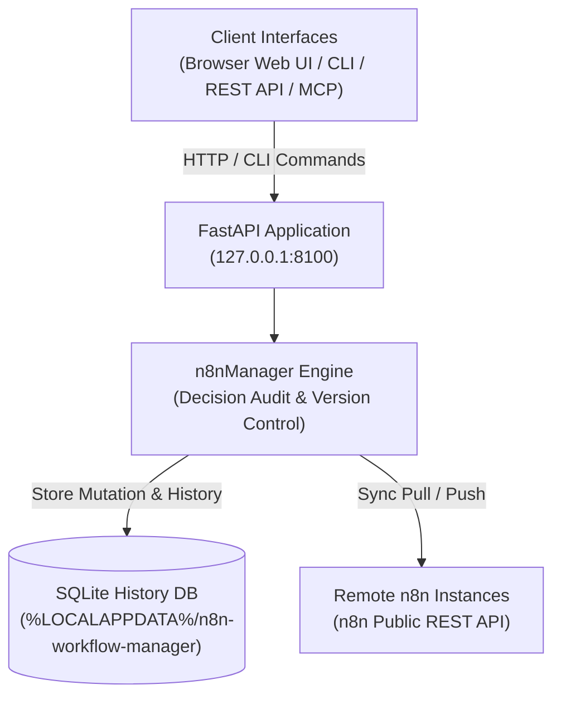

# n8n Workflow Manager

**[English](README.md) · [Deutsch](README_de.md) · [Español](README_es.md) · [日本語](README_ja.md) · [Русский](README_ru.md)**

> n8n 向けのローカル優先ワークフロー管理ツールです。ワークフローのレビューと視覚的な確認、判断理由を記録した編集、履歴管理、複数サーバーとの同期を行えます。

> [!IMPORTANT]
> 独立したコミュニティプロジェクトです。n8n GmbH との提携、同社からの推奨または後援を受けていません。
> 「n8n」は各権利者の商標であり、このツールが連携するソフトウェアを説明する目的でのみ使用しています。

[](https://www.python.org/downloads/)
[](pyproject.toml)
[](LICENSE)
[](tests)
[](https://fastapi.tiangolo.com/)
[](https://github.com/astral-sh/ruff)
[](#what-it-does)
[](SECURITY.md)
[](SECURITY.md)
[](https://github.com/ellmos-ai)
[](https://github.com/open-bricks)
[](llms.txt)

> [!NOTE]
> **AIエージェントとLLM向けの情報**: 機械可読な仕様とRAG検索語句は [`llms.txt`](llms.txt) にまとめられています。自律的なAIワークフロー操作と判断記録のため、[`n8n-manager-mcp`](https://github.com/ellmos-ai/n8n-manager-mcp) と組み合わせて使えます。変更操作では空でない判断理由が記録されますが、人による承認手続きではありません。作成、ビルド、インポート、テンプレート、プルの一部の経路では既定値が使われます。一方、更新、ロールバック、削除、プッシュには、呼び出し元が指定する空でない値が必要です。

## ナビゲーション

- [システムアーキテクチャ](#system-architecture)
- [ワークフローのライフサイクル](#workflow-lifecycle)
- [ガバナンスと実行時の不変条件](#governance-and-runtime-invariants)
- [ビジュアルインターフェースとスクリーンショット](#visual-interface-and-screenshots)
- [想定ユーザー像とSEO](#target-personas-and-seo)
- [アーキテクチャと機能の比較](#comparison-matrix)
- [主な機能](#what-it-does)
- [インストールと起動](#install-and-start)
- [CLIの使用例](#cli-examples)
- [Builder API](#builder-api)
- [設定とデータ](#configuration-and-data)
- [Docker](#docker)
- [リモート n8n のセットアップ](#remote-n8n-setup)
- [Manager と MCP の連携](#manager-plus-mcp-pairing)
- [関連エコシステム](#sibling-ecosystem)
- [検証](#verification)
- [ライセンス](#license)

---

<a id="system-architecture"></a>
## システムアーキテクチャ




---

<a id="workflow-lifecycle"></a>
## ワークフローのライフサイクル

このシーケンスでは、ローカルでのロールバックとリモート同期を分けて示します。ロールバックは SQLite に保持されたバージョンを復元し、指定された判断理由を記録します。変更されるのはローカルデータベースだけです。その状態をリモート n8n に送るには、別途 push が必要です。

```mermaid
sequenceDiagram
    autonumber
    actor User as "Operator / AI Agent (MCP)"
    participant API as "FastAPI Application (127.0.0.1:8100)"
    participant SQLite as "Local SQLite History DB"
    participant n8n as "Configured Remote n8n API"

    Note over User,SQLite: "1. Local Rollback (No Remote Call)"
    User->>API: "POST /api/workflows/{workflow_id}/rollback/{version_number} (Decision)"
    API->>SQLite: "Read retained target version"
    SQLite-->>API: "Stored workflow JSON"
    API->>SQLite: "Update local workflow; record version and decision"
    SQLite-->>API: "Local transaction committed"
    API-->>User: "Rollback response (message, history URL)"
    Note over User,n8n: "Remote n8n remains unchanged after rollback"
    Note over User,n8n: "2. Separate Explicit Push (Optional)"
    User->>API: "POST /api/export/{workflow_id}/to-server?decision=...&server_id=..."
    API->>SQLite: "Read local workflow and remote binding"
    SQLite-->>API: "Workflow JSON and binding (if any)"
    API->>n8n: "Create or update via n8n REST API"
    n8n-->>API: "Remote result (success or error)"
    API->>SQLite: "Record sync result; update binding on success"
    API-->>User: "Push response"
```


---

<a id="governance-and-runtime-invariants"></a>
## ガバナンスと実行時の不変条件

| # | 機能・方針 | プロジェクトの動作 | 境界・制約 |
|---|---|---|---|
| 1 | **ローカル優先の既定動作** | サービスは既定で 127.0.0.1 にバインドされます。 | 設定済みの n8n 接続には REST を使い、リモート設定には SSH を使います。外向き通信が一切ないという保証ではありません。 |
| 2 | **判断記録** | ワークフローの変更操作では空でない判断理由を記録します。 | 作成、ビルド、インポート、テンプレート、プルの経路では既定値を使う場合があります。更新、ロールバック、削除、プッシュには、呼び出し元が指定する空でない値が必要です。判断理由は意図を記録するもので、人による承認ではありません。 |
| 3 | **SQLite の履歴** | ワークフローのバージョンと判断記録を SQLite に保存します。 | 通常のローカルデータベース記録であり、不変または改ざん不能ではありません。ワークフローを削除すると、そのバージョンも削除されます。 |
| 4 | **ロールバック** | 保持されているバージョンをローカルのワークフロー記録に復元できます。 | ロールバックしてもリモート n8n は変更されません。push は別の操作です。履歴は災害復旧を保証するバックアップではありません。 |
| 5 | **n8n との同期** | サーバーごとの pull と push には n8n REST API を使います。 | 設定済みサーバーとネットワーク接続が必要です。push は明示的に実行します。 |
| 6 | **視覚的な確認用アセット** | vis-network のブラウザーライブラリをローカルに同梱します。 | このライブラリの取得に CDN へのリクエストは不要ですが、リモート同期にはネットワーク接続が必要です。 |
| 7 | **API キーの取り扱い** | 登録した n8n キーはユーザーごとのローカルデータに保存し、API/UI の応答ではマスキングします。 | キーは暗号化されずに保存されます。SECURITY.md の説明に従い、ユーザーデータディレクトリを保護してください。 |
| 8 | **インターフェース** | ブラウザー UI、REST API、CLI を提供します。MCP コンパニオンは別プロジェクトとして保守されています。 | コンパニオンはこのプロジェクトの API を使います。上記のローカル・リモート間の動作は変わりません。 |
| 9 | **権限モデル** | アプリケーションと Docker イメージは、権限を昇格せずに動かす設計です。 | ここで述べているのは、文書化されている実行時設定です。 |
| 10 | **セキュリティ対応方針** | SECURITY.md は、48 時間以内の初回応答と、5 営業日以内のトリアージを約束しています。 | 方針上の約束であり、実行時の保証や、48 時間以内にパッチをリリースする約束ではありません。 |

---

<a id="visual-interface-and-screenshots"></a>
<a id="screenshots"></a>
## ビジュアルインターフェースとスクリーンショット

ブラウザー UI では、ローカル環境を離れずにワークフローを対話的に確認し、ノード依存関係のグラフを表示し、履歴を管理できます。

| ダッシュボードとワークフロー概要 | グラフビューアーとライブインスペクター |
|:---:|:---:|
|  |  |
| *ワークフロー一覧、サーバーとの紐付け、リビジョン数、クイック操作* | *対話型 vis.js グラフ、ノードパラメーター、認証情報、接続* |

---

<a id="target-personas-and-seo"></a>
## 想定ユーザー像とSEO

n8n Workflow Manager は、ローカルの判断記録とバージョン履歴を保ちながら n8n ワークフローを確認、文書化、編集、同期する必要がある技術チーム、運用担当者、AI エージェント向けに設計されています。

- **`[PERSONA-01]` ワークフロー自動化エンジニアとシステム管理者**: ステージング、テスト、本番環境の n8n インスタンスを管理し、ローカルでのワークフローレビュー、視覚的な確認、サーバーごとの同期を必要とする運用担当者。
- **`[PERSONA-02]` AI エージェントフレームワークの設計者と MCP インテグレーター**: n8n-manager-mcp を通じて LLM を連携し、ワークフローの作成や変更を行うチーム。Manager は判断理由を記録します。一部の経路では既定値が使われ、判断理由は人による承認を意味しません。
- **`[PERSONA-03]` セキュリティ・コンプライアンス担当者**: ローカルの SQLite によるワークフローバージョンと判断の履歴、応答時の API キーマスキング、同梱フロントエンドアセット、権限を昇格しない実行を必要とするチーム。SQLite の履歴は不変でも改ざん不能でもありません。
- **`[PERSONA-04]` DevOps とサイト信頼性エンジニア（SRE）**: REST API、サーバーごとの同期、保持されたバージョンからのローカルロールバックを利用するチーム。災害復旧には別途バックアップを用意してください。ワークフロー履歴はバックアップを保証するものではありません。

#### 検索意図の高いキーワード
- `local n8n workflow manager`, `visual n8n graph viewer`, `n8n multi-server sync`, `decision-tracked workflow automation`, `n8n-manager-mcp companion`, `local-first workflow rollback`, `vis.js n8n editor`, `fastapi n8n controller`, `offline n8n documentation export`

---

<a id="comparison-matrix"></a>
## アーキテクチャと機能の比較

プロジェクトの機能と境界を示します。この表は、他の製品との比較を主張するものではありません。

| # | 機能・方針 | プロジェクトの動作 | 境界・制約 |
|---|---|---|---|
| 1 | **ローカル優先の既定動作** | サービスは既定で 127.0.0.1 にバインドされます。 | 設定済みの n8n 接続には REST を使い、リモート設定には SSH を使います。外向き通信が一切ないという保証ではありません。 |
| 2 | **判断記録** | ワークフローの変更操作では空でない判断理由を記録します。 | 作成、ビルド、インポート、テンプレート、プルの経路では既定値を使う場合があります。更新、ロールバック、削除、プッシュには、呼び出し元が指定する空でない値が必要です。判断理由は意図を記録するもので、人による承認ではありません。 |
| 3 | **SQLite の履歴** | ワークフローのバージョンと判断記録を SQLite に保存します。 | 通常のローカルデータベース記録であり、不変または改ざん不能ではありません。ワークフローを削除すると、そのバージョンも削除されます。 |
| 4 | **ロールバック** | 保持されているバージョンをローカルのワークフロー記録に復元できます。 | ロールバックしてもリモート n8n は変更されません。push は別の操作です。履歴は災害復旧を保証するバックアップではありません。 |
| 5 | **n8n との同期** | サーバーごとの pull と push には n8n REST API を使います。 | 設定済みサーバーとネットワーク接続が必要です。push は明示的に実行します。 |
| 6 | **視覚的な確認用アセット** | vis-network のブラウザーライブラリをローカルに同梱します。 | このライブラリの取得に CDN へのリクエストは不要ですが、リモート同期にはネットワーク接続が必要です。 |
| 7 | **API キーの取り扱い** | 登録した n8n キーはユーザーごとのローカルデータに保存し、API/UI の応答ではマスキングします。 | キーは暗号化されずに保存されます。SECURITY.md の説明に従い、ユーザーデータディレクトリを保護してください。 |
| 8 | **インターフェース** | ブラウザー UI、REST API、CLI を提供します。MCP コンパニオンは別プロジェクトとして保守されています。 | コンパニオンはこのプロジェクトの API を使います。上記のローカル・リモート間の動作は変わりません。 |
| 9 | **権限モデル** | アプリケーションと Docker イメージは、権限を昇格せずに動かす設計です。 | ここで述べているのは、文書化されている実行時設定です。 |
| 10 | **セキュリティ対応方針** | SECURITY.md は、48 時間以内の初回応答と、5 営業日以内のトリアージを約束しています。 | 方針上の約束であり、実行時の保証や、48 時間以内にパッチをリリースする約束ではありません。 |

---

<a id="what-it-does"></a>
## 主な機能

- n8n ワークフロー JSON を視覚的に確認できるグラフビューアーと、ブラウザー上で使えるエディター。
- SQLite によるバージョン履歴と、ワークフロー変更の判断理由記録。一部の作成・インポート経路では既定値を使用します。
- REST API または CLI からのローカルロールバック。リモート n8n を更新するには別途 push が必要です。
- n8n 公開 API とカーソルページネーションを使った、ワークフロー・サーバーごとの pull/push 紐付け。
- JSON と Markdown へのエクスポート、検証付きインポート、汎用テンプレートの同梱。
- FastAPI REST API、Swagger UI、ターミナル CLI。

アプリケーションはローカル優先です。既定では `127.0.0.1` にバインドされ、設定と実行時データは、インストール済みパッケージやソースのチェックアウト先ではなく、ユーザーごとのディレクトリに保存します。

Manager をループバックにバインドしても、設定済みの n8n サーバーや SSH ホストへの外向き接続は遮断されません。

### 用途別クイックスタート

| 目的・ワークフローのニーズ | 推奨するツール・画面 | コマンド・手順 |
|---|---|---|
| **ローカルワークフローの確認と可視化** | Web ダッシュボードと vis.js グラフビューアー | `n8n-manager serve` &rarr; `http://127.0.0.1:8100` を開く |
| **引き継ぎ用のワークフロー文書化** | Markdown / JSON エクスポートエンジン | `n8n-manager export <id> --format md` |
| **複数サーバー間の同期（ステージングから本番へ）** | サーバーレジストリと pull/push エンジン | `n8n-manager push <id> --decision "Deploy reviewed changes"` |
| **AI によるワークフローの自動作成** | Builder REST API と MCP サーバー | `POST /api/workflows/build` を `n8n-manager-mcp` 経由で実行 |
| **保持済みのローカルバージョンを復元** | ローカルのワークフロー履歴と rollback | `n8n-manager rollback <id> <target-version> --decision "Revert defect"`（リモート n8n は変更されません。必要な場合は別途 push してください） |
| **SSH によるリモート n8n のセットアップ** | SSH セットアップコマンド | `n8n-manager setup --host <server> --user <deploy>` |

---

<a id="install-and-start"></a>
## インストールと起動

```bash
pip install git+https://github.com/ellmos-ai/n8n-workflow-manager.git
n8n-manager serve
```


<http://127.0.0.1:8100> を開いてください。対話型 API ドキュメントは <http://127.0.0.1:8100/docs> にあります。

開発環境の場合:

```bash
git clone https://github.com/ellmos-ai/n8n-workflow-manager.git
cd n8n-workflow-manager
python -m pip install -e ".[dev]"
python -m pytest -q
```


---

<a id="cli-examples"></a>
## CLIの使用例

> [!WARNING]
> push はローカルのワークフローを設定済みの n8n サーバーに送信します。rollback が変更するのはローカルデータベースだけです。delete はローカルのワークフロー、そのバージョン履歴、ローカルのサーバー紐付けを削除します。n8n には削除リクエストを送りません。ローカルでロールバックしたバージョンを n8n に送るには、別途 push を実行してください。本番環境へ push する前に n8n-manager status で既定のサーバーを確認してください。servers --add で登録する API キーはユーザーごとのデータディレクトリに暗号化されずに保存されます。SSH キーと同様にディレクトリを保護してください。[SECURITY.md](SECURITY.md) を参照してください。

作成、ビルド、インポート、テンプレート、プルの一部の経路では、空でない判断理由が既定値から記録されます。更新、ロールバック、削除、プッシュには、呼び出し元が指定する空でない判断理由が必要です。判断理由は申告された意図を記録するもので、人による承認を証明するものではありません。

```bash
n8n-manager import workflow.json --decision "Import reviewed customer workflow"
n8n-manager list
n8n-manager history 1
n8n-manager export 1 --format md

n8n-manager servers --add production https://n8n.example.com YOUR_API_KEY --default
n8n-manager push 1 --decision "Deploy reviewed version"
n8n-manager pull
n8n-manager rollback 1 2 --decision "Restore last known-good version"

n8n-manager status                       # effective paths, database and server state
n8n-manager config --show                # inspect the resolved configuration
n8n-manager config --set db_path ./my.db # change a single setting
```


TLS 検証は既定で有効です。`--no-verify-tls` は自己署名証明書を使う管理下のローカル環境向けに用意されています。信頼できないネットワークでは使用しないでください。

---

<a id="builder-api"></a>
## Builder API

```bash
curl -X POST http://127.0.0.1:8100/api/workflows/build \
  -H "Content-Type: application/json" \
  -d '{
    "name": "Webhook forwarder",
    "decision": "Create a reviewed draft",
    "nodes": [
      {"type": "n8n-nodes-base.webhook", "name": "Trigger", "parameters": {"path": "hook"}},
      {"type": "n8n-nodes-base.httpRequest", "name": "Forward", "parameters": {"url": "https://api.example.com"}}
    ],
    "connections": [{"from_node": "Trigger", "to_node": "Forward"}]
  }'
```


変更操作と履歴の契約については [API_REFERENCE.md](docs/API_REFERENCE.md) を参照してください。

---

<a id="configuration-and-data"></a>
## 設定とデータ

`n8n-manager status` は有効なパスを表示します。相対パスの `db_path` はユーザーデータディレクトリを基準に解決されます。

| プラットフォーム | 設定 | 実行時データ |
|---|---|---|
| Windows | `%APPDATA%\n8n-workflow-manager` | `%LOCALAPPDATA%\n8n-workflow-manager` |
| macOS | `~/Library/Application Support/n8n-workflow-manager` | 同じディレクトリ |
| Linux | `${XDG_CONFIG_HOME:-~/.config}/n8n-workflow-manager` | `${XDG_DATA_HOME:-~/.local/share}/n8n-workflow-manager` |

上書きに使える項目は `N8N_MANAGER_CONFIG`、`N8N_MANAGER_CONFIG_DIR`、`N8N_MANAGER_DATA_DIR` です。[config.example.json](config.example.json) から始めてください。既定の `trusted_hosts` はループバックの Host ヘッダーのみを受け付けます。認証付きリバースプロキシを使う場合は、確認済みの公開ホスト名を明示的に列挙してください。

---

<a id="docker"></a>
## Docker

```bash
docker compose up --build -d
```


Compose のポートは `127.0.0.1:8100` にバインドされ、状態は `runtime/` 以下にマウントされます。イメージは非特権ユーザーで実行されます。

---

<a id="remote-n8n-setup"></a>
## リモート n8n のセットアップ

セットアップコマンドを実行する前に、リモートホストの OS 方針に従って Docker をインストールしておく必要があります。コマンドは、公式の n8n イメージをバージョン固定でループバック専用ポートに導入します。リモートで `curl | sh` を実行するインストーラーは使いません。

```bash
n8n-manager setup --host your-server --user deploy --ssh-key ~/.ssh/id_ed25519
# Follow the printed ssh -L ... tunnel command, then open http://127.0.0.1:5678
```


SSH はバッチモードと `StrictHostKeyChecking=accept-new` を使います。公開サービスを提供する場合は、認証付き TLS リバースプロキシを用意してください。n8nManager も、生成された n8n リスナーも、インターネットに直接公開しないでください。

---

<a id="manager-plus-mcp-pairing"></a>
## Manager と MCP の連携

`n8n-workflow-manager` と
[n8n-manager-mcp](https://github.com/ellmos-ai/n8n-manager-mcp) は一対で使う設計です。MCP サーバーは AI の操作レイヤーであり、このプロジェクトは視覚的なレビュー、ワークフローごとの判断記録、バージョン、ロールバックを扱う状態・履歴のレイヤーです。クライアントは変更前に `/api/workflows/{id}/history` を参照できます。一部の経路では判断理由が既定値から記録されます。更新、ロールバック、削除、プッシュには呼び出し元が指定する空でない判断理由が必要です。判断記録は意図を示すもので、人による承認を証明するものではありません。

判断ログの正本はこのプロジェクトにあり、クライアントに依存しません。そのため、同じレビュー履歴を MCP サーバー、`curl`、CLI、Web UI で共有できます。

n8n を単体ではなくセルフホスト型スタックの一部として実行する場合、[ellmos-stack](https://github.com/ellmos-ai/ellmos-stack) は Docker Compose を使って n8n、Ollama、ドキュメントインデックスを起動します。この Manager は、ほかの n8n サーバーと同様にそのインスタンスへ接続します。
会話の文脈には、[ctx](https://github.com/ctxrs/ctx)（Apache-2.0）のような pull 型の履歴インデックスも利用できます。

---

<a id="sibling-ecosystem"></a>
## 関連エコシステム

`n8n-workflow-manager` は、[ellmos-ai](https://github.com/ellmos-ai) と [open-bricks](https://github.com/open-bricks) のオープンソースエコシステムを構成するプロジェクトです。

| リポジトリ | 目的 | 連携内容 |
|---|---|---|
| [`ellmos-ai/n8n-manager-mcp`](https://github.com/ellmos-ai/n8n-manager-mcp) | n8n ワークフロー管理用 MCP サーバー | 判断記録に対応した自律型 AI エージェントの操作レイヤー |
| [`ellmos-ai/ellmos-stack`](https://github.com/ellmos-ai/ellmos-stack) | ローカル AI と自動化の統合スタック | Docker Compose で n8n、Ollama、KnowledgeDigest を実行 |
| [`ellmos-ai/ellmos-homebase-mcp`](https://github.com/ellmos-ai/ellmos-homebase-mcp) | 中央ナレッジベースとメモリー MCP | セッションをまたぐエージェントの記憶と調整 |
| [`ellmos-ai/ellmos-controlcenter-mcp`](https://github.com/ellmos-ai/ellmos-controlcenter-mcp) | マルチエージェントの登録とツールのオーケストレーション | ツールの動的なバンドルとルーティング |
| [`dev-bricks/automation-master`](https://github.com/dev-bricks/automation-master) | 自動化の稼働状況とタスクを一元管理する監督ツール | システムレベルの稼働状況オーケストレーションとウォッチドッグ |
| [`ellmos-ai/clirec`](https://github.com/ellmos-ai/clirec) | CLI セッションを決定論的に記録・再生するエンジン | 対話型ターミナルの監査とセッション検証 |
| [`open-bricks/open-bricks`](https://github.com/open-bricks) | オープンソース組織のアンブレラ | 共通標準、セキュリティガイドライン、ガバナンス |

---

<a id="verification"></a>
## 検証

リリース条件は [RELEASE_GATE.md](RELEASE_GATE.md) に記載されています。主なローカルチェックは次のとおりです。

```bash
python -m pytest -q
python -m ruff check n8nManager tests
python -m bandit -q -r n8nManager -lll
python -m pip_audit
python -m build
```


---

<a id="license"></a>
## ライセンス

MIT ライセンスです。[LICENSE](LICENSE) を参照してください。利用は自己責任であり、保証も保守の約束もありません。

このライセンスが適用されるのは、このプロジェクト向けに作成されたコードです。リポジトリとビルド済み配布物には、ブラウザーライブラリ **vis-network** も同梱されています（Apache-2.0 または MIT のデュアルライセンスで提供され、ここでは MIT の選択肢を使用しています）。同ライブラリには独自の著作権者がいます。告知全文は [THIRD_PARTY_LICENSES.md](THIRD_PARTY_LICENSES.md) を参照してください。
