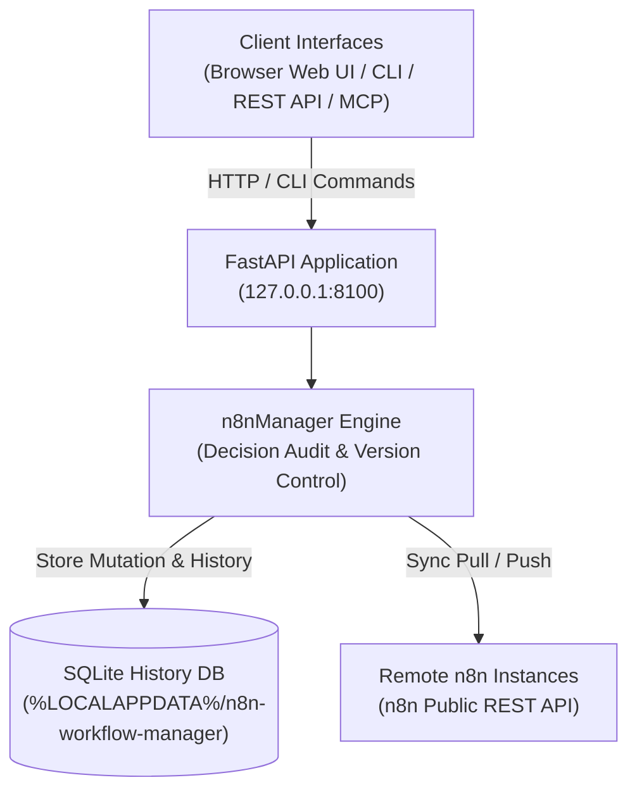

# Gestor de fluxos de trabalho do n8n

**[English](README.md) · [Deutsch](README_de.md) · [Español](README_es.md) · [日本語](README_ja.md) · [Русский](README_ru.md) · [Français](README_fr.md) · [简体中文](README_zh.md) · [हिन्दी](README_hi.md) · [العربية](README_ar.md) · [বাংলা](README_bn.md) · [Português](README_pt.md)**

> Revisão local de fluxos de trabalho, inspeção visual, edição com registo de decisões, histórico e sincronização de várias instâncias n8n.

> [!IMPORTANT]
> Projeto comunitário independente. Não é afiliado, recomendado nem patrocinado
> pela n8n GmbH. «n8n» é uma marca registada do respetivo titular e é aqui usada
> apenas para descrever o software com o qual esta ferramenta funciona em conjunto.

[](https://www.python.org/downloads/)
[](pyproject.toml)
[](LICENSE)
[](tests)
[](https://fastapi.tiangolo.com/)
[](https://github.com/astral-sh/ruff)
[](#what-it-does)
[](SECURITY.md)
[](SECURITY.md)
[](https://github.com/ellmos-ai)
[](https://github.com/open-bricks)
[](llms.txt)

> [!NOTE]
> **Contexto para agentes de IA e LLMs**: A especificação legível por máquina e as frases de pesquisa RAG estão indexadas em [`llms.txt`](llms.txt). Este projeto funciona em conjunto com [`n8n-manager-mcp`](https://github.com/ellmos-ai/n8n-manager-mcp) para operações autónomas de fluxos de trabalho de IA com registo de decisões. As alterações registam uma justificação não vazia, mas isso não constitui uma etapa de aprovação humana: algumas operações de criação, construção, importação, aplicação de modelos e obtenção (pull) fornecem justificações predefinidas, enquanto atualização, reversão (rollback), eliminação e envio (push) exigem uma justificação não vazia fornecida pelo chamador.

## Navegação

- [Arquitetura do sistema](#system-architecture)
- [Ciclo de vida do fluxo de trabalho](#workflow-lifecycle)
- [Governação e invariantes de execução](#governance-and-runtime-invariants)
- [Interface visual e capturas de ecrã](#visual-interface-and-screenshots)
- [Personas do público-alvo e SEO](#target-personas-and-seo)
- [Comparação de arquitetura e funcionalidades](#comparison-matrix)
- [O que faz](#what-it-does)
- [Instalação e arranque](#install-and-start)
- [Exemplos de CLI](#cli-examples)
- [API de criação](#builder-api)
- [Configuração e dados](#configuration-and-data)
- [Docker](#docker)
- [Configuração remota do n8n](#remote-n8n-setup)
- [Integração do Manager com MCP](#manager-plus-mcp-pairing)
- [Ecossistema de projetos relacionados](#sibling-ecosystem)
- [Verificação](#verification)
- [Licença](#license)

---

<a id="system-architecture"></a>
## Arquitetura do sistema



---

<a id="workflow-lifecycle"></a>
## Ciclo de vida do fluxo de trabalho

Esta sequência distingue a reversão local da sincronização remota. Uma reversão repõe uma versão SQLite retida e regista a decisão indicada. Altera apenas a base de dados local; é necessário fazer um envio (push) separado para enviar esse estado para o n8n remoto.

```mermaid
sequenceDiagram
    autonumber
    actor User as "Operator / AI Agent (MCP)"
    participant API as "FastAPI Application (127.0.0.1:8100)"
    participant SQLite as "Local SQLite History DB"
    participant n8n as "Configured Remote n8n API"

    Note over User,SQLite: "1. Local Rollback (No Remote Call)"
    User->>API: "POST /api/workflows/{workflow_id}/rollback/{version_number} (Decision)"
    API->>SQLite: "Read retained target version"
    SQLite-->>API: "Stored workflow JSON"
    API->>SQLite: "Update local workflow; record version and decision"
    SQLite-->>API: "Local transaction committed"
    API-->>User: "Rollback response (message, history URL)"
    Note over User,n8n: "Remote n8n remains unchanged after rollback"
    Note over User,n8n: "2. Separate Explicit Push (Optional)"
    User->>API: "POST /api/export/{workflow_id}/to-server?decision=...&server_id=..."
    API->>SQLite: "Read local workflow and remote binding"
    SQLite-->>API: "Workflow JSON and binding (if any)"
    API->>n8n: "Create or update via n8n REST API"
    n8n-->>API: "Remote result (success or error)"
    API->>SQLite: "Record sync result; update binding on success"
    API-->>User: "Push response"
```

---

<a id="governance-and-runtime-invariants"></a>
## Governação e invariantes de execução

| # | Capacidade / política | Comportamento do projeto | Limite |
|---|---|---|---|
| 1 | **Predefinição local** | O serviço escuta em 127.0.0.1 por predefinição. | As ligações configuradas ao n8n usam REST; a configuração remota usa SSH. Isto não garante ausência total de tráfego de saída. |
| 2 | **Registos de decisão** | As alterações aos fluxos de trabalho registam uma justificação não vazia. | As operações de criação, construção, importação, aplicação de modelos e obtenção (pull) podem aplicar justificações predefinidas; atualização, reversão, eliminação e envio (push) exigem um valor não vazio fornecido pelo chamador. A justificação regista a intenção, não a aprovação humana. |
| 3 | **Histórico SQLite** | As versões dos fluxos de trabalho e as linhas de decisão são guardadas em SQLite. | São registos comuns numa base de dados local; não são imutáveis nem à prova de adulteração. A eliminação de um fluxo de trabalho remove as respetivas versões. |
| 4 | **Reversão** | É possível repor no registo local do fluxo de trabalho uma versão retida. | A reversão não altera o n8n remoto. O envio é uma operação separada; o histórico não garante recuperação em caso de desastre. |
| 5 | **Sincronização com n8n** | A obtenção e o envio ao âmbito de um servidor usam a API REST do n8n. | É necessário configurar um servidor e ter acesso à rede; o envio é explícito. |
| 6 | **Recursos de inspeção visual** | A biblioteca de navegador vis-network está incluída localmente. | A inclusão evita um pedido a uma CDN para essa biblioteca; a sincronização remota continua a precisar de acesso à rede. |
| 7 | **Gestão de chaves de API** | As chaves n8n registadas ficam nos dados locais de cada utilizador e são ocultadas nas respostas da API e da interface. | As chaves são guardadas sem encriptação; proteja o diretório de dados do utilizador conforme indicado em SECURITY.md. |
| 8 | **Interfaces** | O projeto disponibiliza uma interface no navegador, uma API REST e uma CLI; o complemento MCP é mantido à parte. | O complemento usa a API deste projeto; não altera o comportamento local/remoto descrito acima. |
| 9 | **Modelo de privilégios** | A aplicação e a imagem Docker foram concebidas para funcionar sem privilégios elevados. | Esta descrição corresponde à configuração de execução documentada. |
| 10 | **Política de resposta de segurança** | SECURITY.md compromete-se a dar uma resposta inicial no prazo de 48 horas e a fazer a triagem no prazo de cinco dias úteis. | Trata-se de um compromisso de política, não de uma garantia do comportamento do sistema em execução nem de uma promessa de disponibilizar uma correção em 48 horas. |

---

<a id="visual-interface-and-screenshots"></a>
<a id="screenshots"></a>
## Interface visual e capturas de ecrã

A interface no navegador permite inspecionar fluxos de trabalho, visualizar graficamente as dependências entre nós e gerir o histórico sem sair do ambiente local:

| Painel e visão geral dos fluxos de trabalho | Visualizador gráfico e inspetor em tempo real |
|:---:|:---:|
|  |  |
| *Catálogo de fluxos de trabalho, associações a servidores, contagem de revisões e ações rápidas* | *Gráfico interativo vis.js, parâmetros dos nós, credenciais e ligações* |

---

<a id="target-personas-and-seo"></a>
## Personas do público-alvo e SEO

O n8n Workflow Manager destina-se a equipas técnicas, operadores e agentes de IA que precisam de inspecionar, documentar, editar e sincronizar fluxos de trabalho n8n com um histórico local de decisões e versões:

- **`[PERSONA-01]` Engenheiros de automatização de fluxos de trabalho e administradores de sistemas**: Operadores que gerem instâncias n8n em ambientes de preparação, teste e produção e precisam de rever fluxos de trabalho localmente, inspecioná-los visualmente e sincronizá-los por servidor.
- **`[PERSONA-02]` Arquitetos de frameworks de agentes de IA e integradores MCP**: Equipas que integram LLMs através de n8n-manager-mcp para criar ou alterar fluxos de trabalho. O gestor regista uma justificação para a decisão; algumas operações usam justificações predefinidas, e uma justificação não constitui aprovação humana.
- **`[PERSONA-03]` Responsáveis de segurança e conformidade**: Equipas que precisam de histórico local de versões de fluxos de trabalho e decisões em SQLite, ocultação de chaves de API nas respostas, recursos de frontend incluídos no pacote e execução sem privilégios elevados. O histórico SQLite não é imutável nem inviolável.
- **`[PERSONA-04]` Engenheiros de DevOps e de fiabilidade do site (SRE)**: Equipas que usam a API REST, sincronização ao âmbito do servidor e reversão local para versões retidas. Mantenha cópias de segurança independentes para recuperação em caso de desastre; o histórico dos fluxos de trabalho não é uma garantia de cópia de segurança.

#### Termos de pesquisa e palavras-chave de elevada intenção
- `local n8n workflow manager`, `visual n8n graph viewer`, `n8n multi-server sync`, `decision-tracked workflow automation`, `n8n-manager-mcp companion`, `local-first workflow rollback`, `vis.js n8n editor`, `fastapi n8n controller`, `offline n8n documentation export`

---

<a id="comparison-matrix"></a>
## Comparação de arquitetura e funcionalidades

Capacidades e limites do projeto. Esta tabela não apresenta alegações comparativas sobre outros produtos.

| # | Capacidade / política | Comportamento do projeto | Limite |
|---|---|---|---|
| 1 | **Predefinição local** | O serviço escuta em 127.0.0.1 por predefinição. | As ligações configuradas ao n8n usam REST; a configuração remota usa SSH. Isto não garante ausência total de tráfego de saída. |
| 2 | **Registos de decisão** | As alterações aos fluxos de trabalho registam uma justificação não vazia. | As operações de criação, construção, importação, aplicação de modelos e obtenção (pull) podem aplicar justificações predefinidas; atualização, reversão, eliminação e envio (push) exigem um valor não vazio fornecido pelo chamador. A justificação regista a intenção, não a aprovação humana. |
| 3 | **Histórico SQLite** | As versões dos fluxos de trabalho e as linhas de decisão são guardadas em SQLite. | São registos comuns numa base de dados local; não são imutáveis nem à prova de adulteração. A eliminação de um fluxo de trabalho remove as respetivas versões. |
| 4 | **Reversão** | É possível repor no registo local do fluxo de trabalho uma versão retida. | A reversão não altera o n8n remoto. O envio é uma operação separada; o histórico não garante recuperação em caso de desastre. |
| 5 | **Sincronização com n8n** | A obtenção e o envio ao âmbito de um servidor usam a API REST do n8n. | É necessário configurar um servidor e ter acesso à rede; o envio é explícito. |
| 6 | **Recursos de inspeção visual** | A biblioteca de navegador vis-network está incluída localmente. | A inclusão evita um pedido a uma CDN para essa biblioteca; a sincronização remota continua a precisar de acesso à rede. |
| 7 | **Gestão de chaves de API** | As chaves n8n registadas ficam nos dados locais de cada utilizador e são ocultadas nas respostas da API e da interface. | As chaves são guardadas sem encriptação; proteja o diretório de dados do utilizador conforme indicado em SECURITY.md. |
| 8 | **Interfaces** | O projeto disponibiliza uma interface no navegador, uma API REST e uma CLI; o complemento MCP é mantido à parte. | O complemento usa a API deste projeto; não altera o comportamento local/remoto descrito acima. |
| 9 | **Modelo de privilégios** | A aplicação e a imagem Docker foram concebidas para funcionar sem privilégios elevados. | Esta descrição corresponde à configuração de execução documentada. |
| 10 | **Política de resposta de segurança** | SECURITY.md compromete-se a dar uma resposta inicial no prazo de 48 horas e a fazer a triagem no prazo de cinco dias úteis. | Trata-se de um compromisso de política, não de uma garantia do comportamento do sistema em execução nem de uma promessa de disponibilizar uma correção em 48 horas. |

---

<a id="what-it-does"></a>
## O que faz

- Visualizador gráfico e editor funcional no navegador para JSON de fluxos de trabalho n8n.
- Histórico de versões suportado por SQLite e registo das justificações das decisões relativas a alterações; algumas operações de criação e importação usam justificações predefinidas.
- Reversão local através da API REST ou da CLI; é necessário um envio separado para atualizar o n8n remoto.
- Associações de obtenção/envio por fluxo de trabalho e por servidor, usando a API pública do n8n e paginação por cursor.
- Exportação para JSON e Markdown, importações validadas e modelos genéricos incluídos no pacote.
- API REST FastAPI, interface Swagger UI e CLI de terminal.

A aplicação dá prioridade à execução local: escuta em `127.0.0.1` por predefinição e guarda
a configuração e os dados de execução em diretórios de cada utilizador, em vez de os guardar
no pacote instalado ou no checkout do código-fonte.

Associar o gestor ao endereço de loopback não impede ligações de saída para um servidor n8n ou anfitrião SSH configurado.

### Início rápido por caso de utilização

| Objetivo / necessidade de fluxo de trabalho | Ferramenta / interface recomendada | Comando / fluxo de trabalho |
|---|---|---|
| **Inspecionar e visualizar fluxos de trabalho locais** | Painel Web e visualizador gráfico vis.js | `n8n-manager serve` &rarr; abrir `http://127.0.0.1:8100` |
| **Documentar fluxos de trabalho para passagem de contexto** | Motor de exportação Markdown / JSON | `n8n-manager export <id> --format md` |
| **Sincronização entre vários servidores (preparação para produção)** | Registo de servidores e motor de obtenção/envio | `n8n-manager push <id> --decision "Deploy reviewed changes"` |
| **Criação autónoma de fluxos de trabalho por IA** | API REST de criação e servidor MCP | `POST /api/workflows/build` através de `n8n-manager-mcp` |
| **Repor uma versão local retida** | Histórico e reversão de fluxos de trabalho locais | `n8n-manager rollback <id> <target-version> --decision "Revert defect"` (o n8n remoto permanece inalterado; se necessário, faça um envio separado) |
| **Configurar n8n remoto por SSH** | Comando de configuração automatizada por SSH | `n8n-manager setup --host <server> --user <deploy>` |

---

<a id="install-and-start"></a>
## Instalação e arranque

```bash
pip install git+https://github.com/ellmos-ai/n8n-workflow-manager.git
n8n-manager serve
```

Abra <http://127.0.0.1:8100>. A documentação interativa da API está em
<http://127.0.0.1:8100/docs>.

Para desenvolvimento:

```bash
git clone https://github.com/ellmos-ai/n8n-workflow-manager.git
cd n8n-workflow-manager
python -m pip install -e ".[dev]"
python -m pytest -q
```

---

<a id="cli-examples"></a>
## Exemplos de CLI

> [!WARNING]
> A operação push envia o fluxo de trabalho local para o servidor n8n configurado. A operação rollback altera
> apenas a base de dados local. A operação delete remove o fluxo de trabalho local, o respetivo histórico de versões
> e as associações locais a servidores; não envia um pedido de eliminação ao n8n. Para enviar ao n8n uma versão
> reposta localmente, execute um push à parte. Antes de enviar para produção, verifique o servidor predefinido com
> n8n-manager status. As chaves de API registadas com servers --add são guardadas sem encriptação no diretório de
> dados do utilizador; proteja-o como protegeria uma chave SSH. Consulte [SECURITY.md](SECURITY.md).

Algumas operações de criação, construção, importação, aplicação de modelos e obtenção (pull) registam uma decisão predefinida não vazia. Atualização, reversão, eliminação e envio (push) exigem uma decisão não vazia fornecida pelo chamador. Uma decisão regista a intenção declarada; não comprova aprovação humana.

```bash
n8n-manager import workflow.json --decision "Import reviewed customer workflow"
n8n-manager list
n8n-manager history 1
n8n-manager export 1 --format md

n8n-manager servers --add production https://n8n.example.com YOUR_API_KEY --default
n8n-manager push 1 --decision "Deploy reviewed version"
n8n-manager pull
n8n-manager rollback 1 2 --decision "Restore last known-good version"

n8n-manager status                       # effective paths, database and server state
n8n-manager config --show                # inspect the resolved configuration
n8n-manager config --set db_path ./my.db # change a single setting
```

A verificação TLS está ativada por predefinição. A opção `--no-verify-tls` existe para
ambientes locais controlados com certificados autoassinados; não a utilize em
redes não fidedignas.

---

<a id="builder-api"></a>
## API de criação

```bash
curl -X POST http://127.0.0.1:8100/api/workflows/build \
  -H "Content-Type: application/json" \
  -d '{
    "name": "Webhook forwarder",
    "decision": "Create a reviewed draft",
    "nodes": [
      {"type": "n8n-nodes-base.webhook", "name": "Trigger", "parameters": {"path": "hook"}},
      {"type": "n8n-nodes-base.httpRequest", "name": "Forward", "parameters": {"url": "https://api.example.com"}}
    ],
    "connections": [{"from_node": "Trigger", "to_node": "Forward"}]
  }'
```

Consulte [API_REFERENCE.md](docs/API_REFERENCE.md) para conhecer os contratos de alteração e de histórico.

---

<a id="configuration-and-data"></a>
## Configuração e dados

`n8n-manager status` apresenta os caminhos efetivos. Os valores relativos de `db_path` são
resolvidos a partir do diretório de dados do utilizador.

| Plataforma | Configuração | Dados de execução |
|---|---|---|
| Windows | `%APPDATA%\n8n-workflow-manager` | `%LOCALAPPDATA%\n8n-workflow-manager` |
| macOS | `~/Library/Application Support/n8n-workflow-manager` | mesmo diretório |
| Linux | `${XDG_CONFIG_HOME:-~/.config}/n8n-workflow-manager` | `${XDG_DATA_HOME:-~/.local/share}/n8n-workflow-manager` |

Substituições: `N8N_MANAGER_CONFIG`, `N8N_MANAGER_CONFIG_DIR` e `N8N_MANAGER_DATA_DIR`. Comece por [config.example.json](config.example.json).
O valor predefinido de `trusted_hosts` aceita apenas cabeçalhos Host de loopback; ao usar
um proxy inverso autenticado, indique explicitamente o nome de anfitrião público revisto.

---

<a id="docker"></a>
## Docker

```bash
docker compose up --build -d
```

A porta do Compose está associada a `127.0.0.1:8100` e o estado é montado em
`runtime/`. A imagem funciona com um utilizador sem privilégios.

---

<a id="remote-n8n-setup"></a>
## Configuração remota do n8n

O comando de configuração pressupõe que o Docker já foi instalado de acordo com a política
do sistema operativo do anfitrião remoto. Instala uma imagem oficial do n8n com versão fixada numa porta
acessível apenas por loopback; não executa um instalador remoto do tipo `curl | sh`.

```bash
n8n-manager setup --host your-server --user deploy --ssh-key ~/.ssh/id_ed25519
# Follow the printed ssh -L ... tunnel command, then open http://127.0.0.1:5678
```

O SSH usa o modo batch e `StrictHostKeyChecking=accept-new`. Para disponibilizar o serviço publicamente,
configure um proxy inverso TLS autenticado. Não exponha diretamente à Internet o n8nManager
nem a porta de escuta do n8n criada.

---

<a id="manager-plus-mcp-pairing"></a>
## Integração do Manager com MCP

`n8n-workflow-manager` e
[n8n-manager-mcp](https://github.com/ellmos-ai/n8n-manager-mcp) foram concebidos
para funcionar em conjunto: o servidor MCP é a camada de ações de IA, enquanto este projeto
é a camada humana de estado e histórico, com revisão visual, decisões por fluxo de trabalho,
versões e reversão. Antes de uma alteração, um cliente pode consultar
`/api/workflows/{id}/history`. Algumas operações fornecem uma justificação predefinida; atualização,
reversão, eliminação e envio (push) exigem uma decisão não vazia fornecida pelo chamador.
Os registos de decisão documentam a intenção e não certificam aprovação humana.

O registo de decisões oficial reside aqui e é independente do cliente, pelo que o mesmo
rasto de revisão pode abranger o servidor MCP, `curl`, a CLI ou a interface Web.

Se executar o n8n como parte de uma pilha autoalojada, em vez de o executar isoladamente,
[ellmos-stack](https://github.com/ellmos-ai/ellmos-stack) inicia o n8n, o Ollama e um índice
de documentos através do Docker Compose; este gestor liga-se depois a essa instância como
a qualquer outro servidor n8n.
O contexto conversacional também pode vir de um índice de histórico baseado em obtenção,
como [ctx](https://github.com/ctxrs/ctx) (Apache-2.0).

---

<a id="sibling-ecosystem"></a>
## Ecossistema de projetos relacionados

`n8n-workflow-manager` é uma componente essencial dos ecossistemas de código aberto
[ellmos-ai](https://github.com/ellmos-ai) e [open-bricks](https://github.com/open-bricks):

| Repositório | Finalidade | Integração |
|---|---|---|
| [`ellmos-ai/n8n-manager-mcp`](https://github.com/ellmos-ai/n8n-manager-mcp) | Servidor MCP para gestão de fluxos de trabalho n8n | Camada autónoma de ações de agentes de IA com auditoria de decisões |
| [`ellmos-ai/ellmos-stack`](https://github.com/ellmos-ai/ellmos-stack) | Pilha local tudo-em-um de IA e automatização | Executa n8n, Ollama e KnowledgeDigest através do Docker Compose |
| [`ellmos-ai/ellmos-homebase-mcp`](https://github.com/ellmos-ai/ellmos-homebase-mcp) | Base de conhecimento central e MCP de memória | Memória de agentes entre sessões e coordenação |
| [`ellmos-ai/ellmos-controlcenter-mcp`](https://github.com/ellmos-ai/ellmos-controlcenter-mcp) | Registo multiagente e orquestração de ferramentas | Agrupamento e encaminhamento dinâmicos de ferramentas |
| [`dev-bricks/automation-master`](https://github.com/dev-bricks/automation-master) | Supervisor central de tarefas e estado das automatizações | Orquestração do estado do sistema e monitorização |
| [`ellmos-ai/clirec`](https://github.com/ellmos-ai/clirec) | Gravador e motor de reprodução determinísticos de sessões CLI | Auditoria de terminais interativos e verificação de sessões |
| [`open-bricks/open-bricks`](https://github.com/open-bricks) | Organização agregadora de código aberto | Normas partilhadas, diretrizes de segurança e governação |

---

<a id="verification"></a>
## Verificação

O contrato de lançamento está documentado em [RELEASE_GATE.md](RELEASE_GATE.md). As
verificações locais principais são:

```bash
python -m pytest -q
python -m ruff check n8nManager tests
python -m bandit -q -r n8nManager -lll
python -m pip_audit
python -m build
```

---

<a id="license"></a>
## Licença

MIT; consulte [LICENSE](LICENSE). A utilização é por sua conta e risco; não é fornecida
qualquer garantia nem compromisso de manutenção.

Esta licença abrange o código escrito para este projeto. O repositório e as distribuições
compiladas também incluem a biblioteca de navegador **vis-network** (licenciada em regime
duplo, Apache-2.0 ou MIT; aqui utilizada ao abrigo da opção MIT), que mantém os seus próprios
titulares de direitos de autor. Avisos completos: [THIRD_PARTY_LICENSES.md](THIRD_PARTY_LICENSES.md).
