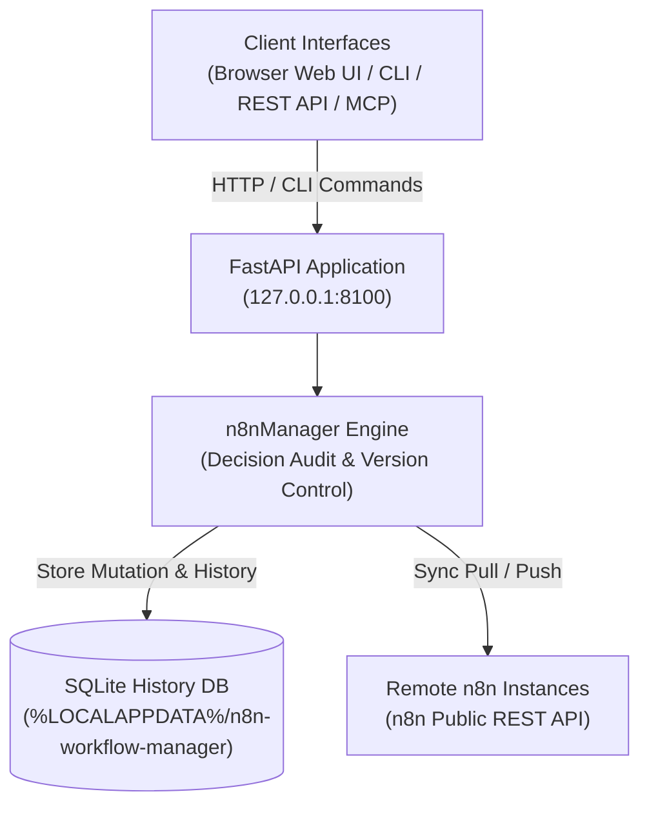

# n8n Workflow Manager

**[English](README.md) · [Deutsch](README_de.md) · [Español](README_es.md) · [日本語](README_ja.md) · [Русский](README_ru.md)**

> Локальная проверка рабочих процессов n8n, визуальный просмотр, редактирование с фиксацией решений, история изменений и синхронизация нескольких серверов.

> [!IMPORTANT]
> Независимый проект сообщества. Не связан с n8n GmbH, не одобрен и не спонсируется
> этой компанией. «n8n» — товарный знак соответствующего правообладателя и используется
> здесь только для обозначения программного обеспечения, с которым взаимодействует этот инструмент.

[](https://www.python.org/downloads/)
[](pyproject.toml)
[](LICENSE)
[](tests)
[](https://fastapi.tiangolo.com/)
[](https://github.com/astral-sh/ruff)
[](#what-it-does)
[](SECURITY.md)
[](SECURITY.md)
[](https://github.com/ellmos-ai)
[](https://github.com/open-bricks)
[](llms.txt)

> [!NOTE]
> **Контекст для ИИ-агентов и LLM**: машиночитаемая спецификация и поисковые фразы для RAG собраны в [`llms.txt`](llms.txt). Для автономных операций ИИ с рабочими процессами и фиксацией решений этот проект дополняет [`n8n-manager-mcp`](https://github.com/ellmos-ai/n8n-manager-mcp). При изменениях записывается непустое обоснование решения, но это не этап одобрения человеком: для некоторых операций создания, сборки, импорта, применения шаблона и загрузки данных используется значение по умолчанию, а обновление, откат, удаление и отправка требуют непустого значения от вызывающей стороны.

## Навигация

- [Архитектура системы](#system-architecture)
- [Жизненный цикл рабочего процесса](#workflow-lifecycle)
- [Правила управления и выполнения](#governance-and-runtime-invariants)
- [Визуальный интерфейс и снимки экрана](#visual-interface-and-screenshots)
- [Целевые аудитории и SEO](#target-personas-and-seo)
- [Возможности и границы проекта](#comparison-matrix)
- [Возможности](#what-it-does)
- [Установка и запуск](#install-and-start)
- [Примеры CLI](#cli-examples)
- [API конструктора](#builder-api)
- [Конфигурация и данные](#configuration-and-data)
- [Docker](#docker)
- [Настройка удалённого n8n](#remote-n8n-setup)
- [Совместная работа Manager и MCP](#manager-plus-mcp-pairing)
- [Связанные проекты экосистемы](#sibling-ecosystem)
- [Проверка](#verification)
- [Лицензия](#license)

---

<a id="system-architecture"></a>
## Архитектура системы




---

<a id="workflow-lifecycle"></a>
## Жизненный цикл рабочего процесса

Эта последовательность отделяет локальный откат от удалённой синхронизации. Откат восстанавливает сохранённую версию из SQLite и записывает переданное обоснование решения. Он изменяет только локальную базу данных; чтобы передать это состояние в удалённый n8n, требуется отдельная команда отправки.

```mermaid
sequenceDiagram
    autonumber
    actor User as "Operator / AI Agent (MCP)"
    participant API as "FastAPI Application (127.0.0.1:8100)"
    participant SQLite as "Local SQLite History DB"
    participant n8n as "Configured Remote n8n API"

    Note over User,SQLite: "1. Local Rollback (No Remote Call)"
    User->>API: "POST /api/workflows/{workflow_id}/rollback/{version_number} (Decision)"
    API->>SQLite: "Read retained target version"
    SQLite-->>API: "Stored workflow JSON"
    API->>SQLite: "Update local workflow; record version and decision"
    SQLite-->>API: "Local transaction committed"
    API-->>User: "Rollback response (message, history URL)"
    Note over User,n8n: "Remote n8n remains unchanged after rollback"
    Note over User,n8n: "2. Separate Explicit Push (Optional)"
    User->>API: "POST /api/export/{workflow_id}/to-server?decision=...&server_id=..."
    API->>SQLite: "Read local workflow and remote binding"
    SQLite-->>API: "Workflow JSON and binding (if any)"
    API->>n8n: "Create or update via n8n REST API"
    n8n-->>API: "Remote result (success or error)"
    API->>SQLite: "Record sync result; update binding on success"
    API-->>User: "Push response"
```


---

<a id="governance-and-runtime-invariants"></a>
## Правила управления и выполнения

| № | Возможность / правило | Поведение проекта | Граница |
|---|---|---|---|
| 1 | **Локальная работа по умолчанию** | Сервис по умолчанию привязывается к 127.0.0.1. | Для подключений к n8n используется REST, для удалённой настройки — SSH. Гарантии нулевого исходящего трафика нет. |
| 2 | **Записи об обосновании решений** | При изменениях рабочих процессов записывается непустое обоснование. | Для операций создания, сборки, импорта, применения шаблона и загрузки данных могут использоваться значения по умолчанию; для обновления, отката, удаления и отправки требуется непустое значение от вызывающей стороны. Обоснование фиксирует намерение, но не означает одобрение человеком. |
| 3 | **История в SQLite** | Версии рабочих процессов и записи решений хранятся в SQLite. | Это обычные записи локальной базы данных, они не являются неизменяемыми или защищёнными от подмены. При удалении рабочего процесса удаляются и его версии. |
| 4 | **Откат** | Сохранённую версию можно восстановить в локальной записи рабочего процесса. | Откат не меняет удалённый n8n. Отправка выполняется отдельно; история не гарантирует аварийное восстановление. |
| 5 | **Синхронизация n8n** | Получение данных и отправка на сервер выполняются через REST API n8n для выбранного сервера. | Требуются настроенный сервер и доступ к сети; отправка запускается явно. |
| 6 | **Ресурсы визуального просмотра** | Библиотека браузера vis-network включена в локальную поставку. | Благодаря этому для библиотеки не нужен запрос к CDN; для удалённой синхронизации сеть всё равно необходима. |
| 7 | **Работа с API-ключами** | Зарегистрированные ключи n8n хранятся в локальных пользовательских данных и маскируются в ответах API/UI. | Ключи хранятся без шифрования; защищайте каталог пользовательских данных согласно SECURITY.md. |
| 8 | **Интерфейсы** | Проект предоставляет браузерный UI, REST API и CLI; MCP-компаньон поддерживается отдельно. | Компаньон использует API этого проекта и не меняет описанное выше поведение локальных и удалённых операций. |
| 9 | **Модель привилегий** | Приложение и образ Docker рассчитаны на работу без повышенных привилегий. | Это характеристика документированной конфигурации выполнения. |
| 10 | **Политика реагирования на уязвимости** | В SECURITY.md заявлены первичный ответ в течение 48 часов и первичный разбор сообщений в течение пяти рабочих дней. | Это обязательство политики, а не гарантия во время выполнения и не обещание выпустить исправление за 48 часов. |

---

<a id="visual-interface-and-screenshots"></a>
<a id="screenshots"></a>
## Визуальный интерфейс и снимки экрана

Браузерный UI позволяет интерактивно просматривать рабочие процессы, граф зависимостей узлов и историю изменений, не покидая локальную среду:

| Панель управления и обзор рабочего процесса | Просмотр графа и инспектор в реальном времени |
|:---:|:---:|
|  |  |
| *Каталог рабочих процессов, привязки к серверам, число ревизий и быстрые действия* | *Интерактивный граф vis.js, параметры узлов, учётные данные и соединения* |

---

<a id="target-personas-and-seo"></a>
## Целевые аудитории и SEO

n8n Workflow Manager предназначен для технических команд, операторов и ИИ-агентов, которым нужно проверять, документировать, редактировать и синхронизировать рабочие процессы n8n с локальной историей решений и версий:

- **`[PERSONA-01]` Инженеры по автоматизации рабочих процессов и системные администраторы**: операторы, управляющие инстансами n8n в средах подготовки, тестирования и эксплуатации, которым нужны локальная проверка рабочих процессов, визуальный просмотр и синхронизация с выбранными серверами.
- **`[PERSONA-02]` Архитекторы фреймворков ИИ-агентов и интеграторы MCP**: команды, подключающие LLM через n8n-manager-mcp для создания или изменения рабочих процессов. Менеджер записывает обоснование решения; в некоторых операциях используются значения по умолчанию, а обоснование не является одобрением человеком.
- **`[PERSONA-03]` Специалисты по безопасности и соответствию требованиям**: команды, которым нужны локальная история версий рабочих процессов и решений в SQLite, маскирование API-ключей в ответах, включённые в поставку ресурсы интерфейса и выполнение без повышенных привилегий. История SQLite не является неизменяемой и не защищена от подмены.
- **`[PERSONA-04]` Инженеры DevOps и специалисты по надёжности сервисов (SRE)**: команды, использующие REST API, синхронизацию с выбранными серверами и локальный откат к сохранённым версиям. Для аварийного восстановления используйте отдельные резервные копии; история рабочих процессов не является гарантией резервного копирования.

#### Поисковые запросы с высокой заинтересованностью и ключевые слова
- `local n8n workflow manager`, `visual n8n graph viewer`, `n8n multi-server sync`, `decision-tracked workflow automation`, `n8n-manager-mcp companion`, `local-first workflow rollback`, `vis.js n8n editor`, `fastapi n8n controller`, `offline n8n documentation export`

---

<a id="comparison-matrix"></a>
## Возможности и границы проекта

В таблице описаны возможности и границы этого проекта. Сравнительных утверждений о других продуктах здесь нет.

| № | Возможность / правило | Поведение проекта | Граница |
|---|---|---|---|
| 1 | **Локальная работа по умолчанию** | Сервис по умолчанию привязывается к 127.0.0.1. | Для подключений к n8n используется REST, для удалённой настройки — SSH. Гарантии нулевого исходящего трафика нет. |
| 2 | **Записи об обосновании решений** | При изменениях рабочих процессов записывается непустое обоснование. | Для операций создания, сборки, импорта, применения шаблона и загрузки данных могут использоваться значения по умолчанию; для обновления, отката, удаления и отправки требуется непустое значение от вызывающей стороны. Обоснование фиксирует намерение, но не означает одобрение человеком. |
| 3 | **История в SQLite** | Версии рабочих процессов и записи решений хранятся в SQLite. | Это обычные записи локальной базы данных, они не являются неизменяемыми или защищёнными от подмены. При удалении рабочего процесса удаляются и его версии. |
| 4 | **Откат** | Сохранённую версию можно восстановить в локальной записи рабочего процесса. | Откат не меняет удалённый n8n. Отправка выполняется отдельно; история не гарантирует аварийное восстановление. |
| 5 | **Синхронизация n8n** | Получение данных и отправка на сервер выполняются через REST API n8n для выбранного сервера. | Требуются настроенный сервер и доступ к сети; отправка запускается явно. |
| 6 | **Ресурсы визуального просмотра** | Библиотека браузера vis-network включена в локальную поставку. | Благодаря этому для библиотеки не нужен запрос к CDN; для удалённой синхронизации сеть всё равно необходима. |
| 7 | **Работа с API-ключами** | Зарегистрированные ключи n8n хранятся в локальных пользовательских данных и маскируются в ответах API/UI. | Ключи хранятся без шифрования; защищайте каталог пользовательских данных согласно SECURITY.md. |
| 8 | **Интерфейсы** | Проект предоставляет браузерный UI, REST API и CLI; MCP-компаньон поддерживается отдельно. | Компаньон использует API этого проекта и не меняет описанное выше поведение локальных и удалённых операций. |
| 9 | **Модель привилегий** | Приложение и образ Docker рассчитаны на работу без повышенных привилегий. | Это характеристика документированной конфигурации выполнения. |
| 10 | **Политика реагирования на уязвимости** | В SECURITY.md заявлены первичный ответ в течение 48 часов и первичный разбор сообщений в течение пяти рабочих дней. | Это обязательство политики, а не гарантия во время выполнения и не обещание выпустить исправление за 48 часов. |

---

<a id="what-it-does"></a>
## Возможности

- Визуальный просмотр графа и рабочий браузерный редактор для JSON рабочих процессов n8n.
- История версий SQLite и записанные обоснования изменений рабочих процессов; для некоторых операций создания и импорта используются значения по умолчанию.
- Локальный откат через REST API или CLI; для обновления удалённого n8n нужна отдельная отправка.
- Привязки получения/отправки для каждого рабочего процесса и сервера через публичный API n8n с курсорной пагинацией.
- Экспорт в JSON и Markdown, проверенный импорт и набор универсальных шаблонов.
- REST API FastAPI, Swagger UI и терминальный CLI.

Приложение ориентировано на локальную работу: по умолчанию оно привязывается к
`127.0.0.1` и хранит конфигурацию и данные выполнения в пользовательских
каталогах, а не в установленном пакете или рабочей копии исходного кода.

Привязка менеджера к loopback не предотвращает исходящие подключения к настроенному серверу n8n или хосту SSH.

### Быстрый старт для типичных задач

| Цель / задача рабочего процесса | Рекомендуемый инструмент / интерфейс | Команда / процесс |
|---|---|---|
| **Проверить и визуализировать локальные рабочие процессы** | Веб-панель и просмотрщик графов vis.js | `n8n-manager serve` &rarr; открыть `http://127.0.0.1:8100` |
| **Подготовить документацию для передачи** | Экспорт в Markdown / JSON | `n8n-manager export <id> --format md` |
| **Синхронизировать несколько серверов (с тестовой среды в рабочую)** | Реестр серверов и механизм Pull/Push | `n8n-manager push <id> --decision "Deploy reviewed changes"` |
| **Автономно создавать рабочие процессы с помощью ИИ** | REST API конструктора и MCP-сервер | `POST /api/workflows/build` через `n8n-manager-mcp` |
| **Восстановить сохранённую локальную версию** | Локальная история и откат рабочего процесса | `n8n-manager rollback <id> <target-version> --decision "Revert defect"` (удалённый n8n не меняется; при необходимости выполните отдельную отправку) |
| **Настройка удалённого n8n через SSH** | Команда автоматической настройки через SSH | `n8n-manager setup --host <server> --user <deploy>` |

---

<a id="install-and-start"></a>
## Установка и запуск

```bash
pip install git+https://github.com/ellmos-ai/n8n-workflow-manager.git
n8n-manager serve
```


Откройте <http://127.0.0.1:8100>. Интерактивная документация API доступна по
адресу <http://127.0.0.1:8100/docs>.

Для разработки:

```bash
git clone https://github.com/ellmos-ai/n8n-workflow-manager.git
cd n8n-workflow-manager
python -m pip install -e ".[dev]"
python -m pytest -q
```


---

<a id="cli-examples"></a>
## Примеры CLI

> [!WARNING]
> Команда push отправляет локальный рабочий процесс на настроенный сервер n8n. rollback
> меняет только локальную базу данных. delete удаляет локальный рабочий процесс, его историю
> версий и локальные привязки к серверам; запрос на удаление в n8n не отправляется. Чтобы
> передать в n8n рабочий процесс после локального отката, отдельно выполните push. Перед
> отправкой в рабочую среду проверьте сервер по умолчанию командой n8n-manager status.
> API-ключи, добавленные через servers --add, хранятся без шифрования в пользовательском
> каталоге данных; защищайте его так же, как SSH-ключ. См. [SECURITY.md](SECURITY.md).

В некоторых операциях создания, сборки, импорта, применения шаблонов и загрузки данных записывается непустое обоснование решения по умолчанию. Для обновления, отката, удаления и отправки требуется непустое обоснование от вызывающей стороны. Запись решения фиксирует заявленное намерение, но не подтверждает одобрение человеком.

```bash
n8n-manager import workflow.json --decision "Import reviewed customer workflow"
n8n-manager list
n8n-manager history 1
n8n-manager export 1 --format md

n8n-manager servers --add production https://n8n.example.com YOUR_API_KEY --default
n8n-manager push 1 --decision "Deploy reviewed version"
n8n-manager pull
n8n-manager rollback 1 2 --decision "Restore last known-good version"

n8n-manager status                       # effective paths, database and server state
n8n-manager config --show                # inspect the resolved configuration
n8n-manager config --set db_path ./my.db # change a single setting
```


Проверка TLS включена по умолчанию. Параметр `--no-verify-tls` предусмотрен для
контролируемых локальных сред с самоподписанными сертификатами; не используйте его
в недоверенных сетях.

---

<a id="builder-api"></a>
## API конструктора

```bash
curl -X POST http://127.0.0.1:8100/api/workflows/build \
  -H "Content-Type: application/json" \
  -d '{
    "name": "Webhook forwarder",
    "decision": "Create a reviewed draft",
    "nodes": [
      {"type": "n8n-nodes-base.webhook", "name": "Trigger", "parameters": {"path": "hook"}},
      {"type": "n8n-nodes-base.httpRequest", "name": "Forward", "parameters": {"url": "https://api.example.com"}}
    ],
    "connections": [{"from_node": "Trigger", "to_node": "Forward"}]
  }'
```


Описание контрактов изменения и истории см. в [API_REFERENCE.md](docs/API_REFERENCE.md).

---

<a id="configuration-and-data"></a>
## Конфигурация и данные

Команда `n8n-manager status` выводит фактические пути. Относительные значения `db_path`
разрешаются относительно каталога пользовательских данных.

| Платформа | Конфигурация | Данные выполнения |
|---|---|---|
| Windows | `%APPDATA%\n8n-workflow-manager` | `%LOCALAPPDATA%\n8n-workflow-manager` |
| macOS | `~/Library/Application Support/n8n-workflow-manager` | тот же каталог |
| Linux | `${XDG_CONFIG_HOME:-~/.config}/n8n-workflow-manager` | `${XDG_DATA_HOME:-~/.local/share}/n8n-workflow-manager` |

Переопределения: `N8N_MANAGER_CONFIG`, `N8N_MANAGER_CONFIG_DIR` и
`N8N_MANAGER_DATA_DIR`. Начните с [config.example.json](config.example.json).
По умолчанию `trusted_hosts` принимает только заголовки Host от loopback; при
использовании проверенного обратного прокси с аутентификацией явно укажите
его публичное имя хоста.

---

<a id="docker"></a>
## Docker

```bash
docker compose up --build -d
```


Порт Compose привязан к `127.0.0.1:8100`, а состояние монтируется в `runtime/`.
Образ запускается от имени непривилегированного пользователя.

---

<a id="remote-n8n-setup"></a>
## Настройка удалённого n8n

Команда настройки предполагает, что Docker уже установлен в соответствии с
политикой операционной системы удалённого хоста. Она устанавливает закреплённый
официальный образ n8n и открывает порт только на loopback; удалённый установщик
`curl | sh` не запускается.

```bash
n8n-manager setup --host your-server --user deploy --ssh-key ~/.ssh/id_ed25519
# Follow the printed ssh -L ... tunnel command, then open http://127.0.0.1:5678
```


SSH работает в пакетном режиме с `StrictHostKeyChecking=accept-new`. Для публичного
сервиса используйте обратный прокси с аутентификацией и TLS. Не открывайте напрямую
доступ в интернет ни к n8nManager, ни к созданному прослушивателю n8n.

---

<a id="manager-plus-mcp-pairing"></a>
## Совместная работа Manager и MCP

`n8n-workflow-manager` и
[n8n-manager-mcp](https://github.com/ellmos-ai/n8n-manager-mcp) задуманы как
пара: MCP-сервер служит слоем действий ИИ, а этот проект — слоем состояния и
истории для человека, обеспечивающим визуальную проверку, фиксацию решений для
каждого рабочего процесса, версии и откат. Перед изменением клиент может прочитать
`/api/workflows/{id}/history`. Для некоторых операций используется обоснование по умолчанию; для обновления, отката, удаления и отправки вызывающая сторона должна передать непустое обоснование. Запись решения фиксирует намерение и не подтверждает одобрение человеком.

Авторитетный журнал решений хранится здесь и не зависит от клиента, поэтому одна
и та же история проверок может охватывать MCP-сервер, `curl`, CLI или веб-интерфейс.

Если n8n работает в составе самостоятельно размещённого стека, а не отдельно,
[ellmos-stack](https://github.com/ellmos-ai/ellmos-stack) запускает n8n вместе
с Ollama и индексом документов через Docker Compose; этот менеджер подключается
к такому экземпляру как к любому другому серверу n8n.
Контекст диалога можно также получать из индекса истории с выборочной загрузкой,
например [ctx](https://github.com/ctxrs/ctx) (Apache-2.0).

---

<a id="sibling-ecosystem"></a>
## Связанные проекты экосистемы

`n8n-workflow-manager` — неотъемлемая часть экосистем с открытым исходным кодом
[ellmos-ai](https://github.com/ellmos-ai) и [open-bricks](https://github.com/open-bricks):

| Репозиторий | Назначение | Интеграция |
|---|---|---|
| [`ellmos-ai/n8n-manager-mcp`](https://github.com/ellmos-ai/n8n-manager-mcp) | MCP-сервер для управления рабочими процессами n8n | Слой действий автономных ИИ-агентов с аудитом решений |
| [`ellmos-ai/ellmos-stack`](https://github.com/ellmos-ai/ellmos-stack) | Универсальный локальный стек ИИ и автоматизации | Запускает n8n, Ollama и KnowledgeDigest через Docker Compose |
| [`ellmos-ai/ellmos-homebase-mcp`](https://github.com/ellmos-ai/ellmos-homebase-mcp) | Централизованная база знаний и MCP-память | Межсессионная память и координация агентов |
| [`ellmos-ai/ellmos-controlcenter-mcp`](https://github.com/ellmos-ai/ellmos-controlcenter-mcp) | Реестр нескольких агентов и оркестрация инструментов | Динамическая комплектация и маршрутизация инструментов |
| [`dev-bricks/automation-master`](https://github.com/dev-bricks/automation-master) | Центральный мониторинг состояния автоматизации и диспетчер задач | Оркестрация системного контроля состояния и watchdog |
| [`ellmos-ai/clirec`](https://github.com/ellmos-ai/clirec) | Детерминированная запись и повтор CLI-сеансов | Аудит интерактивного терминала и проверка сеансов |
| [`open-bricks/open-bricks`](https://github.com/open-bricks) | Организация открытого исходного кода, объединяющая проекты | Общие стандарты, рекомендации по безопасности и управление |

---

<a id="verification"></a>
## Проверка

Условия выпуска описаны в [RELEASE_GATE.md](RELEASE_GATE.md). Основные локальные
проверки:

```bash
python -m pytest -q
python -m ruff check n8nManager tests
python -m bandit -q -r n8nManager -lll
python -m pip_audit
python -m build
```


---

<a id="license"></a>
## Лицензия

MIT; см. [LICENSE](LICENSE). Используйте на свой риск; гарантия и обязательства
по техническому обслуживанию не предоставляются.

Эта лицензия распространяется на код, написанный для данного проекта. В репозитории
и собранных дистрибутивах также поставляется браузерная библиотека **vis-network**
(двойное лицензирование: Apache-2.0 или MIT; здесь используется вариант MIT),
авторские права на которую принадлежат её собственным правообладателям. Полные
уведомления: [THIRD_PARTY_LICENSES.md](THIRD_PARTY_LICENSES.md).
