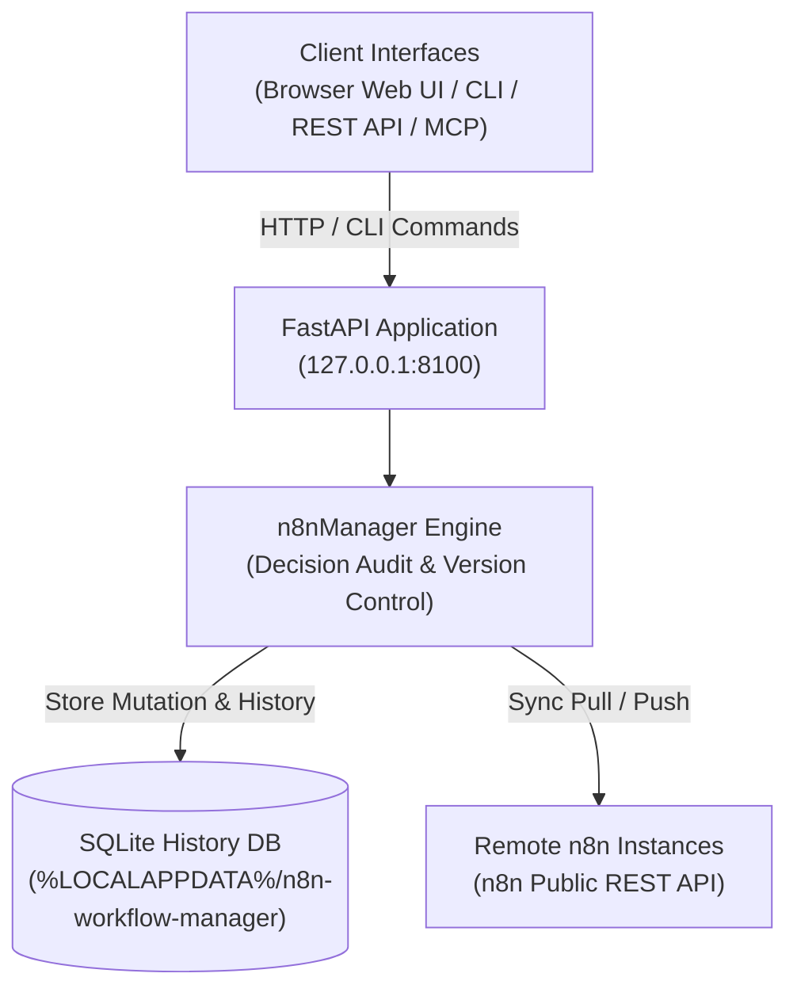

# n8n 工作流管理器

**[English](README.md) · [Deutsch](README_de.md) · [Español](README_es.md) · [日本語](README_ja.md) · [Русский](README_ru.md) · [Français](README_fr.md) · [简体中文](README_zh.md) · [हिन्दी](README_hi.md)**

> 面向 n8n 的本地优先工作流审查、可视化检查、带决策记录的编辑、历史记录及多服务器同步。

> [!IMPORTANT]
> 独立社区项目。与 n8n GmbH 无关联，未获其认可或赞助。
> “n8n”是其各自所有者的商标，此处仅用于描述本工具可互操作的软件。

[](https://www.python.org/downloads/)
[](pyproject.toml)
[](LICENSE)
[](tests)
[](https://fastapi.tiangolo.com/)
[](https://github.com/astral-sh/ruff)
[](#what-it-does)
[](SECURITY.md)
[](SECURITY.md)
[](https://github.com/ellmos-ai)
[](https://github.com/open-bricks)
[](llms.txt)

> [!NOTE]
> **AI 智能体与 LLM 上下文**：机器可读规范和 RAG 搜索短语已收录在 [`llms.txt`](llms.txt) 中。与 [`n8n-manager-mcp`](https://github.com/ellmos-ai/n8n-manager-mcp) 配合，可在记录决策的同时自主操作 AI 工作流。每次变更都会记录非空的决策理由，但这不构成人工审批：部分创建、构建、导入、模板和拉取路径会提供默认理由，而更新、回滚、删除和推送要求调用方提供非空值。

## 导航

- [系统架构](#system-architecture)
- [工作流生命周期](#workflow-lifecycle)
- [治理与运行时不变量](#governance-and-runtime-invariants)
- [可视化界面与截图](#visual-interface-and-screenshots)
- [目标用户画像与 SEO](#target-personas-and-seo)
- [架构与功能对照](#comparison-matrix)
- [功能说明](#what-it-does)
- [安装与启动](#install-and-start)
- [CLI 示例](#cli-examples)
- [构建器 API](#builder-api)
- [配置与数据](#configuration-and-data)
- [Docker](#docker)
- [远程 n8n 设置](#remote-n8n-setup)
- [Manager 与 MCP 配合使用](#manager-plus-mcp-pairing)
- [生态项目](#sibling-ecosystem)
- [验证](#verification)
- [许可证](#license)

---

<a id="system-architecture"></a>
## 系统架构



---

<a id="workflow-lifecycle"></a>
## 工作流生命周期

此流程将本地回滚与远程同步区分开来。回滚会恢复 SQLite 中保留的版本，并记录所提供的决策理由。它只更改本地数据库；要将该状态发送到远程 n8n，必须另行执行推送。

```mermaid
sequenceDiagram
    autonumber
    actor User as "Operator / AI Agent (MCP)"
    participant API as "FastAPI Application (127.0.0.1:8100)"
    participant SQLite as "Local SQLite History DB"
    participant n8n as "Configured Remote n8n API"

    Note over User,SQLite: "1. Local Rollback (No Remote Call)"
    User->>API: "POST /api/workflows/{workflow_id}/rollback/{version_number} (Decision)"
    API->>SQLite: "Read retained target version"
    SQLite-->>API: "Stored workflow JSON"
    API->>SQLite: "Update local workflow; record version and decision"
    SQLite-->>API: "Local transaction committed"
    API-->>User: "Rollback response (message, history URL)"
    Note over User,n8n: "Remote n8n remains unchanged after rollback"
    Note over User,n8n: "2. Separate Explicit Push (Optional)"
    User->>API: "POST /api/export/{workflow_id}/to-server?decision=...&server_id=..."
    API->>SQLite: "Read local workflow and remote binding"
    SQLite-->>API: "Workflow JSON and binding (if any)"
    API->>n8n: "Create or update via n8n REST API"
    n8n-->>API: "Remote result (success or error)"
    API->>SQLite: "Record sync result; update binding on success"
    API-->>User: "Push response"
```

---

<a id="governance-and-runtime-invariants"></a>
## 治理与运行时不变量

| # | 能力 / 策略 | 项目行为 | 边界说明 |
|---|---|---|---|
| 1 | **本地优先默认设置** | 服务默认绑定到 127.0.0.1。 | 已配置的 n8n 连接使用 REST；远程设置会使用 SSH。这并不保证完全没有出站流量。 |
| 2 | **决策记录** | 工作流变更会记录非空的理由。 | 创建、构建、导入、模板和拉取路径可应用默认值；更新、回滚、删除和推送要求调用方提供非空值。理由记录的是意图，并不代表人工审批。 |
| 3 | **SQLite 历史记录** | 工作流版本和决策记录存储在 SQLite 中。 | 这些是普通的本地数据库记录，不可视为不可变或防篡改数据。删除工作流会同时删除其版本记录。 |
| 4 | **回滚** | 可将保留的版本恢复到本地工作流记录。 | 回滚不会更改远程 n8n。推送是单独操作；历史记录不构成灾难恢复保证。 |
| 5 | **n8n 同步** | 按服务器范围执行的拉取和推送使用 n8n REST API。 | 需要配置服务器并具备网络访问能力；推送需显式触发。 |
| 6 | **可视化检查资源** | vis-network 浏览器库已在本地打包。 | 打包可避免为该库发起 CDN 请求；远程同步仍需要网络访问。 |
| 7 | **API 密钥处理** | 已注册的 n8n 密钥存储在每位用户的本地数据中，并在 API/UI 响应中脱敏。 | 密钥以未加密形式存储；请按 SECURITY.md 中的说明保护用户数据目录。 |
| 8 | **接口** | 项目提供浏览器 UI、REST API 和 CLI；MCP 配套组件单独维护。 | 配套组件使用本项目的 API；不会改变上述本地/远程行为。 |
| 9 | **权限模型** | 应用和 Docker 镜像旨在以非特权方式运行。 | 这描述的是文档所述的运行时配置。 |
| 10 | **安全响应政策** | SECURITY.md 承诺在 48 小时内首次响应，并在五个工作日内完成分诊。 | 这是政策承诺，不是运行时保证，也不承诺在 48 小时内发布补丁。 |

---

<a id="visual-interface-and-screenshots"></a>
<a id="screenshots"></a>
## 可视化界面与截图

浏览器 UI 可交互式检查工作流、绘制节点依赖关系图并管理历史记录，所有操作都在本地环境中进行：

| 仪表板与工作流概览 | 可视化图查看器与实时检查器 |
|:---:|:---:|
|  |  |
| *工作流目录、服务器绑定、修订计数与快捷操作* | *交互式 vis.js 图、节点参数、凭据与连接* |

---

<a id="target-personas-and-seo"></a>
## 目标用户画像与 SEO

n8n Workflow Manager 面向技术团队、运维人员和 AI 智能体，帮助他们检查、记录、编辑和同步 n8n 工作流，并保留本地决策记录与版本历史：

- **`[PERSONA-01]` 工作流自动化工程师与系统管理员**：负责管理预发布、测试和生产环境中的 n8n 实例，需要进行本地工作流审查、可视化检查和按服务器范围同步的运维人员。
- **`[PERSONA-02]` AI 智能体框架架构师与 MCP 集成者**：通过 n8n-manager-mcp 集成 LLM 并创建或修改工作流的团队。管理器会记录决策理由；部分路径使用默认值，而决策理由并不代表人工审批。
- **`[PERSONA-03]` 安全与合规负责人**：需要本地 SQLite 工作流版本和决策历史、响应中的 API 密钥脱敏、本地打包的前端资源，以及非特权运行方式的团队。SQLite 历史记录不可视为不可变或防篡改数据。
- **`[PERSONA-04]` DevOps 与站点可靠性工程师（SRE）**：使用 REST API、按服务器范围同步，以及从保留版本进行本地回滚的团队。请维护独立备份以用于灾难恢复；工作流历史记录不保证可用于备份恢复。

#### 高意图发现与搜索关键词
- `local n8n workflow manager`, `visual n8n graph viewer`, `n8n multi-server sync`, `decision-tracked workflow automation`, `n8n-manager-mcp companion`, `local-first workflow rollback`, `vis.js n8n editor`, `fastapi n8n controller`, `offline n8n documentation export`

---

<a id="comparison-matrix"></a>
## 架构与功能对照

本项目的能力与边界。此表不对其他产品作比较性主张。

| # | 能力 / 策略 | 项目行为 | 边界说明 |
|---|---|---|---|
| 1 | **本地优先默认设置** | 服务默认绑定到 127.0.0.1。 | 已配置的 n8n 连接使用 REST；远程设置会使用 SSH。这并不保证完全没有出站流量。 |
| 2 | **决策记录** | 工作流变更会记录非空的理由。 | 创建、构建、导入、模板和拉取路径可应用默认值；更新、回滚、删除和推送要求调用方提供非空值。理由记录的是意图，并不代表人工审批。 |
| 3 | **SQLite 历史记录** | 工作流版本和决策记录存储在 SQLite 中。 | 这些是普通的本地数据库记录，不可视为不可变或防篡改数据。删除工作流会同时删除其版本记录。 |
| 4 | **回滚** | 可将保留的版本恢复到本地工作流记录。 | 回滚不会更改远程 n8n。推送是单独操作；历史记录不构成灾难恢复保证。 |
| 5 | **n8n 同步** | 按服务器范围执行的拉取和推送使用 n8n REST API。 | 需要配置服务器并具备网络访问能力；推送需显式触发。 |
| 6 | **可视化检查资源** | vis-network 浏览器库已在本地打包。 | 打包可避免为该库发起 CDN 请求；远程同步仍需要网络访问。 |
| 7 | **API 密钥处理** | 已注册的 n8n 密钥存储在每位用户的本地数据中，并在 API/UI 响应中脱敏。 | 密钥以未加密形式存储；请按 SECURITY.md 中的说明保护用户数据目录。 |
| 8 | **接口** | 项目提供浏览器 UI、REST API 和 CLI；MCP 配套组件单独维护。 | 配套组件使用本项目的 API；不会改变上述本地/远程行为。 |
| 9 | **权限模型** | 应用和 Docker 镜像旨在以非特权方式运行。 | 这描述的是文档所述的运行时配置。 |
| 10 | **安全响应政策** | SECURITY.md 承诺在 48 小时内首次响应，并在五个工作日内完成分诊。 | 这是政策承诺，不是运行时保证，也不承诺在 48 小时内发布补丁。 |

---

<a id="what-it-does"></a>
## 功能说明

- 提供可视化图查看器和可直接使用的浏览器编辑器，用于编辑 n8n 工作流 JSON。
- 提供由 SQLite 支持的版本历史，以及针对工作流变更记录的决策理由；部分创建和导入路径使用默认值。
- 可通过 REST API 或 CLI 在本地回滚；更新远程 n8n 需要另行执行推送。
- 通过 n8n 公共 API 和游标分页，按工作流/服务器维护拉取与推送绑定。
- 支持 JSON 和 Markdown 导出、经过校验的导入，以及内置的通用模板。
- 提供 FastAPI REST API、Swagger UI 和终端 CLI。

应用采用本地优先模式：默认绑定到 `127.0.0.1`，并将配置和运行时
数据存储在每位用户各自的目录中，而不是已安装的软件包或源代码检出目录内。

管理器绑定到回环地址，并不会阻止它向已配置的 n8n 服务器或 SSH 主机建立出站连接。

### 按使用场景快速开始

| 目标 / 工作流需求 | 推荐工具 / 界面 | 命令 / 工作流 |
|---|---|---|
| **检查与可视化本地工作流** | Web 仪表板与 vis.js 图查看器 | `n8n-manager serve` &rarr; 打开 `http://127.0.0.1:8100` |
| **为交接记录工作流** | Markdown / JSON 导出引擎 | `n8n-manager export <id> --format md` |
| **多服务器同步（预发布环境到生产环境）** | 服务器注册表与拉取/推送引擎 | `n8n-manager push <id> --decision "Deploy reviewed changes"` |
| **自主编写 AI 工作流** | 构建器 REST API 与 MCP 服务器 | 调用 `POST /api/workflows/build`（通过 `n8n-manager-mcp`） |
| **恢复保留的本地版本** | 本地工作流历史与回滚 | `n8n-manager rollback <id> <target-version> --decision "Revert defect"`（远程 n8n 保持不变；如有需要，请另行推送） |
| **通过 SSH 设置远程 n8n** | 自动化 SSH 设置命令 | `n8n-manager setup --host <server> --user <deploy>` |

---

<a id="install-and-start"></a>
## 安装与启动

```bash
pip install git+https://github.com/ellmos-ai/n8n-workflow-manager.git
n8n-manager serve
```

打开 <http://127.0.0.1:8100>。交互式 API 文档位于
<http://127.0.0.1:8100/docs>。

开发环境：

```bash
git clone https://github.com/ellmos-ai/n8n-workflow-manager.git
cd n8n-workflow-manager
python -m pip install -e ".[dev]"
python -m pytest -q
```

---

<a id="cli-examples"></a>
## CLI 示例

> [!WARNING]
> push 会将本地工作流发送到已配置的 n8n 服务器。rollback 只更改
> 本地数据库。delete 会删除本地工作流、其版本历史以及本地服务器绑定；
> 不会向 n8n 发送删除请求。若要将本地回滚后的版本发送到 n8n，请另行执行
> push。推送到生产环境前，请用 n8n-manager status 检查默认服务器。通过
> servers --add 注册的服务器 API 密钥以未加密形式保存在每用户数据目录中；
> 请像保护 SSH 密钥一样保护该目录。参见 [SECURITY.md](SECURITY.md)。

部分创建、构建、导入、模板和拉取路径会记录默认的非空决策理由。更新、回滚、删除和推送要求调用方提供非空决策。决策记录的是所述意图，并不构成人工审批。

```bash
n8n-manager import workflow.json --decision "Import reviewed customer workflow"
n8n-manager list
n8n-manager history 1
n8n-manager export 1 --format md

n8n-manager servers --add production https://n8n.example.com YOUR_API_KEY --default
n8n-manager push 1 --decision "Deploy reviewed version"
n8n-manager pull
n8n-manager rollback 1 2 --decision "Restore last known-good version"

n8n-manager status                       # effective paths, database and server state
n8n-manager config --show                # inspect the resolved configuration
n8n-manager config --set db_path ./my.db # change a single setting
```

默认启用 TLS 验证。`--no-verify-tls` 可用于使用自签名证书的受控
本地环境；请勿在不受信任的网络中使用。

---

<a id="builder-api"></a>
## 构建器 API

```bash
curl -X POST http://127.0.0.1:8100/api/workflows/build \
  -H "Content-Type: application/json" \
  -d '{
    "name": "Webhook forwarder",
    "decision": "Create a reviewed draft",
    "nodes": [
      {"type": "n8n-nodes-base.webhook", "name": "Trigger", "parameters": {"path": "hook"}},
      {"type": "n8n-nodes-base.httpRequest", "name": "Forward", "parameters": {"url": "https://api.example.com"}}
    ],
    "connections": [{"from_node": "Trigger", "to_node": "Forward"}]
  }'
```

变更和历史记录的契约请参阅 [API_REFERENCE.md](docs/API_REFERENCE.md)。

---

<a id="configuration-and-data"></a>
## 配置与数据

`n8n-manager status` 会打印实际生效的路径。相对路径形式的 `db_path` 会在
用户数据目录下解析。

| 平台 | 配置 | 运行时数据 |
|---|---|---|
| Windows | `%APPDATA%\n8n-workflow-manager` | `%LOCALAPPDATA%\n8n-workflow-manager` |
| macOS | `~/Library/Application Support/n8n-workflow-manager` | 同一目录 |
| Linux | `${XDG_CONFIG_HOME:-~/.config}/n8n-workflow-manager` | `${XDG_DATA_HOME:-~/.local/share}/n8n-workflow-manager` |

覆盖项：`N8N_MANAGER_CONFIG`、`N8N_MANAGER_CONFIG_DIR` 和
`N8N_MANAGER_DATA_DIR`。请从 [config.example.json](config.example.json) 开始配置。默认的
`trusted_hosts` 只接受回环 Host 标头；使用经过身份验证的反向代理时，请明确列出已审核的公网主机名。

---

<a id="docker"></a>
## Docker

```bash
docker compose up --build -d
```

Compose 端口绑定到 `127.0.0.1:8100`，状态数据挂载在
`runtime/` 下。镜像以非特权用户身份运行。

---

<a id="remote-n8n-setup"></a>
## 远程 n8n 设置

设置命令要求 Docker 已按照远程主机的操作系统策略安装。该命令会在仅监听回环地址的端口上安装固定版本的官方 n8n 镜像；不会通过远程 `curl | sh` 安装程序进行安装。

```bash
n8n-manager setup --host your-server --user deploy --ssh-key ~/.ssh/id_ed25519
# Follow the printed ssh -L ... tunnel command, then open http://127.0.0.1:5678
```

SSH 使用批处理模式，并设置 `StrictHostKeyChecking=accept-new`。若要对外提供服务，请配置经过身份验证的 TLS 反向代理。不要将 n8nManager 或生成的 n8n 监听器直接暴露到互联网。

---

<a id="manager-plus-mcp-pairing"></a>
## Manager 与 MCP 配合使用

`n8n-workflow-manager` 与
[n8n-manager-mcp](https://github.com/ellmos-ai/n8n-manager-mcp) 配套设计：MCP 服务器是 AI 操作层，本项目则作为面向人的状态与历史记录层，提供可视化审查、逐工作流决策记录、版本和回滚功能。客户端可在变更前读取 `/api/workflows/{id}/history`。部分路径会提供默认理由；更新、回滚、删除和推送要求调用方提供非空决策理由。决策记录用于记载意图，不代表人工审批。

权威决策日志存储在本项目中，与客户端无关，因此同一条审查记录可涵盖 MCP 服务器、`curl`、CLI 或 Web UI。

如果你在自托管堆栈中运行 n8n，而非单独运行，
[ellmos-stack](https://github.com/ellmos-ai/ellmos-stack) 可通过 Docker Compose 同时启动 n8n、Ollama 和文档索引；本管理器随后会像连接其他 n8n 服务器一样连接该实例。
对话上下文还可以来自基于拉取的历史索引，例如 [ctx](https://github.com/ctxrs/ctx)（Apache-2.0）。

---

<a id="sibling-ecosystem"></a>
## 生态项目

`n8n-workflow-manager` 是 [ellmos-ai](https://github.com/ellmos-ai) 和 [open-bricks](https://github.com/open-bricks) 开源生态的重要组成部分：

| 代码库 | 用途 | 集成方式 |
|---|---|---|
| [`ellmos-ai/n8n-manager-mcp`](https://github.com/ellmos-ai/n8n-manager-mcp) | 用于管理 n8n 工作流的 MCP 服务器 | 带决策审计的自主 AI 智能体操作层 |
| [`ellmos-ai/ellmos-stack`](https://github.com/ellmos-ai/ellmos-stack) | 一体化本地 AI 与自动化堆栈 | 通过 Docker Compose 运行 n8n、Ollama 和 KnowledgeDigest |
| [`ellmos-ai/ellmos-homebase-mcp`](https://github.com/ellmos-ai/ellmos-homebase-mcp) | 中央知识库与记忆 MCP | 跨会话智能体记忆与协调 |
| [`ellmos-ai/ellmos-controlcenter-mcp`](https://github.com/ellmos-ai/ellmos-controlcenter-mcp) | 多智能体注册表与工具编排 | 动态工具打包与路由 |
| [`dev-bricks/automation-master`](https://github.com/dev-bricks/automation-master) | 自动化健康状态与任务中央监督器 | 系统级健康状态编排与看门狗 |
| [`ellmos-ai/clirec`](https://github.com/ellmos-ai/clirec) | 确定性的 CLI 会话记录与回放引擎 | 交互式终端审计与会话验证 |
| [`open-bricks/open-bricks`](https://github.com/open-bricks) | 开源组织总入口 | 共享标准、安全指南与治理 |

---

<a id="verification"></a>
## 验证

发布契约记录在 [RELEASE_GATE.md](RELEASE_GATE.md) 中。核心本地检查项为：

```bash
python -m pytest -q
python -m ruff check n8nManager tests
python -m bandit -q -r n8nManager -lll
python -m pip_audit
python -m build
```

---

<a id="license"></a>
## 许可证

MIT 许可证；参见 [LICENSE](LICENSE)。使用风险自负；不提供任何保证或维护承诺。

该许可证适用于本项目编写的代码。代码库和构建后的分发包还包含浏览器库 **vis-network**（双重许可：Apache-2.0 或 MIT；本项目按 MIT 许可选项使用），其版权仍归各自权利人所有。完整声明参见 [THIRD_PARTY_LICENSES.md](THIRD_PARTY_LICENSES.md)。
